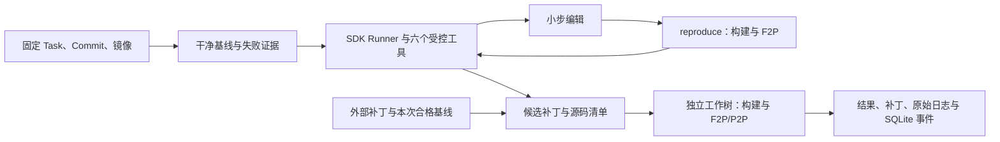

# ReproPatch

面向 C++ 工程的可复现代码修复与独立验收 Harness。
正式版本 **[v0.3.0](https://github.com/lilong555/ReproPatch/releases/tag/v0.3.0)** 已于 2026-10-24 发布，任务格式 **Task v2**。

ReproPatch 将固定 Git 基线、文件编辑权限、模型预算和 CMake/CTest 验收连接成一个修复流程。
模型通过六个受控工具读取和修改实现；Harness 在独立工作树与全新容器中重建候选，依据 F2P/P2P 测试决定是否接受。
`verify-patch` 使用同一验证器，核心安装即可完成零 API 密钥验收。



[规格](SPEC.md) · [架构](docs/ARCHITECTURE.md) · [测试报告](docs/TEST_REPORT.md) ·
[评测与复现](benchmarks/README.md) · [发布身份](RELEASE.json) ·
[CI](https://github.com/lilong555/ReproPatch/actions/workflows/ci.yml)

[GitHub Actions 实验](docs/ACTIONS_RESULTS.md)完成固定镜像下的资格检查、构建缓存 A/B 和 1/2/4 Job 对照。
**21 道明确缺陷中 21 道通过 O3 Docker 资格**，仓库历史模型尝试审查为无记录；
新模型请求与 Token 均为 **0**。当前开发源码通过 **584 项 CI**，覆盖 23 项真实 Docker 检查。
同一真实 C++ 目标的热 ccache 中位耗时为 **0.87 秒**，冷 Ninja 为 **13.27 秒**，重复变体各三个样本。
完整 Agent 的端到端效果待后续模型实验。[逐题资格与证据](benchmarks/actions-scale/cloud-results.json)
保留全部 Run、失败记录、固定镜像和下载 SHA-256；执行命令见 [Actions 说明](docs/ACTIONS_BENCHMARK.md)。

发布提交 `6e69e58` 通过 **514 项测试**：338 Core、154 SDK、22 真实 Docker。
发布页提供 wheel、sdist、原始实验和验证证据，共 11 个附件，公开下载的 SHA-256 均已核验。
[当前发布清单](RELEASE.json)记录正式版本身份，[rc3 原始清单](docs/releases/v0.3.0rc3.json)保存历史制品与验证记录。

## 固定预算下的实际结果

2026-10-24 的 v2 对照使用同一 CPA 端点、`gpt-6-luna`、实际观测的 `medium` 推理强度，
每题每框架首跑一次，最多 12 个模型请求与 24 次工具调用。六次正式运行共 **61/72 次请求**，
另有一次独立参数校准；两项用量均完整结算。

| 任务 | ReproPatch Full | mini-SWE-agent 2.4.6 | Codex CLI 0.163.0 |
| --- | --- | --- | --- |
| fmt-4055 | 候选编译失败 | 空候选 | 请求预算结束，空候选 |
| simdjson-1899 | **93/93，通过** | 92/93 | 92/93，请求预算结束 |
| 外部 Oracle 通过 | **1/2** | **0/2** | **0/2** |
| 模型请求 | 23 | 14 | 24 |

两题已有 v1 尝试，v2 记录冻结新配置后的复核。每次候选、失败、用量和原生退出状态均保留于
[逐运行结果](benchmarks/generalization-final-results.json)；
[报告](benchmarks/generalization-final-results.md)列明计时与评分范围，
[v1 封存记录](benchmarks/generalization-v1-results.md)单列历史 110 次请求。

Full 在 simdjson 第 3 步产生首个编辑，通过 F2P 自检识别剩余的浮点负零路径并继续修改，
最终通过内部独立验收和外部 93 项原生测试。六次运行中 Full 共调用 3 次 `reproduce`、1 次 `verify`。
两题各一次的结果用于观察修复过程；单项机制的收益和跨仓库表现仍需配对实验。

历史 Catch2 两个开发题的三次重复消融中，只读接口追踪与可编辑范围反馈的组合取得 **6/6**，
消融组与 mini 各 **3/6**。历史 json-4537 的[双入口审计](benchmarks/json4537-header-audit.md)
保留了分发单头文件漏改的失败记录。全部历史实验见[评测索引](benchmarks/README.md)。

后续 Luna 对照入口默认使用 `max`，也支持显式 `--reasoning-effort medium`。
三框架的参数检查范围与供应商校准状态见 [Luna 配置](benchmarks/luna-max-config.json)。
`max` 已通过三个客户端的离线请求检查，真实供应商响应校准与新一批实验待执行。
v2 的执行源码、协议和请求记录对应冻结的 `medium` 配置。

## 修复循环

| 机制 | 作用 |
| --- | --- |
| 只读接口与编辑权限反馈 | 沿声明、宏展开和调用关系定位可编辑实现，保护测试接口 |
| 剩余预算反馈 | 每次工具返回展示剩余请求、工具与时间额度，帮助安排编辑和自检 |
| 紧凑诊断视图 | 模型获得有界构建与测试摘要，完整原始输出另行保存 |
| `reproduce` | 在新容器内配置、编译并运行 F2P 目标测试，供编辑后自检 |
| `verify` | 在新容器内配置、编译并运行 F2P/P2P，供仍有修复预算时检查回归 |
| 独立验收 | 从固定 commit 应用补丁，核对源码与补丁往返，再完整重建和测试 |

最终验收由 Harness 独立执行。两类自检都包含配置和编译，实际耗时随任务记录。
同时可编辑 `include/` 与 `single_include/` 的任务会提示同步对应实现；分发完整性由相应 Oracle 检查。

工具集合为 `list_directory`、`read_file`、`search_code`、`edit_file`、`run_command`、`run_shell`。
`run_shell` 使用一次性只读源码容器，每次 `/build` 为空；持久化源码修改经 `edit_file` 完成。
模型循环由公开 Agents SDK Runner 管理，工具整批准入、串行执行。

## 零 API 密钥的补丁验收

需要 Linux amd64、Python 3.12+、Git 和可用的 Docker daemon。
WSL2 可使用启用 Ubuntu 集成的 Docker Desktop Linux 引擎。先准备编译镜像，再生成固定 commit/image 的 Task。

```bash
git clone --branch v0.3.0 https://github.com/lilong555/ReproPatch.git
cd ReproPatch
python3.12 -m venv .venv
source .venv/bin/activate
python -m pip install -e .

docker build -t repropatch-cpp:0.1 -f docker/Dockerfile docker
python scripts/init_example.py \
  --write-task examples/tasks/negative-maximum.v2.yaml --image repropatch-cpp:0.1
repropatch validate-task examples/tasks/negative-maximum.v2.yaml
repropatch doctor --image repropatch-cpp:0.1 --json
repropatch verify-patch examples/tasks/negative-maximum.v2.yaml \
  --patch examples/patches/negative-maximum.correct.patch --producer local --json
repropatch verify-patch examples/tasks/negative-maximum.v2.yaml \
  --patch examples/patches/negative-maximum.wrong.patch --producer local --json
```

正确补丁得到 `ACCEPTED`，错误补丁得到 `REJECTED`。JSON 提供 Run ID 和证据目录。
这个自有 C++ fixture 演示验收流程；真实开源缺陷的成绩见上方评测。
初始化脚本保留已有仓库和源码，生成 Task 时记录实际完整 commit、本地 image ID 和规范任务哈希。

## Task 与执行契约

Task 固定仓库完整 commit OID、镜像 ID/digest、可读与可编辑文件、受保护输入、F2P/P2P 名称及预算。
CMake 文件和测试受保护；修改范围为显式列举的 C/C++ 实现文件。
[完整 Task 契约](specs/2026-10-19.2/docs/TASK_FORMAT.md)描述字段与静态检查。
跨机器复现使用同一镜像与 prepared commit，本地 image ID 用于核对实际环境。

`SourceManifest` 记录每个文件的原始字节哈希、大小和 Git mode。
候选在全新工作树中真实应用保存的补丁，源码清单和再次导出的补丁逐字节核对。
CTest 以 JSON inventory 固定测试身份，逐项保存 JUnit，并结合退出码与原始失败签名判定。
完整源码及补丁契约见 [P1-03A](docs/P1-03A.md)，测试判定见 [P1-06](docs/P1-06.md)。

容器使用非 root、断网、只读源码与根文件系统、无 capabilities，以及固定 CPU/内存/PID 和构建 tmpfs 限额。
创建后核查实际配置；超时、取消或输出达限时删除整个容器并再次 inspect。
每命令双流原始输出上限 4 MiB，每 Run 审计预算 256 MiB；生命周期见 [P1-03B](docs/P1-03B.md)。

## 证据、暂停与恢复

每个 Run 保存 `task.resolved.json`、`report.json`、候选、源码清单、原始 stdout/stderr、JUnit 和 `events.sqlite3`。
SQLite 是状态、事件、预算和 Checkpoint 的权威；JSON/Markdown 报告与 JSONL 从已提交记录导出。

```bash
repropatch inspect RUN_ID --root .repropatch/runs --json
repropatch report RUN_ID --root .repropatch/runs --format json
repropatch replay RUN_ID --root .repropatch/runs --mode trace
repropatch export-trace RUN_ID --root .repropatch/runs --output exports/trace.jsonl
```

查询和轨迹导出只读取已有证据。`--pause-after-step N` 在完整 SDK 输入边界保存 Checkpoint；
`resume RUN_ID` 核对配置、剩余预算、源码、容器身份和已关闭的执行片段后继续。
未知模型结果、未闭合工具片段和源码分歧都有明确失败原因，已执行副作用保持原状。
恢复与只读轨迹契约见 [P2-01](docs/P2-01.md)、[P2-02](docs/P2-02.md)、
[P2-03](docs/P2-03.md)、[P2-04](docs/P2-04.md)。

Benchmark 导出候选时依次检查 EvidenceRef、`patch.diff`、`diagnostics/unverified.patch`，选择首个非空内容；
损坏的证据引用明确报错。候选来源、原生结局与外部 Oracle 结果分别保存。
原始大文件通过带逐文件 SHA-256 清单的发布附件交付，Git 保存[证据索引](docs/evidence/README.md)与摘要。

## 开发验证

```bash
python -m pip install -e '.[dev]'
ruff check src tests scripts
ruff format --check src tests scripts
python -m pytest -m 'not docker and not sdk' -q

python3.12 -m venv .venv-agent
.venv-agent/bin/python -m pip install -c requirements/agent.txt -e '.[agent,dev]' cmake==4.4.4
.venv-agent/bin/python -m pytest -m sdk -q
umask 0022
.venv-agent/bin/python scripts/check_docker_gate.py
```

可选 `agent` 固定 `openai-agents==0.24.0` 和 `openai==3.35.1`，完整约束见
[requirements/agent.txt](requirements/agent.txt)。核心安装仅需 PyYAML。
真实自动修复使用 `--engine agents-sdk --model MODEL --allow-paid-model`，凭据经 `--key-env` 指定的环境变量读取。
`--use-env-proxy` 显式使用宿主代理；模型客户端配置见 [生产运行契约](docs/P1-05.md)。

许可：Apache-2.0。
