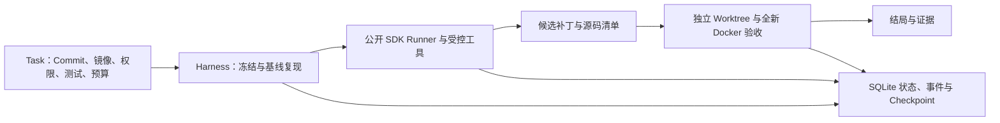

# ReproPatch

## 用途

ReproPatch 是面向真实 C++ 仓库的可恢复、可观测代码修复 Agent 系统。它将固定 Git 基线、源码权限、执行预算、模型工具调用和 CMake/CTest 独立验收连接为一个有证据可查的运行流程。

项目的工程主线覆盖 Agent 的任务配置、执行、验收、恢复与观测：公开 OpenAI Agents SDK 管理模型与工具循环，ReproPatch 管理任务冻结、工具准入、Docker 资源、运行状态、Checkpoint 恢复和候选验收。适用于操作者选定的本地 C++ 仓库，以及外部 Agent 产出补丁后的独立验收。真实开源缺陷实验为设计选择和优化提供验证，协议与原始记录见[评测索引](benchmarks/README.md)。

## 可运行入口

需要 Python 3.12+、Git、Linux amd64 Docker 引擎和可用的 Docker daemon。WSL2 可使用启用发行版集成的 Docker Desktop Linux 引擎，项目与运行目录放在 Linux 文件系统中。

### 零 API 密钥演示

在项目根目录执行：

```bash
python3.12 -m venv .venv
source .venv/bin/activate
python -m pip install -e '.[agent,semantic]'

docker build -t repropatch-cpp:0.1 -f docker/Dockerfile docker
repropatch doctor --image repropatch-cpp:0.1 --json
repropatch demo --output .repropatch/demo --image repropatch-cpp:0.1 --scenario all --json
```

演示通过公开 SDK 的 `ScriptedModel` 驱动真实 Harness 和 Docker，展示成功修复、错误候选拒绝、暂停后恢复。输出目录保存运行身份和验收证据；重复演示使用新的 `--output` 目录。完整步骤与证据检查见[演示指南](docs/DEMO.md)。

实现：[demo.py](src/repropatch/demo.py)、[cli.py](src/repropatch/cli.py)。验证：[CLI 合同测试](tests/test_engineering_cli.py)、[真实 Docker 测试](tests/test_docker_integration.py)。

### 独立补丁验收

`verify-patch` 使用同一验证器，可用于本地补丁和外部 Agent 的候选，核心安装 `pip install -e .` 即可使用。

```bash
python scripts/init_example.py --write-task .repropatch/tasks/negative-maximum.yaml --image repropatch-cpp:0.1
repropatch validate-task .repropatch/tasks/negative-maximum.yaml
repropatch verify-patch .repropatch/tasks/negative-maximum.yaml --patch examples/patches/negative-maximum.correct.patch --producer local --json
```

初始化脚本记录示例仓库的实际完整 commit 和本地镜像 ID。验收先复现原始失败，再从固定 commit 应用候选、重建并运行 Task 声明的 F2P/P2P 测试。正确候选预期得到 `ACCEPTED`。

实现：[Task](src/repropatch/task.py)、[验证器](src/repropatch/verification.py)。验证：[共用验证器测试](tests/test_verification.py)。

### 真实模型修复

准备经过审核的 Task，并设置模型服务凭据与 `MODEL` 环境变量：

```bash
repropatch run task.yaml --engine agents-sdk --model "$MODEL" --allow-paid-model --semantic-state --json
```

默认通过 `OPENAI_API_KEY` 读取凭据，`--api-base`、`--key-env` 和 `--use-env-proxy` 配置模型连接。工具模式、自检缓存、暂停和候选导出的用法见[工程指南](docs/ENGINEERING.md)。

实现：[模型配置](src/repropatch/models.py)、[SDK 运行适配](src/repropatch/agent_runtime.py)。验证：[SDK 契约测试](tests/test_sdk_contract.py)、[模型 CLI 测试](tests/test_models_cli.py)。

## 核心架构和特色



| 能力 | 工程作用 | 实现与测试 |
| --- | --- | --- |
| 独立验收 | 从固定基线真实应用补丁，核对源码清单、测试身份和声明的 F2P/P2P 结果 | [verification.py](src/repropatch/verification.py) · [测试](tests/test_verification.py) |
| 可恢复运行 | 在完整 SDK 输入边界提交 Checkpoint，续跑沿用原预算、期限和运行身份 | [recovery.py](src/repropatch/recovery.py) · [测试](tests/test_resume.py) |
| 受控工具与执行资源 | 默认六工具；`shell-only` 使用持久修复容器。授权编辑、源码审计和独立冷验收贯穿两种模式 | [tools.py](src/repropatch/tools.py)、[repair_sandbox.py](src/repropatch/repair_sandbox.py) · [测试](tests/test_shell_runtime.py) |
| 可选 C++ 结构证据状态 | `--semantic-state` 为默认工具模式增加 `query_code`，保存语法关系、修改、可见检查与证据索引 | [semantic_state.py](src/repropatch/semantic_state.py) · [测试](tests/test_semantic_state.py) |
| 可观测证据链 | SQLite 提供已提交事实，报告、诊断和轨迹关联模型步骤、工具、命令与原始输出 | [events.py](src/repropatch/events.py)、[reports.py](src/repropatch/reports.py)、[trace.py](src/repropatch/trace.py) · [测试](tests/test_events_reports.py)、[轨迹测试](tests/test_trace.py) |

`inspect` 查看事实，`diagnose` 分析阶段、证据与恢复条件，`replay` 查看只读轨迹，`report` 重建派生报告，`resume` 执行恢复。状态与接受结局分别记录，模型输出、自检结果和独立验收均保留各自证据。

## 文档索引

| 文档 | 内容 |
| --- | --- |
| [项目总览](docs/PROJECT_REPORT.md) | 简明项目介绍与面试讲解：架构、恢复与验收决策、优化路径和演示证据 |
| [演示指南](docs/DEMO.md) | 零密钥三场景、产物与运行检查 |
| [架构](docs/ARCHITECTURE.md) | 模块关系、SDK 分工、验收与状态模型 |
| [工程指南](docs/ENGINEERING.md) | 配置、权限、沙箱、恢复、观测与优化验证 |
| [工程验收](docs/ACCEPTANCE.md) | 交付标准、验证矩阵与可重复执行入口 |
| [测试报告](docs/TEST_REPORT.md) | 测试结果、场景结局与原始证据 |
| [工程路线](docs/ROADMAP.md) | 交付能力、优化闭环与后续优先级 |
| [C++ 结构证据状态](docs/SEMANTIC_STATE.md) | 可选结构查询和持久修复状态 |
| [Task 契约](specs/2026-10-19.2/docs/TASK_FORMAT.md) | Task v2 字段与静态检查 |
| [安全模型](SECURITY.md) | 宿主、仓库、容器与证据的信任关系 |
| [评测索引](benchmarks/README.md) | 真实仓库实验、协议、原始结果与复现入口 |

## 简明验证入口

```bash
python -m pip install -c requirements/agent.txt -e '.[agent,semantic,dev]' cmake==4.4.4
ruff check src tests scripts
ruff format --check src tests scripts
python -m pytest -m 'not docker and not sdk' -q
python -m pytest -m 'sdk and not docker' -q
python scripts/check_docker_gate.py --image repropatch-cpp:0.1
python scripts/check_engineering_gate.py --image repropatch-cpp:0.1 --output .repropatch/engineering-evidence
```

本地快捷入口使用当前安装环境，支持 editable 安装。测试环境在宿主运行受信任 C++ fixture，使用 `cmake==4.4.4` 与 C++ 工具链；日常修复与演示的 CMake/CTest 由 Docker 镜像提供。

交付包验收先构建并安装 wheel，再通过 `--require-installed-wheel` 核验安装来源：

```bash
python -m build
python -m pip install --force-reinstall --no-deps dist/*.whl
python scripts/check_engineering_gate.py --image repropatch-cpp:0.1 --output .repropatch/engineering-wheel-evidence --require-installed-wheel
```

工程门禁执行真实 Docker 三场景，并核对 `inspect`、`diagnose`、`replay` 与 `export-trace` 对原 Run 的只读性。CI 按上述顺序构建、安装和验收 wheel，入口与上传证据见[工作流](.github/workflows/ci.yml)。完整测试结果与场景结局见[测试报告](docs/TEST_REPORT.md)，详细验证矩阵见[工程指南](docs/ENGINEERING.md#验证入口)。

许可：Apache-2.0。
