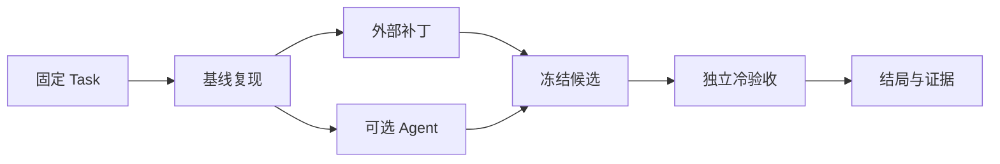

# ReproPatch｜可恢复的 C++ 修复与验证系统

ReproPatch 0.4.0 的技术主线是 **C++ Repair & Verification Harness**：给定已准备的仓库、固定 commit、构建镜像和 F2P/P2P 测试，系统复现基线失败、冻结候选补丁，在独立工作树与全新容器中冷验收，并保存可查询、可恢复的运行证据。补丁可由人工、外部工具或可选内置 Agent 产生。

宿主使用 Python 3.12+、Git 和本地 Linux amd64 Docker 引擎。WSL2 使用 Docker Desktop Linux 引擎与发行版集成，项目和 Run 目录放在 Linux 文件系统中。

## 零密钥脚本模型 Demo

安装 [v0.4.0 Release](https://github.com/lilong555/ReproPatch/releases/tag/v0.4.0) 的 wheel；源码 checkout 提供 Dockerfile 和独立补丁示例：

```bash
git clone --branch v0.4.0 --depth 1 https://github.com/lilong555/ReproPatch.git
cd ReproPatch
python3.12 -m venv .venv
source .venv/bin/activate
python -m pip install -c requirements/agent.txt 'repropatch[agent] @ https://github.com/lilong555/ReproPatch/releases/download/v0.4.0/repropatch-0.4.0-py3-none-any.whl'
docker build -t repropatch-cpp:0.1 -f docker/Dockerfile docker
repropatch doctor --image repropatch-cpp:0.1 --json
repropatch demo --output .repropatch/demo-interview-01 --image repropatch-cpp:0.1 --scenario all --json
```

Demo 使用公开 Agents SDK 的 `ScriptedModel` 驱动真实 C++ 编译、Docker 和 Harness，付费模型请求为零。三场景依次展示 `ACCEPTED`、`REJECTED / F2P_FAILED`、同一 Run 暂停后恢复为 `ACCEPTED`。摘要位于 `.repropatch/demo-interview-01/summary.md`；重复演示使用新的输出目录。操作与四分钟讲解见[演示指南](docs/DEMO.md)。

## Core-only 独立补丁验收

核心 wheel 的依赖为 PyYAML。以下独立环境使用同一发布包，通过 `verify-patch` 验收外部补丁：

```bash
python3.12 -m venv .venv-core
.venv-core/bin/python -m pip install https://github.com/lilong555/ReproPatch/releases/download/v0.4.0/repropatch-0.4.0-py3-none-any.whl
.venv-core/bin/python scripts/init_example.py --write-task .repropatch/tasks/negative-maximum.yaml --image repropatch-cpp:0.1
.venv-core/bin/python -I -m repropatch validate-task .repropatch/tasks/negative-maximum.yaml
.venv-core/bin/python -I -m repropatch verify-patch .repropatch/tasks/negative-maximum.yaml --patch examples/patches/negative-maximum.correct.patch --producer local --json
.venv-core/bin/python -I -m repropatch verify-patch .repropatch/tasks/negative-maximum.yaml --patch examples/patches/negative-maximum.wrong.patch --producer local --json
```

初始化脚本固定示例仓库的完整 commit 和本地镜像 ID。正确补丁预期 `ACCEPTED`、退出码 0；错误补丁预期 `REJECTED / F2P_FAILED`、退出码 1。两次运行分别完成基线复现、补丁往返核验、冷构建与资源清理。F2P 表示原先失败的测试修复后通过，P2P 表示原先通过的测试继续通过。



## 三个源码设计入口

| 设计 | 源码入口 | 核心合同 |
| --- | --- | --- |
| 候选冻结与独立验收 | [verify_candidate](src/repropatch/verification.py)、[apply_candidate](src/repropatch/workspace.py) | 从固定 commit 实际应用补丁，核对完整源码 bytes/mode、测试身份及冷验收结果 |
| Checkpoint 与事务 | [save_checkpoint](src/repropatch/recovery.py)、[EventLog](src/repropatch/events.py) | 附件与目录先持久化，SQLite 事务提交引用、状态和累计预算 |
| 执行资源生命周期 | [DockerSandbox.close](src/repropatch/sandbox.py)、[进程采集](src/repropatch/process.py)、[RunResources](src/repropatch/resources.py) | 管理进程组、双流输出与期限，核对容器 ID/Run 标签及删除确认 |

`inspect`、`diagnose` 和 `replay --mode trace` 只读查询既有事实与轨迹；`export-trace` 导出到 stdout 或 Run 外的新文件；`report` 持锁重建派生报告。Agent 的 `resume` 从已提交的完整模型输入边界继续同一 Run，核验实现、任务、依赖与工具合同，沿用原 deadline 和累计预算；暂停等待计入原期限，shell-only 恢复时重建容器与空构建目录。

## 支持矩阵

| 维度 | 0.4.0 合同 |
| --- | --- |
| 执行环境 | 单用户、本地 Linux amd64 Docker；Python 3.12+ 与 Git 在宿主运行 |
| 输入身份 | 已准备本地仓库、完整 commit、已准备镜像 ID/digest、Task v2 |
| 基线资格 | CMake/CTest 3.26+；configure/build 成功，至少一个 F2P 正常执行后匹配失败签名，至少一个 P2P 通过 |
| 补丁范围 | 显式授权的已有 UTF-8 C/C++ 文件内容修改，保持文件集合与 Git mode |
| 受保护输入 | CMakeLists.txt 与 .cmake 自动保护；验收测试及输入通过 `tests.protected_paths` 声明保护 |
| 可选 Agent | `agent` extra 提供公开 SDK；legacy 六工具或 shell-only 持久 Bash；`semantic` extra 为 legacy 提供语法结构查询 |

真实模型连接、工具模式、自检 ccache 与上下文配置见[工程指南](docs/ENGINEERING.md)。发布后接入和优化见[工程路线](docs/ROADMAP.md)，安全与恢复合同见[SECURITY](SECURITY.md)。

## Release 与证据

发布候选通过 **1159 项测试**：879 Core、232 SDK、48 真实 Docker；4 项历史归档回放按环境条件跳过。安装版三场景与 core-only 正反补丁的 27 条命令符合预期，付费模型请求为 0。[CLI 验收快照与四分钟演示](docs/DEMO.md#已验收快照)提供直接展示入口。

[0.4.0 Release](https://github.com/lilong555/ReproPatch/releases/tag/v0.4.0) 提供 wheel、sdist、[工程原件](https://github.com/lilong555/ReproPatch/releases/download/v0.4.0/ReproPatch-engineering-v0.4.0.zip)和 [SHA256SUMS](https://github.com/lilong555/ReproPatch/releases/download/v0.4.0/SHA256SUMS)。[版本身份](RELEASE.json)与[0.4.0 工程摘要](docs/evidence/v0.4.0/summary.json)关联被测源码、实现摘要、镜像和安装包校验值。

[产品合同](SPEC.md) · [架构](docs/ARCHITECTURE.md) · [工程验收](docs/ACCEPTANCE.md) · [测试报告](docs/TEST_REPORT.md) · [项目讲解](docs/PROJECT_REPORT.md)。

历史工程证据保持[2026-11-02 固定快照](https://github.com/lilong555/ReproPatch/blob/425bf34d7adde10a616226aaf20a69b96d53b3d6/docs/evidence/engineering-2026-11-02/summary.json)的源码与包身份；历史实验按[评测索引](benchmarks/README.md)中的冻结协议复查。许可：Apache-2.0。
