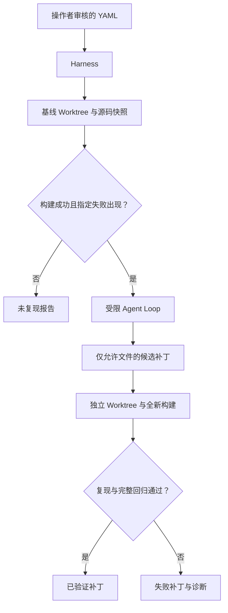

# 架构与关键取舍

本文描述当前 **0.3.0rc3、Task v2** 实现。目标架构见
[Spec 2026-10-19.2](../specs/2026-10-19.2/docs/ARCHITECTURE.md)：
独立 `verify-patch` 验收路径与 SDK 基础入口已提供；自动路径六工具、整批预算与原生上下文已提供。
当前两条入口共用生命周期与独立验证器，模型循环由 SDK 拥有。

## 目标与边界

模型提出工具调用，Harness 按文件权限和预算准入，
验证器根据独立测试结果决定是否接受补丁。Python 3.12 提供单进程执行控制，
公开 SDK 负责单个 Agent 的模型与工具循环。当前交付聚焦 C++ 修复与独立验收，
C++20 执行器计划保持暂停。

## 组件关系

`Task` 严格解析 v2 manifest，拒绝重复键、anchor/alias、未知字段、无效类型和非法文件路径。
`ResolvedTask` 从一次读取的输入冻结完整 commit、实际 image ID、展开文件集合与规范执行 hash；
原 YAML hash 单独保存，绝对位置与 retain 不进入执行 hash。
manifest 是操作策略和验收标准，由人审核。它不是待修复仓库中由模型决定的规则。

`Worktree` 使用已经验证的完整 commit 创建 detached Worktree，不切换调用者的分支。
创建前检查本地 Git 配置与提交属性；拒绝外部 filter、include、额外 worktree 配置、partial clone 等输入。
Git hooks、fsmonitor、外部 diff 与 textconv 不参与运行。完整文件系统与冻结集合核对，
拒绝 symlink/hardlink、特殊文件、额外空目录及未声明文件；单源文件 16 MiB、整树 256 MiB。
`SourceManifest` 保存每个规范路径、原始字节 SHA-256、字节数和 Git mode，整份规范 JSON 生成逻辑 hash。
工作树记录 Git 返回的 manager/common、根目录身份与双向指针；读取及原子编辑拒绝链接，目录 fd 固定替换目标。

`Toolbox` 在宿主机顺序执行读/搜/精确替换，所有路径限定在修复 Worktree。
模型没有宿主 Shell、Docker 或宿主网络工具。`run_shell` 可在一次性受限制容器内运行 Shell，
源码只读，持久化源码编辑经 `edit_file`。`run_command` 引用预配置的 `reproduce/verify`，
会在新环境中先配置和构建。
每次 `run_shell` 的 `/build` 为独立临时空间；`run_command` 一次完成配置、编译及固定测试。
`read_file` 返回 `editable` 标志，模型可直接识别可读接口和允许修改的实现。
受保护文件的编辑反馈引导模型沿声明、宏展开和调用关系继续定位实现；
系统提示使用同一修复策略，并明确构建工具与临时目录的生命周期。

`RunResources` 为 Run 创建独占 0700 控制目录和工作区，持有真实文件锁；资源记录固定根身份、Git 管理目录、容器 ID 与标签。
`AuditBudget` 限制非源码审计文件为 256 MiB，给最终报告和清理诊断保留空间；控制文件为 0600。

`DockerSandbox` 仅挂载源码快照，`/src` 只读；`/build` 是有限容量 tmpfs，允许执行编译产物。
每轮评估创建新容器，配置、编译和测试在同一个容器内进行以共享该轮构建产物。
固定 sleep 入口、禁用健康检查和重启，拒绝额外镜像 VOLUME；创建后核对实际权限、挂载与资源限额。
超时、取消、4 MiB 原始输出达限及阶段结束均删除整个容器，再 inspect 确认不存在。daemon 失联或 ID/标签不符终止运行。禁止运行时自动下载或构建镜像；Task 只接受固定
image ID/digest，PREPARING 查询实际 ID，后续阶段均使用该 ID。CPU、内存、PID 和构建 tmpfs
使用 Task 的执行资源。

`models` 只构造公开 Responses/ScriptedModel；不提供自定义 Model/Turn 协议或 HTTP 客户端。
`agent_runtime.run_agent` 注册六个 async function tools，公开 hooks 执行计数、整批准入和原生附件审计，
`run_sdk` 只调用一次 Runner。SDK 管理 Items 与 call_id 关联，本项目不维护另一份四角色消息表。
领域结果 AgentResult 与 SDK 内部状态分离。工具容器与 Git 操作共享阶段时限；资源清理由外层 Run 拥有。

`verification.py` 是两条入口共用的执行与判定模块。`evaluate_checks` 创建一次评估的全新容器，
按 configure → build → JSON v1 inventory → F2P → P2P 顺序执行，每项 CTest 保存原始 JUnit。
完整 name/argv/properties 生成身份哈希，properties 保留类型和列表顺序；backtrace 不参与身份。
`TestObservation` 对每个计划测试明确记录运行、失败、skip、not_run、timeout、crash 或 invalid。

`verify_candidate` 只接收已满足严格 F2P/P2P 基线的输入，从固定 commit 创建新工作树，
实际应用保存的 patch，核对完整字节清单和规范 diff 后执行 independent。
身份变化、skip/disabled、缺失测试和普通回归拒绝；证据不完整或资源终止无法确定。
只有全部必需测试实际通过且清理确认才能 ACCEPTED。预算停止不消除已有合法候选的独立验证机会。

`Harness` 管理共享 Run 生命周期、输入冻结、资源、原始证据和最小报告。
自动入口在合格 baseline 后进入 SDK Runner；外部入口先复制并静态审核 patch，再运行原始 baseline。
producer trace 是独立的未验证附件，不能构造 CommandResult 或替代 baseline/independent。
纯验证 CLI 及其导入链不加载 models 或 Agents SDK。验证执行遵守阶段 deadline、验证预留和清理余量；
SDK 原生 Items、预算、错误与取消契约见 [P1-05](P1-05.md)。

## 信任边界

| 位置 | 内容 | 权限 |
| --- | --- | --- |
| 宿主机控制面 | 清单、模型客户端、Git 管理、日志 | 只有操作者启动；不直接构建第三方代码 |
| Agent 工具 | 受控文件操作、固定自检、容器内 Shell | 持久化源码编辑经 `edit_file`；测试和 Git 元数据受保护 |
| 评估容器 | CMake、编译器、CTest、待修复源码 | 非 root、断网、只读根文件系统、无 capabilities |
| 独立验证 | 原始 commit + 允许的源码补丁 | 不共享 Agent 构建缓存，不接受其“成功”声明 |

每条容器命令分别保存 stdout.bin/stderr.bin 与 EvidenceRef；64 KiB 双流预览首尾取样、控制字符转义。
失败签名在完整原始流中匹配，不依赖预览、不跨流拼接。快照位于本 Run 工作区，普通成功诊断结束即释放；
none/on_failure/always 控制 repair 工作树与最近诊断快照的保留，validation 工作树结束后移除。
资源清理与证据检查结束后提交最终结局，再导出派生报告。
详细限制及未解决的问题见 SECURITY.md。Docker 不是抵御内核漏洞的完整边界，
当前面向操作者选定的仓库，尚不提供多租户敌对代码执行服务。

## 事件与产物

事件使用事务内序号和 UTC 时间戳，统一信封关联 Run、模型步骤、本地工具与命令身份。
主要类型包含 run_created、state_changed、inputs_frozen、resource_registered、
model_started/model_finished、tool_batch_admitted、tool_started/tool_finished、
command_started/command_finished、baseline_finished、verification_finished、cleanup_finished。
命令耗时来自 monotonic clock。报告保留任务规范/哈希、模型标识、解析后 commit、镜像 ID、
源码快照哈希、完整候选补丁及其哈希、返回码、超时和截断标记。
事件不记录 HTTP Authorization header，也不会复制宿主机环境。

SQLite schema v2 使用 runs/events/checkpoints 三表；runs 是外层状态、预算、期限和执行片段的权威。
创建、冻结输入并进入复现、模型开始扣 turn、工具整批准入、终态各自通过本地事务与事件一起提交。
模型开始先写 segment_open=1，确认提交后才允许 SDK 请求；工具批次扣减提交后才分派。
最终回复或工具返回不会关闭片段；只有完整输入 filter 的 Checkpoint 事务才能关闭修复片段。
recovery.py 保存公开 ModelInputData、普通 patch、完整 SourceManifest 和指纹；全部文件 durable 后才提交引用。
显式暂停与同一个 Checkpoint 事务一起进入 INTERRUPTED，Runner 通过 HarnessPause 离开，不请求下一 turn。
暂停保留修复源码及必需证据，清理构建快照和容器。
resume 先持锁、打开原库，原子记录接管阶段与 recovery_attempt；必要容器清理不受已耗尽 wall 限制。
只有关闭的最新安全 Checkpoint 可继续；原配置和全部引用核对后，从 base＋patch 创建新工作树并比较完整字节。
旧修复树存在且分歧时不覆盖；未知模型结果或未闭合工具轮次以 RECOVERY_FAILED 停止。
恢复成功事务回到 REPAIRING 后，SDK 使用原生 input/instructions、剩余 turn 与累计工具额度；未知用量继续保持未知。
预算耗尽的安全候选按原验证预留规则收尾，不重新执行基线。
写者持有整个控制进程的 flock，使用 DELETE journal、FULL synchronous、外键约束；
只读查询核对外层行和已提交事件前缀，发现分裂或损坏立即拒绝。旧 schema 不迁移、不自动续跑。
JSONL 从已提交的一致性事件前缀导出。
清理及证据检查后，终态事件引用最终事实附件；reports.py 核验引用并生成 JSON / Markdown。
run.json 记录派生导出索引；各文件原子替换，跨文件不承诺原子性。
已提交结局不因导出失败改变；inspect 只读查询，report 可重建丢失报告。
trace.py 仅从只读 SQLite 快照生成按 seq 排序的投影，并核对宿主 EvidenceRef；原生模型文件不展开。
replay --mode trace 不执行模型、工具、Git 或 Docker，不获得控制器锁，不改写原 Run。
export-trace 输出原事件 JSONL；显式外部新文件独占发布，不覆盖 Run 产物或从 JSONL 导入状态。
恢复 gate 单列安全恢复、明确失败与控制器拒绝，保留真实进程故障后的 Run 和只读前缀。
SIGKILL 后须显式 resume 核对安全边界，文件孤儿不成为恢复点；不自动重放历史工具。
导出契约见 [P1-07](P1-07.md)，外层事务见 [P2-01](P2-01.md)，Checkpoint 与暂停见 [P2-02](P2-02.md)，有限恢复见 [P2-03](P2-03.md)，只读轨迹见 [P2-04](P2-04.md)。

## 可复现性的含义

当前记录可复现修复的输入与验证证据，不承诺位级一致构建。Dockerfile 的基础 tag 与 apt 包
并未完全锁定；实际运行以 image ID 固定阶段间环境，但另一台主机需要保存/分发同一镜像。
生产评测应额外固定任务 commit、镜像 digest、模型版本与采样参数。
宿主机受信任 fixture 证据没有 image ID，不能视为 Docker 复现证明。

主机子进程管理参考 Python subprocess 的进程会话语义，Worktree 操作参考 Git 官方文档；
容器配置参考 Docker 官方运行参数：

- https://docs.python.org/3.12/library/subprocess.html
- https://git-scm.com/docs/git-worktree
- https://docs.docker.com/engine/containers/run/
