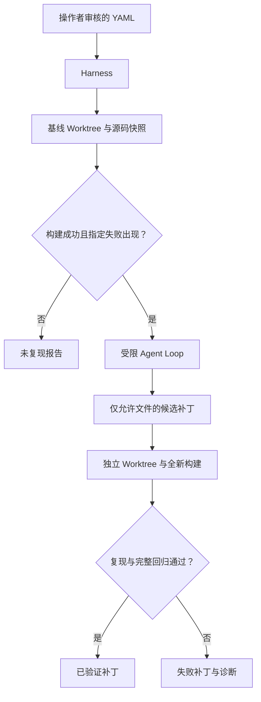

# 架构与关键取舍

## 目标与边界

这个项目将修复能力和执行/验证纪律分开：模型提出工具调用，Harness 决定哪些调用可以执行，
验证器根据独立测试结果决定是否接受补丁。当前是单进程、单模型循环，不包含前端、服务队列或多 Agent。
Python 3.12 负责调度；C++20 独立执行器在下一阶段开发，当前不把示例 C++ 当作执行器。

## 组件关系

`Task` 严格解析 manifest，拒绝重复 YAML 键、未知字段、非有限超时、路径穿越和 shell 字符串。
manifest 是操作策略和验收标准，由人审核。它不是待修复仓库中由模型决定的规则。

`Worktree` 解析 revision 到 commit，使用 detached Worktree，不切换调用者的分支。
Git hooks、fsmonitor、外部 diff 与 textconv 不参与运行。只导出被跟踪的普通文件，
拒绝 symlink/hardlink，并限制单文件 2 MB、整个快照 32 MB。
导出过程中按文件名、权限位和内容的长度编码计算 SHA-256。

`Toolbox` 在宿主机顺序执行读/搜/精确替换，所有路径限定在修复 Worktree。
模型没有直接的 Git、Docker、网络或宿主机 shell 工具。
命令工具只引用预配置的 `reproduce/verify`，会在新环境中先配置和构建。

`DockerSandbox` 仅挂载源码快照，`/src` 只读；`/build` 是有限容量 tmpfs，允许执行编译产物。
每轮评估创建新容器，配置、编译和测试在同一个容器内进行以共享该轮构建产物。
超时删除整个容器，阶段结束也删除容器。默认禁止镜像自动下载，首次解析镜像 tag 到
content-addressed image ID，后续阶段固定使用同一 ID。

`Model` 只负责 `messages + tools -> Turn`。工具 schema 固定；调用和结果顺序记录。
策略拒绝作为工具错误返回给模型，基础设施错误终止运行，不伪装成测试失败。
Mock 脚本只验证框架；真实模型修复率尚无评测。

`Harness` 对基线要求 configure/build 成功，reproduce 具有预期非零退出码与标记。
Agent 结束后检查变更集合、文件类型和权限，将允许文件的内容复制到独立 Worktree，
要求生成的完整 Git diff 与候选一致。独立验证重建并同时执行 reproduce 与 verify。
即便 Agent 的命令工具已通过，仍需独立验证。预算耗尽、模型错误和中断也保留候选 diff。

## 信任边界

| 位置 | 内容 | 权限 |
| --- | --- | --- |
| 宿主机控制面 | 清单、模型客户端、Git 管理、日志 | 只有操作者启动；不直接构建第三方代码 |
| Agent 工具 | 文本读取、搜索、指定源码替换 | 无任意 shell，不能修改测试或 Git 元数据 |
| 评估容器 | CMake、编译器、CTest、待修复源码 | 非 root、断网、只读根文件系统、无 capabilities |
| 独立验证 | 原始 commit + 允许的源码补丁 | 不共享 Agent 构建缓存，不接受其“成功”声明 |

详细限制及未解决的问题见 SECURITY.md。Docker 不是抵御内核漏洞的完整边界，
当前面向操作者选定的仓库，尚不提供多租户敌对代码执行服务。

## 事件与产物

事件使用单调序号和 UTC 时间戳，主要类型是 run_started、evaluation_started、
command_finished、model_turn、tool_started、tool_finished、run_finished。
命令耗时来自 monotonic clock。报告保留任务规范/哈希、模型标识、解析后 commit、镜像 ID、
源码快照哈希、完整候选补丁及其哈希、返回码、超时和截断标记。
事件不记录 HTTP Authorization header，也不会复制宿主机环境。

SQLite 每条事件单独提交，再追加到 JSONL。**两者不是跨文件原子事务**，
突然崩溃时最后一条可能不一致；当前没有恢复或自动重放语义。正常运行测试核对两份记录逐条相同。
运行报告由结束处理生成，SIGKILL/掉电不保证有完整报告。此处明确保留为下一阶段工作。

## 可复现性的含义

当前记录可复现修复的输入与验证证据，不承诺位级一致构建。Dockerfile 的基础 tag 与 apt 包
并未完全锁定；实际运行以 image ID 固定阶段间环境，但另一台主机需要保存/分发同一镜像。
生产评测应额外固定任务 commit、镜像 digest、模型版本与采样参数。
宿主机受信任 fixture 证据没有 image ID，不能视为 Docker 复现证明。

主机子进程管理参考 Python subprocess 的进程会话语义，Worktree 操作参考 Git 官方文档；
容器配置参考 Docker 官方运行参数：

- https://docs.python.org/3.12/library/subprocess.html
- https://git-scm.com/docs/git-worktree
- https://docs.docker.com/engine/containers/run/
