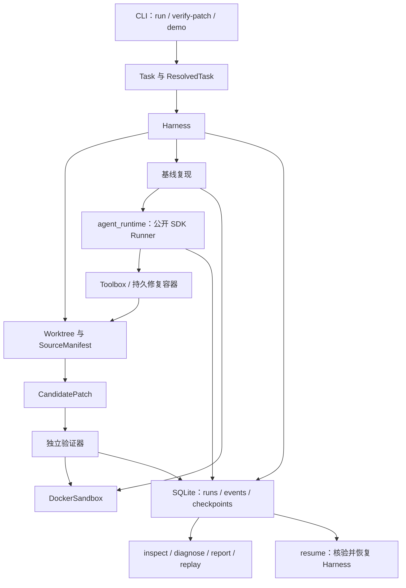

# 架构

ReproPatch 以一个 Run 为执行单元，为操作者选定的 C++ 仓库提供修复控制面。Task 固定输入和验收标准，公开 OpenAI Agents SDK 执行模型与工具循环，Harness 根据独立 CMake/CTest 证据提交最终结局。

实现：[harness.py](../src/repropatch/harness.py)、[agent_runtime.py](../src/repropatch/agent_runtime.py)。验证：[端到端流程](../tests/test_harness.py)、[SDK 契约](../tests/test_sdk_contract.py)。

## 模块关系



| 模块 | 职责与数据 | 对应验证 |
| --- | --- | --- |
| [cli.py](../src/repropatch/cli.py)、[demo.py](../src/repropatch/demo.py) | 解析命令、选择入口、呈现结局；demo 以零密钥脚本驱动真实执行链 | [CLI 合同](../tests/test_engineering_cli.py)、[Docker 集成](../tests/test_docker_integration.py) |
| [task.py](../src/repropatch/task.py) | 解析 Task v2；冻结 commit、镜像身份、文件集合、命令、测试与预算 | [Task 检查](../tests/test_task.py) |
| [harness.py](../src/repropatch/harness.py) | Run 生命周期、输入冻结、阶段期限、资源归属、候选与最终结局 | [流程与失败路径](../tests/test_harness.py)、[生命周期](../tests/test_runtime_lifecycle.py) |
| [workspace.py](../src/repropatch/workspace.py) | detached Worktree、受控编辑、完整字节清单、补丁应用与往返核对 | [源码完整性](../tests/test_source_integrity.py)、[工作区工具](../tests/test_workspace_tools.py) |
| [models.py](../src/repropatch/models.py)、[agent_runtime.py](../src/repropatch/agent_runtime.py) | 公开 Responses/ScriptedModel、SDK hooks、预算准入、原生输入附件 | [SDK 契约](../tests/test_sdk_contract.py)、[Agent 执行](../tests/test_agent_runtime.py) |
| [tools.py](../src/repropatch/tools.py)、[repair_sandbox.py](../src/repropatch/repair_sandbox.py) | 授权文件工具、固定自检、一次性 Shell 或持久修复 Bash | [工具权限](../tests/test_workspace_tools.py)、[持久沙箱](../tests/test_repair_sandbox.py) |
| [context.py](../src/repropatch/context.py)、[semantic_state.py](../src/repropatch/semantic_state.py) | 上下文计量与完整轮次压缩；可选 C++ 语法索引、修改和证据状态 | [上下文压缩](../tests/test_context_compaction.py)、[结构状态](../tests/test_semantic_state.py) |
| [verification.py](../src/repropatch/verification.py)、[sandbox.py](../src/repropatch/sandbox.py) | 干净评估、CTest 身份与结果判定、容器约束和清理确认 | [验证器](../tests/test_verification.py)、[真实 Docker](../tests/test_docker_integration.py) |
| [events.py](../src/repropatch/events.py)、[recovery.py](../src/repropatch/recovery.py) | 事务状态、累计预算、Checkpoint、安全输入边界和恢复核验 | [事务故障](../tests/test_recovery.py)、[Checkpoint](../tests/test_checkpoints.py)、[恢复](../tests/test_resume.py) |
| [reports.py](../src/repropatch/reports.py)、[diagnostics.py](../src/repropatch/diagnostics.py)、[trace.py](../src/repropatch/trace.py) | 从已提交事实读取、诊断、导出报告和轨迹，核验 EvidenceRef | [报告](../tests/test_events_reports.py)、[CLI 诊断合同](../tests/test_engineering_cli.py)、[轨迹](../tests/test_trace.py) |

## SDK 与控制面

SDK 的 `Runner` 负责调用模型、组织原生 Items、关联 `call_id`、分派注册的 function tools 并识别正常结束。模型由公开 `OpenAIResponsesModel` 或 `agents.testing.ScriptedModel` 提供。ReproPatch 通过公开 hooks 与 `call_model_input_filter` 接入预算、证据和 Checkpoint。

`run_sdk()` 每次调用一个公开 `Runner.run()`。默认策略沿用 SDK 原生历史；启用上下文压缩时，控制面在完整输入边界保存状态，调用一次无工具摘要，再以替换后的公开输入进入新的 Runner。恢复也使用已保存的公开输入。SDK 原生消息与调用关联继续由 SDK 管理。

实现：[agent_runtime.py](../src/repropatch/agent_runtime.py)、[models.py](../src/repropatch/models.py)、[context.py](../src/repropatch/context.py)。验证：[原生 Items 与 hooks 顺序](../tests/test_sdk_contract.py)、[完整轮次压缩](../tests/test_context_compaction.py)、[恢复后的原生输入](../tests/test_resume.py)。

控制面在请求前提交 `model_started` 和累计步骤，在工具分派前事务提交整批准入。每个响应最多八次工具调用，执行并发固定为一。超出累计工具额度的整批调用停止于准入阶段；已准入工具按顺序执行。模型与 HTTP 客户端的自动重试均配置为零，使一次尝试的计量和失败身份可追踪。

实现：[agent_runtime.py](../src/repropatch/agent_runtime.py)、[models.py](../src/repropatch/models.py)、[events.py](../src/repropatch/events.py)。验证：[整批准入与串行执行](../tests/test_sdk_contract.py)、[事务提交后分派](../tests/test_recovery.py)。

## 输入与验收链

### 冻结输入

Task 由操作者审核，包含本地仓库完整 commit OID、镜像 ID/digest、可读与可编辑路径、受保护文件、命令、F2P/P2P 测试与预算。解析器检查重复键、未知字段、类型、规范路径和命令约束；运行准备阶段核验实际镜像 ID 并展开文件集合，保存原始 Task 和规范执行哈希。

实现：[task.py](../src/repropatch/task.py)。验证：[Task 字段与身份检查](../tests/test_task.py)、[冻结输入](../tests/test_harness.py)。

Worktree 从固定 commit 创建 detached 工作树，保留调用者的分支与现有文件。源码清单记录路径、原始字节 SHA-256、大小与 Git mode；Git 配置、链接、特殊文件和源码集合都参与审核。修复过程和独立验收通过同一清单描述候选身份。

实现：[workspace.py](../src/repropatch/workspace.py)、[resources.py](../src/repropatch/resources.py)。验证：[字节与文件身份](../tests/test_source_integrity.py)、[资源归属](../tests/test_runtime_lifecycle.py)。

### 基线与候选

基线在干净环境配置、构建并发现 CTest inventory。Task 声明的 F2P 测试应出现指定退出码和原始失败签名，P2P 应实际通过。失败签名逐个原始输出流匹配；测试身份由 name、argv、properties 生成哈希。

合法候选从固定 commit 应用保存的 patch，核对完整源码清单和再次导出的规范 diff，再在全新容器运行声明的 F2P/P2P。只有必需测试实际通过、证据完整且清理确认后提交 `ACCEPTED`。测试身份变化、缺失或跳过、编译失败和回归各有明确判定。模型最终文本及修复阶段自检保留为过程证据，最终结局由独立验证器产生。

实现：[verification.py](../src/repropatch/verification.py)、[workspace.py](../src/repropatch/workspace.py)、[process.py](../src/repropatch/process.py)。验证：[测试判定与共用验证器](../tests/test_verification.py)、[源码往返](../tests/test_source_integrity.py)、[Docker 验收](../tests/test_docker_integration.py)。

`verify-patch` 与模型修复共用基线和独立验证器。`--candidate-only` 完成候选冻结与源码往返核验后，以 `INCONCLUSIVE / EXTERNAL_ORACLE_REQUIRED` 交付外部评分；默认修复入口直接执行独立验收。

实现：[harness.py](../src/repropatch/harness.py)。验证：[外部候选](../tests/test_verification.py)、[候选交付资格](../tests/test_candidate_eligibility.py)。

## 状态与恢复

Run 的 `state` 表示运行阶段，`outcome` 表示最终结局。正常修复路径如下，外部补丁验收从 `REPRODUCING` 直接进入 `VERIFYING`：

```text
CREATED -> PREPARING -> REPRODUCING -> REPAIRING -> VERIFYING -> FINISHED
                                       |
                                       v
                                  INTERRUPTED -> RECOVERING -> REPAIRING
```

`FINISHED` 配套保存 `ACCEPTED`、`REJECTED`、`NOT_REPRODUCED`、`INCONCLUSIVE`、`BUDGET_EXHAUSTED`、`ERROR`、`CANCELLED` 或 `RECOVERY_FAILED`，并附 `reason_code`。显式暂停在 `INTERRUPTED` 阶段保留空结局和已提交 Checkpoint。

实现：[events.py](../src/repropatch/events.py)、[harness.py](../src/repropatch/harness.py)。验证：[状态事务](../tests/test_recovery.py)、[暂停](../tests/test_checkpoints.py)。

SQLite 的 `runs/events/checkpoints` 三表是外层状态权威。状态行、事件前缀、预算和 Checkpoint 引用在本地事务内共同提交；单写者持有 Run 文件锁，使用 DELETE journal、FULL synchronous 与外键约束。报告和 JSONL 由已提交记录导出。

实现：[events.py](../src/repropatch/events.py)、[resources.py](../src/repropatch/resources.py)。验证：[锁与持久化配置](../tests/test_recovery.py)、[一致性快照](../tests/test_events_reports.py)。

Checkpoint 在所有准入工具已完成、资源静止的完整 SDK 输入边界生成。原生下一输入、普通补丁、完整源码清单、配置指纹和可选上下文状态先 durable 写入，随后事务提交引用并关闭 `segment_open`。显式暂停与该事务一起提交。

`resume` 持锁接管同一 Run，核验原配置、Python/SDK/实现身份、Task、镜像、工具 schema、证据和资源归属，从 base + patch 重建源码并比较清单。已有修复树的分歧保留为诊断；成功恢复沿用累计请求、工具、未知用量和原始 wall 期限，并复用已核验基线。Shell 恢复重新建立容器，`/build`、`/tmp` 和编译缓存从空环境开始。

实现：[recovery.py](../src/repropatch/recovery.py)、[agent_runtime.py](../src/repropatch/agent_runtime.py)。验证：[安全恢复与分歧](../tests/test_resume.py)、[真实容器恢复](../tests/test_docker_integration.py)、[结构状态恢复](../tests/test_semantic_state.py)。

故障恢复按已提交事实作判断：未知模型结果对应 `MODEL_RESULT_UNKNOWN`，未闭合轮次对应 `OPEN_AGENT_SEGMENT`，损坏 Checkpoint 对应 `CHECKPOINT_CORRUPT`。这些运行以 `RECOVERY_FAILED` 保存诊断与已有候选。故障门禁将安全恢复、明确失败和控制器锁拒绝分组记录。

实现：[recovery.py](../src/repropatch/recovery.py)、[恢复门禁](../scripts/check_recovery_gate.py)。验证：[进程死亡边界](../tests/test_resume.py)、[核心恢复拒绝路径](../tests/test_resume_core.py)。

## 工具与执行资源

默认 `legacy` 注册 `list_directory`、`read_file`、`search_code`、`edit_file`、`run_command`、`run_shell`。文件工具使用冻结的 readable/editable 集合；`edit_file` 精确替换唯一片段。`run_command reproduce` 运行 F2P，`verify` 运行 F2P/P2P，每次均从新容器配置和构建。`run_shell` 使用只读源码和一次性 `/build`。

`shell-only` 注册单一 `bash`，`/src` 展示完整 prepared 源码快照，授权的已有文件逐个可写挂载；命令间复用修复容器和 `/build`。命令完成后冻结容器、核对空闲进程并审计源码。最终验收继续使用新工作树和冷构建。

实现：[tools.py](../src/repropatch/tools.py)、[harness.py](../src/repropatch/harness.py)、[repair_sandbox.py](../src/repropatch/repair_sandbox.py)。验证：[文件权限](../tests/test_workspace_tools.py)、[Shell 生命周期](../tests/test_shell_runtime.py)、[持久容器](../tests/test_repair_sandbox.py)。

Docker 执行 CMake、编译器、CTest 和第三方代码；宿主控制面管理 Git、模型连接与证据。容器使用非 root、断网、只读根文件系统、清空 capabilities、固定 CPU/内存/PID 和有限 tmpfs。创建后核验实际 profile；超时、取消、输出达限或阶段结束都删除整个容器并检查删除结果。运行使用已准备的固定镜像，跨机器复现需要分发同一镜像身份。

实现：[sandbox.py](../src/repropatch/sandbox.py)、[process.py](../src/repropatch/process.py)、[docker/Dockerfile](../docker/Dockerfile)。验证：[沙箱约束与清理](../tests/test_process_sandbox.py)、[真实 Shell](../tests/test_shell_docker.py)。具体信任关系见[安全模型](../SECURITY.md)。

## 上下文与观测

`--semantic-state` 为 legacy 增加 `query_code`，提供定义、语法引用、包含关系、修复状态和已登记证据查询。Tree-sitter 结果带源码 SHA、位置、语法精度标注、解析错误和分页信息。源码修改使相应索引失效；Checkpoint 保存可序列化状态，AST 缓存按需重建。

默认 CLI 使用有界原生历史；`--semantic-state` 选择支持完整轮次压缩的策略。Task 合同长期固定，基线观察、修改、可见检查和证据索引参与上下文重建。压缩请求计入累计预算，原始工具结果另存证据。具体配置层次与指标见[工程指南](ENGINEERING.md#上下文与结构证据)。

实现：[semantic_state.py](../src/repropatch/semantic_state.py)、[context.py](../src/repropatch/context.py)、[agent_runtime.py](../src/repropatch/agent_runtime.py)。验证：[结构证据](../tests/test_semantic_state.py)、[上下文计量](../tests/test_context_results.py)、[压缩](../tests/test_context_compaction.py)。

事件按 Run、步骤、本地工具 ID 和命令 ID 关联，命令耗时来自 monotonic clock。EvidenceRef 保存产物路径、SHA-256 和大小，关联原始 stdout/stderr、JUnit、inventory、候选与原生模型附件。`inspect`、`diagnose` 和 `replay` 从只读快照查询；`export-trace` 发布到 stdout 或 Run 外的新文件。`report` 持锁重建派生报告，`resume` 执行恢复。

公开 SDK tracing 关闭，项目的领域事件与受控证据承担观测职责。工程门禁使用当前安装环境执行真实 Docker 三场景，并比较只读查询前后的 Run 内容。默认支持 editable 安装；CI 先构建和安装 wheel，再通过 `--require-installed-wheel` 核验安装来源。完整入口见[交付包验收](ENGINEERING.md#交付包验收)。

实现：[events.py](../src/repropatch/events.py)、[artifacts.py](../src/repropatch/artifacts.py)、[diagnostics.py](../src/repropatch/diagnostics.py)、[reports.py](../src/repropatch/reports.py)、[trace.py](../src/repropatch/trace.py)、[工程门禁](../scripts/check_engineering_gate.py)。验证：[报告完整性](../tests/test_events_reports.py)、[只读轨迹](../tests/test_trace.py)、[CLI 合同](../tests/test_engineering_cli.py)。

## 工程取舍

独立冷构建提供验收隔离，也消耗固定构建成本；`--compiler-cache` 和持久 Shell 优先优化修复阶段反馈。事务与内容哈希增加本地写入和核验工作，换取恢复判断与证据关联。结构检索使用有界语法索引，解析成本、缓存命中和失败诊断分别计量。

这些取舍通过运行记录中的验收结局、命令耗时、自检次数、Token 用量、压缩记录、恢复结果和资源清理确认检验。配对优化方法与测试入口见[工程指南](ENGINEERING.md#观测与优化)，真实仓库验证见[评测索引](../benchmarks/README.md)。
