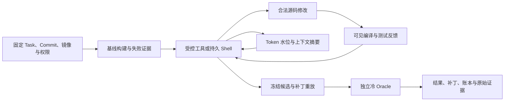

# ReproPatch 项目报告

日期：2026 年 10 月 27 日

项目：[lilong555/ReproPatch](https://github.com/lilong555/ReproPatch)

ReproPatch 已交付 v0.3.0、受控 C++ 修复循环、独立冷验收、持久 Shell 和统一上下文压缩。在 19 道完整五组配对的 fmt 缺陷上，Full 与 Shell-only 各通过 17 题，mini 与 Codex 各通过 16 题，关闭自检组通过 14 题。

21 道既有任务的 105 个注册槽位保留全部原始身份、模型失败和三次人工中断。正式实验累计 1,895/2,520 请求，10 次用量未知；11 次校准单列。107 份收费尝试归档、53,040 份文件及 1,895 个唯一请求 ID 完成核验。完整逐题结果见[统一上下文报告](../benchmarks/unified-context/results.md)。

## 项目与执行链

ReproPatch 将固定源码、文件权限、模型预算、编译反馈和测试验收连接成一个修复流程。技术栈为 Python 3.12、Agents SDK、Git Worktree、Docker、CMake/CTest 和 SQLite。核心安装支持零 API 密钥的 `verify-patch`；模型运行依赖单独安装。

| 机制 | 实际作用 |
| --- | --- |
| Task v2 | 固定完整 commit、镜像、授权文件、F2P/P2P 与预算 |
| Git Worktree 与源码清单 | 隔离修复和验收，检查受保护文件及补丁重放 |
| Docker | 非 root、断网、只读根文件系统、资源限制和退场清理 |
| Full 自检 | reproduce 执行配置、编译与 F2P；verify 执行完整 F2P/P2P |
| Shell-only | 持久 Bash、Run 内构建目录复用、命令后源码审计 |
| 统一上下文 | 供应商 Usage 锚点、明文增量估算、不透明状态归因和摘要替换 |
| SQLite | 保存事件、原始用量、Checkpoint、摘要状态与停止原因 |
| 冷 Oracle | 冻结候选在独立源码与构建环境中验收 |

标准运行由 Harness 完成最终独立验收；Benchmark 的 candidate-only 导出经审计候选，由统一外部 Oracle 评分。修复调试优先使用 reproduce，预算允许继续修改时执行 verify。

## 已交付状态

| 范围 | 交付证据 |
| --- | --- |
| 正式版本 | [v0.3.0](https://github.com/lilong555/ReproPatch/releases/tag/v0.3.0)，发布源码 514 项测试 |
| Shell-first | 持久 Bash、合法补丁导出及独立冷验收；基线 CI 653 项 |
| 统一上下文 | Full、关闭自检、Shell-only、mini 适配器与固定 Codex 原生摘要 |
| 冻结实现 CI | [708 项通过](https://github.com/lilong555/ReproPatch/actions/runs/40462738957)：492 Core、176 SDK、40 Docker |
| 正式结果 | [21 题、105 槽完整记录](../benchmarks/unified-context/results.json) |
| 归档核验 | [107 份收费尝试归档](evidence/context-unified-2026-10-27/verification.json)，53,040 份文件 |
| O3 Docker 资格 | [21/21 通过](ACTIONS_RESULTS.md)，资格阶段模型请求为 0 |

O3 Docker 资格确认固定镜像与优化级别下的真实 F2P、基线 P2P、参考补丁修复，以及独立冷构建中的完整原生 Oracle。129 条 C++ 候选池和原生资格记录保留各自的证据范围。

## 五组实验

模型为 gpt-6-luna、实际 max 思考强度；每次 24 请求、48 工具、8192 输出 Token，模型总期限保持 180 秒。公共上下文窗口为 128,000 Token，压缩触发为 48,000，目标为 21,600，完整 HTTP Body 保护上限为 2 MiB。

| 实验组 | 19 题完整配对通过 | 基础设施错误 | 请求 | Worker 中位秒数 |
| --- | ---: | ---: | ---: | ---: |
| Full | 17/19 | 1 | 326 | 327.24 |
| 关闭自检 | 14/19 | 1 | 350 | 245.80 |
| Shell-only | 17/19 | 2 | 296 | 382.11 |
| mini | 16/19 | 3 | 276 | 232.81 |
| Codex | 16/19 | 0 | 421 | 278.72 |

Full 相对关闭自检组净多通过 fmt-1361、fmt-2310、fmt-3732 三题，自检累计 1,605.84 秒。Full 与 Shell-only 各有一题独自通过，体现两种工具流程的任务差异。Worker 按原执行器范围计时，分阶段耗时单列。

完整配对依据人工中断状态确定，排除 fmt-1171 和 fmt-3158；其余基础设施错误留在对应题目。每题每组一次，三个冻结源码快照和两个计量故障复验分别记录。21 题已有前序模型曝光，本批用于配置复核和修复机制观察。

## 上下文与运行可靠性

原 256 KiB 配置的离线审计确认 32/105 次尝试触及传输阈值，其中 16 次已有候选通过冷 Oracle。统一策略分别度量实际 Token 和正文物理字节，先留存完整请求，再执行准入。

Shell-only、mini、Codex 的选定轨迹分别有 5、3、10 次已验证压缩，均观察到历史实质缩小和后续工具执行。Full 与关闭自检组的实际压缩次数为 0，其强制压缩链路通过固定响应与 CI 验证。

Codex 的 fmt-3727 将正文从约 370 KB 压缩到 73 KB，压缩后输入 16,118 Token，最终通过 Oracle。fmt-3158 在第 11 次请求持续返回推理状态，180 秒总期限到达时尚无完成事件，最终为空候选。该次用量保留为未知。

7 项基础设施错误对应上游 6 次 HTTP 524 和 1 次 HTTP 502。[错误核验](evidence/context-unified-2026-10-27/errors.json)记录各执行器原生停止码、HTTP 状态与请求身份。

## 用量与复核

正式累计为 1,875 次修复、20 次摘要、0 次实际重试，共 1,895 请求；校准 11 次单列。10 次未知用量继续保留。已知输入 41,079,208 Token、输出 882,822 Token，缓存输入与推理输出分别作为其中的细分项。金额依据供应商账单，当前记录为未知。

[summarize_context_campaign.py](../scripts/summarize_context_campaign.py)从冻结协议、原始评分与逐请求证据重算结果。脚本核验跨批次尝试身份、收费复验规则、请求唯一性、取消状态、未知用量和上下文合同，保留失败的复验结果。

[结果与复现命令](../benchmarks/unified-context/results.md)、[源码与协议身份](../benchmarks/unified-context/results.json)、[逐题 CSV](../benchmarks/unified-context/attempts.csv)和[验证摘要](evidence/context-unified-2026-10-27/summary.json)提供独立复核入口。

## 当前工程重点

现有 Full 与 Shell-only 均保留，模型总期限维持 180 秒。工程重点为对照轨迹复核、编译反馈与自检时机分析、长期证据保存，以及已有项目适配的离线任务扩容。新的模型批次独立冻结任务、源码和额度。

历史 medium 六次对照、四臂首次实验与旧 256 KiB 五组结果分别归档于[评测索引](../benchmarks/README.md)，正式发布制品身份保存在 [RELEASE.json](../RELEASE.json)。
