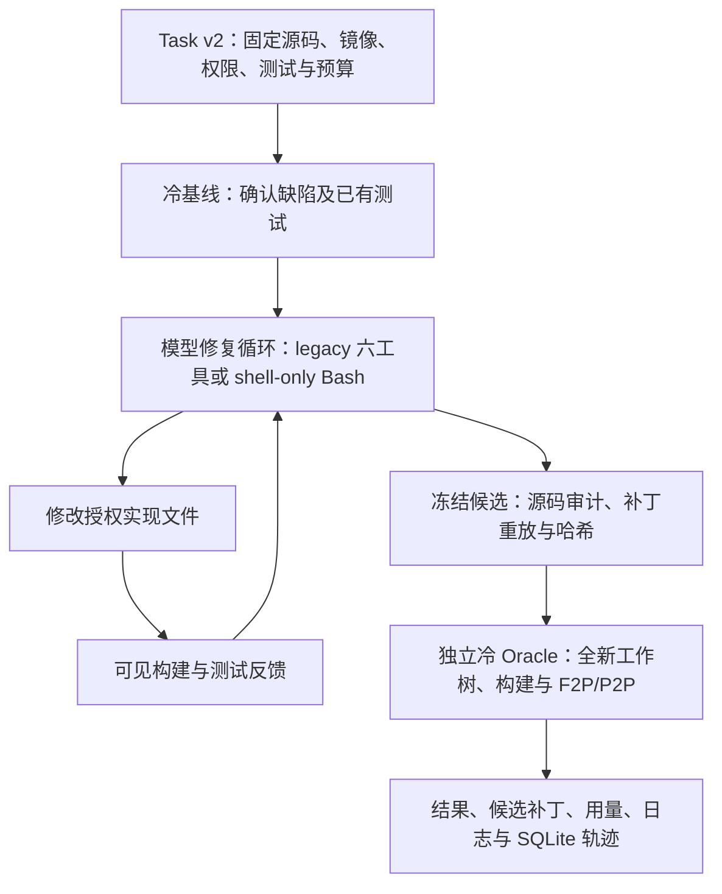

# ReproPatch 项目报告

日期：2026 年 10 月 26 日

项目：[lilong555/ReproPatch](https://github.com/lilong555/ReproPatch)

开发基准：`feat/shell-first-agent`，提交 `3dedb21489f10427638e7483337869bc3ff77e53`

ReproPatch 已完成 v0.3.0 发布、隔离修复与独立验收、GitHub Actions 批量实验，以及 Shell-only 修复模式的开发验证。当前工作重点是用配对实验确定工具接口、自检和构建复用的实际收益。

历史受限配置实验覆盖 **21 道 fmt 缺陷、五组配置、105 次修复尝试**。Full 与关闭自检组均通过 **17/21（81.0%）**，mini-SWE-agent 通过 **16/21**，Shell-only 通过 **15/21**，Codex CLI 通过 **13/21**。两批合计使用 **1629/2520 次模型请求**，统一配置为 `gpt-6-luna`、`max` 思考强度。

全部原始归档的离线审计确认，旧 256 KiB 检查截断了 **32/105 次尝试**，其中 16 次的候选通过冷 Oracle。各组的截断次数为 Full 3、关闭自检 1、Shell-only 9、mini 9、Codex 10。22 次拒绝可从原生输入、响应及工具结果重建；Codex 的 10 次保留拒绝层与字节下界。完整结果见[逐次审计表](evidence/context-audit-2026-10-26/audit.csv)。

当前 P0 工作统一 Token 与传输字节计量，并为五组执行器提供上下文压缩。后续通过端点校准、四题 Pilot 和同一 21 题配对重跑，评估结构化工具、中途自检与持久 Shell 的效果。历史 Oracle 成绩和原协议完整保留，架构比较以通过统一上下文门禁的配对实验为依据。

## 一、项目概览

### 1. 项目定位

ReproPatch 是面向 C++ 工程的可复现代码修复与独立验收 Harness。它将缺陷描述、固定源码版本、文件权限、模型预算和编译测试组合成完整流程：模型定位并修改实现，Harness 保存执行证据，独立验证器重建候选并给出验收结果。

项目主要解决 C++ 自动修复中的三类工程问题：编译和测试反馈成本高、修改与验收环境需要隔离、实验结果需要追溯到具体源码和执行配置。

技术栈以 Python 3.12、OpenAI Agents SDK、Git Worktree、Docker、CMake/CTest 和 SQLite 为主。核心安装仅依赖 PyYAML；`verify-patch` 支持零 API 密钥的补丁复核。Agent 依赖单独安装，当前固定 `openai-agents==0.24.0` 与 `openai==3.35.1`。

### 2. 核心执行链



F2P 指基线失败、修复后应通过的测试；P2P 指基线已经通过、修复后仍应通过的测试。独立冷 Oracle 在干净源码和构建环境中运行冻结测试，作为最终评分依据。

| 机制 | 当前作用 |
| --- | --- |
| Task v2 | 固定完整 commit、镜像身份、文件权限、F2P/P2P 与执行预算 |
| Git Worktree 与源码清单 | 隔离修复和验收，检查受保护文件、授权修改及补丁重放完整性 |
| Docker 沙箱 | 非 root、断网、只读根文件系统，限制 CPU、内存、PID，并确认资源清理 |
| 受控工具与预算 | 对模型请求、输入大小、输出、工具批次和执行时间统一计量 |
| 中途自检 | `reproduce` 运行配置、编译和 F2P；`verify` 进一步运行完整 F2P/P2P |
| 独立验收 | 使用冻结候选重新构建，结合测试退出码、JUnit 和原始日志判断结果 |
| SQLite 与证据 | 保存事件、用量、Checkpoint、候选和失败原因，支持查询与有限恢复 |

标准运行由 Harness 完成最终独立验收。Benchmark 中的 `candidate-only` 先导出经审计的候选，再由统一外部冷 Oracle 评分，减少重复的最终验收。Agent 调试优先使用 `reproduce`，剩余预算允许继续修正时再使用 `verify` 检查回归。

架构与执行合同见[架构说明](ARCHITECTURE.md)、[Shell-first 规格](SHELL_FIRST.md)和[项目入口](../README.md)。

## 二、目前进度与实施方案

### 1. 已完成的交付

| 工作项 | 当前状态 | 证据 |
| --- | --- | --- |
| 正式发布 | v0.3.0 于 2026-10-24 发布，提供 wheel、sdist 和实验验证附件 | [Release](https://github.com/lilong555/ReproPatch/releases/tag/v0.3.0) |
| 核心 Harness | 固定任务、权限审计、隔离运行、独立验收、事件与恢复流程已实现 | [架构](ARCHITECTURE.md) |
| 云端任务资格 | 21 道明确 fmt 缺陷全部通过 O3 Docker 资格 | [资格 Run](https://github.com/lilong555/ReproPatch/actions/runs/40194807297) |
| 构建与缓存 | 已实现 Run 内 ccache，完成真实目标的冷、热构建实验 | [云端性能报告](ACTIONS_RESULTS.md) |
| Benchmark 管线 | Actions 调度、冻结协议、请求账本、候选导出、冷评分及证据归档已贯通 | [执行入口](../scripts/formal_benchmark.py) |
| 五组配对实验 | 21 题 × 5 组，共 105 次尝试全部取得结果 | [本报告数据汇总](evidence/comparison-24-2026-10-26/summary.json) |
| Shell-only | 持久修复容器、Bash、构建目录复用、源码同步、候选导出和恢复已实现 | [开发规格](SHELL_FIRST.md) |

**O3 Docker 资格**表示在固定镜像和 `-O3 -DNDEBUG` 配置下，已经确认基线存在真实 F2P、P2P 通过，参考补丁修复目标失败，并在独立冷构建中通过完整原生 Oracle。当前 21 题的模型实验建立在这套资格证据上。

任务储备包括 Multi-SWE-bench 的 129 条 C++ 候选记录，以及较早完成的 41 条原生环境资格记录。当前可直接用于本批统一实验的是上述 21 道 fmt 缺陷。历史适配覆盖 Catch2、fmt、nlohmann/json、simdjson；后续扩展优先复用已有项目适配。

### 2. 当前修复模式

| 模式 | 工具与环境 | 当前用途 |
| --- | --- | --- |
| Full / legacy | 六个工具；显式读写与搜索；自检开启；实验中开启 Run 内 ccache | 默认流程与完整机制基线 |
| 关闭自检 | 保留四个文件工具，移除 `run_command`、`run_shell`；沿用 Full 的其他配置 | 观察中途执行反馈的整体影响 |
| Shell-only | 单一 `bash` 工具；同次修复复用容器、源码快照、`/build` 和 `/tmp`；本批关闭 ccache | 观察复合命令与持久构建的效果 |

Shell-only 每条命令结束后冻结容器、审计源码并同步合法修改；最终候选在独立环境中验收。该模式属于当前开发分支能力。v0.3.0 发布制品和当前分支分别保留版本身份。

### 3. 工程验证与性能进度

| 验证范围 | 对应源码 | 已记录结果 |
| --- | --- | ---: |
| v0.3.0 发布验证 | 发布身份见 `RELEASE.json` | 514 项：338 Core、154 SDK、22 Docker |
| Shell-first 完整 CI | `24bbcea3922d8a01bfd9cc241600fe4821ea8406` | **653 项：448 Core、166 SDK、39 Docker** |
| 最新四臂模型批次 | `3dedb21489f10427638e7483337869bc3ff77e53` | 84/84 条结果齐全 |
| 最新 Shell-only 批次 | `608b39322004f763ed8e3378614c8540339fa514` | 21/21 条结果齐全 |

653 项完整 CI 的失败、错误与跳过均为 0，Ruff 与格式检查通过，覆盖持久 Bash、构建复用、权限、冷验收、清理和恢复。该计数对应表中的 Shell-first 基线提交；后续实验提交继续调整了调度与预算配置。[CI 运行](https://github.com/lilong555/ReproPatch/actions/runs/40275823791)与[测试报告](TEST_REPORT.md)保留具体身份。

云端 fmt-4055 目标构建实验中，冷 Ninja 中位耗时为 **13.268 秒**，热 ccache 为 **0.868 秒**，耗时减少 **93.46%**，两个重复变体各三个样本。计时范围为配置、目标构建与目标测试。完整 Agent 的端到端收益继续作为独立测量项。

同一四题资格集的 1/2/4 Job 实验分别耗时 **1042/547/291 秒**，资格 Job 活动 Runner 分钟为 **17.00/16.95/17.33**，各配置运行一次。当前工作流默认并发两个 Job。[构建与并发原始结果](ACTIONS_RESULTS.md)
## 三、最新实验结果

### 1. 实验范围与固定配置

本次汇总由两个已完成的 GitHub Actions 批次组成：四臂对照 **84 次**，Shell-only **21 次**。每组在相同 21 道 fmt 任务上运行一次，自动重试为 0。

| 配置项 | 本批设置 |
| --- | --- |
| 模型与思考强度 | `gpt-6-luna`，`reasoning_effort=max` |
| 模型端点 | `https://cpa.liyinlong.me/v1` |
| 每次尝试请求上限 | 24 次；两批合计上限 2520 次 |
| 工具预算 | 每次尝试 48 次；单响应最多 8 次，整批准入 |
| 输入与输出 | 256 KiB 请求输入准入；每请求最多 8192 输出 Token |
| 请求超时配置 | 180 秒 |
| Task 时间预算 | 7200 秒，含 1200 秒验收预留 |
| 环境 | 同一 GHCR 镜像、O3 配置和逐题冻结测试 |
| 评分 | 候选冻结后由独立冷 Oracle 检查 F2P/P2P |
| 参数校准 | 复用已通过的 Luna max 校准，本批新增校准请求 0 |
| 框架身份 | Codex CLI `0.163.0`；mini 固定 commit `04d809ceab9df28f9adaed044884180159172930` |

固定镜像：

```text
ghcr.io/lilong555/repropatch-benchmark@sha256:c00247e787729d6af3af364ab80cce196d90033832f77f2c1262a6e8f7cf111a
```

逐题核验确认五组使用相同 Task 文件 SHA、prepared commit 和 image ID。Shell-only 与四臂对照分别记录执行源码提交；各工具接口、构建复用和调用语义按上文配置保留。

协议：[四臂 24 请求协议](../benchmarks/comparison-full-24-protocol.json)、[Shell-only 协议](../benchmarks/shell-only-full-protocol.json)、[Luna max 校准](../benchmarks/formal-max-calibration.json)。

### 2. 五组汇总

成功率以每组全部 21 次尝试为分母，基础设施异常保留在对应任务记录中。

| 实验组 | Oracle 通过 | 成功率 | 模型请求 | 基础设施异常 | 最终未知用量请求 |
| --- | ---: | ---: | ---: | ---: | ---: |
| **ReproPatch Full** | **17/21** | **81.0%** | 374 | 1 | 1 |
| **关闭自检** | **17/21** | **81.0%** | 375 | 1 | 1 |
| mini-SWE-agent | 16/21 | 76.2% | 278 | 2 | 2 |
| Shell-only | 15/21 | 71.4% | 310 | 1 | 1 |
| Codex CLI | 13/21 | 61.9% | 292 | 1 | 0 |
| 合计 | 78/105 次尝试 | — | **1629** | **6** | **5** |

其余结果为 **9 次编译失败、9 次测试失败、3 次空候选**。105 个 Attempt ID 唯一且完整；78 个通过记录均执行了 Oracle，资格证据为 `VERIFIED`，F2P/P2P 全部通过。评分阶段模型请求为 0。

用量采用最终 `attempt.usage`。Codex-2292 的最后一次上游响应在评分快照之后完成结算，最终未知用量为 0；全批最终未知用量为 5。全量 Token、Worker 分阶段耗时与自检耗时待逐题原始账本汇总，当前费用记为 `UNKNOWN`，金额以供应商账单为准。

来源：[四臂结果](evidence/comparison-24-2026-10-26/comparison-results.json)、[Shell-only 结果](evidence/comparison-24-2026-10-26/shell-only-results.json)、[聚合与身份核验](evidence/comparison-24-2026-10-26/summary.json)。

### 3. 逐题结果

表中的“基础设施异常”保留模型服务、请求超时或 CLI 传输异常分类。

| fmt 任务 | Full | 关闭自检 | mini | Shell-only | Codex |
| --- | --- | --- | --- | --- | --- |
| 1171 | 通过 | 编译失败 | 通过 | 通过 | 通过 |
| 1361 | 基础设施异常 | 编译失败 | 通过 | 编译失败 | 编译失败 |
| 1390 | 通过 | 通过 | 通过 | 通过 | 通过 |
| 2070 | 通过 | 通过 | 通过 | 通过 | 通过 |
| 2292 | 通过 | 基础设施异常 | 基础设施异常 | 基础设施异常 | 基础设施异常 |
| 2310 | 通过 | 通过 | 通过 | 测试失败 | 测试失败 |
| 2317 | 通过 | 通过 | 通过 | 通过 | 通过 |
| 2610 | 通过 | 通过 | 通过 | 通过 | 通过 |
| 2940 | 通过 | 通过 | 通过 | 通过 | 通过 |
| 3158 | 编译失败 | 通过 | 测试失败 | 测试失败 | 空候选 |
| 3248 | 通过 | 通过 | 通过 | 通过 | 通过 |
| 3260 | 测试失败 | 通过 | 通过 | 通过 | 通过 |
| 3272 | 通过 | 通过 | 通过 | 通过 | 通过 |
| 3537 | 通过 | 通过 | 通过 | 通过 | 通过 |
| 3713 | 通过 | 通过 | 通过 | 通过 | 通过 |
| 3727 | 通过 | 通过 | 通过 | 通过 | 测试失败 |
| 3732 | 通过 | 通过 | 通过 | 编译失败 | 空候选 |
| 3734 | 通过 | 通过 | 通过 | 通过 | 通过 |
| 3750 | 通过 | 编译失败 | 编译失败 | 通过 | 编译失败 |
| 3819 | 测试失败 | 通过 | 测试失败 | 测试失败 | 空候选 |
| 493 | 通过 | 通过 | 基础设施异常 | 通过 | 通过 |

### 4. 结果解释与机制证据

**Full 与关闭自检的总成功数相同，成功任务存在互补。** 两组共同通过 14 题。Full 单独通过 1171、2292、3750；关闭自检组单独通过 3158、3260、3819。其中 2292 的关闭自检尝试发生模型服务异常，其差异包含基础设施因素。

两条 Full 原始轨迹清楚展示了反馈参与纠错的过程：

| 案例 | 可核验的修复过程 | 最终结果 |
| --- | --- | --- |
| fmt-1171 | 第 8 步编辑；第 9 步 `reproduce` 失败；后续继续编辑；第 16 步 `reproduce` 通过，第 17 步 `verify` 通过 | 18 次请求，冷 Oracle 通过 |
| fmt-3750 | 第 15 步首次编辑；第 20 步 `reproduce` 构建失败；第 21 步修正；第 22 步 `reproduce`、第 23 步 `verify` 通过 | 24 次请求，冷 Oracle 通过 |

这些轨迹支持保留自检能力，并进一步研究执行时机。当前五组配对中，Full 与关闭自检均为 17 题，单次运行的具体路径仍有明显差异。

**Shell-only 的请求量较低，当前成功数低于 Full。** Shell-only 使用 310 次请求，相比 Full 的 374 次减少 **64 次、17.1%**，成功数为 15 对 17。两组共同通过 14 题；Full 单独通过 2292、2310、3732，Shell-only 单独通过 3260。这里测得的是请求数量变化，Token、时间与费用分别由对应账本评估。

**较大的请求预算提供了更多编辑与纠错机会。** Full 的 17 次成功中，13 次使用超过 12 个请求。对齐上一批相同的 19 题、剔除 3727 和 3750 后，观察如下：

| 实验组 | 历史 12 请求配置 | 当前 24 请求配置 |
| --- | ---: | ---: |
| Full | 7/19 | 15/19 |
| 关闭自检 | 10/19 | 16/19 |
| mini | 11/19 | 15/19 |
| Codex | 11/19 | 13/19 |

历史与当前同时包含预算、执行源码和运行波动差异，因此该表用于观察配置复核后的变化。历史数据见[19 题记录](../benchmarks/actions-scale/formal-results.json)。

**上下文计量与压缩是当前 P0 门禁。** 全量审计确认 Full、关闭自检、Shell-only、mini、Codex 分别有 3、1、9、9、10 次物理字节截断，总计 32 次。Full-2292 和 Full-3158 的完整请求分别为 263,986 B 和 263,166 B，触发账本限制后被原报告归为 `MODEL_ERROR`。32 次截断中的 16 个候选通过冷 Oracle。后续报告并列展示停止原因和 Oracle 结果。

### 5. 基础设施异常与实验适用范围

6 次基础设施异常的具体分布为：Full-1361、关闭自检-2292、Shell-only-2292 记录 `MODEL_SERVER_ERROR`；mini-2292、mini-493 记录请求超时；Codex-2292 记录 `CLI_ERROR`。

Codex-2292 的最后一次 SSE 首字节约在 **3.06 秒**到达，上游响应约 **278.77 秒**完成。CLI/Relay 的等待配置为 **190 秒**，先行退出后出现 `BrokenPipeError`；上游 8 次请求最终均为 HTTP 200，且用量完成结算。这一案例指向流式传输等待与终态结算的协调问题。180 秒客户端超时配置仍需结合流式读取语义解释。

当前 21 题集中于 fmt，且已经参加前序模型实验；本轮属于固定配置后的配对复核，每配置每题一次。下一轮先在相同任务、镜像与冷 Oracle 上完成统一压缩对照，跨仓库任务扩展排在 P0 验收之后。

## 数据来源与复核

| 来源 | 执行身份或内容 |
| --- | --- |
| [四臂 Actions Run 40278513399](https://github.com/lilong555/ReproPatch/actions/runs/40278513399) | `3dedb21489f10427638e7483337869bc3ff77e53`，84 次尝试 |
| [Shell-only Actions Run 40277677079](https://github.com/lilong555/ReproPatch/actions/runs/40277677079) | `608b39322004f763ed8e3378614c8540339fa514`，21 次尝试 |
| [本地机器可读汇总](evidence/comparison-24-2026-10-26/summary.json) | 105 条记录聚合、请求用量、配对集合、协议及结果 SHA-256 |
| [四臂原始结果摘要](evidence/comparison-24-2026-10-26/comparison-results.json) | 完整保留 Actions 结果 JSON |
| [Shell-only 原始结果摘要](evidence/comparison-24-2026-10-26/shell-only-results.json) | 完整保留 Actions 结果 JSON |
| [资格与云端性能](ACTIONS_RESULTS.md) | O3 Docker 资格、ccache、1/2/4 Job |
| [工程测试报告](TEST_REPORT.md) | 发布与各开发基线的测试身份 |

两份结果 ZIP 的 SHA-256 已与 GitHub Artifact digest 核对：

```text
comparison.zip
582e1da33600604fb163a79fccf9d214e11e4a7a18d34c29b261df97c3f830cd

shell-only.zip
f667d4f90133d9648f54677e646475d551c3782e0bb9d525d639ecdeca6fb34d
```

105 条结果摘要完成身份与评分检查，105 份原始证据包全部完成逐文件 SHA 清单核验。[上下文审计](evidence/context-audit-2026-10-26/audit.json)保存每次尝试的停止原因、发送状态、测量对象、阈值和证据归属。现有协议将 Actions Artifact 保留期设为 14 天；机器可读摘要随报告保存，完整请求、日志和候选可从对应 Run 的逐题 Artifact 复核。
