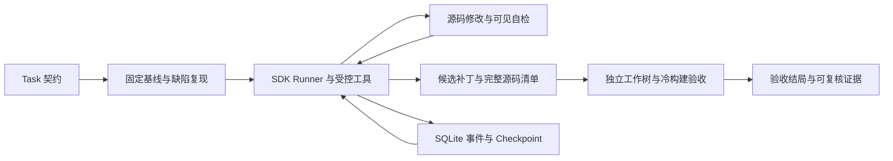
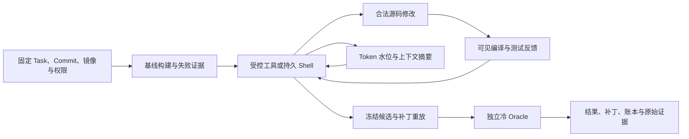

# ReproPatch 项目总览

ReproPatch 是面向 C++ 仓库的可恢复、可观测代码修复 Agent。它把任务定义、模型调用、
源码工具、隔离执行、状态恢复和独立验收组织为完整的工程流程，交付候选补丁、验收结局
和可核查的运行证据。

技术栈：Python 3.12、OpenAI Agents SDK、Git Worktree、Docker、CMake/CTest、
SQLite，以及可选的 Tree-sitter C++。
仓库：[lilong555/ReproPatch](https://github.com/lilong555/ReproPatch)。

## 业务流程

使用者提供固定源码提交、构建镜像、可编辑文件和测试契约。系统先确认原始缺陷可以复现，
再由 Agent 读取源码、定位问题、修改实现并获取编译或测试反馈。修复结束后，系统从基线
创建独立工作树、应用候选补丁、冷构建并逐项核验测试，最后输出结局与原始证据。



`run` 完成自动修复，`verify-patch` 验收外部候选，`resume` 继续同一 Run。
`inspect`、`diagnose` 和 `replay` 支持从已提交事实定位问题。

## 工程能力

| 环节 | 实现内容 | 可讲解的技术决策 |
| --- | --- | --- |
| 需求与契约 | Task v2 固定 commit、镜像、授权路径、F2P/P2P、资源与预算 | 将业务完成标准转为可执行检查，准备阶段发现无效输入 |
| 模型与工具 | 公开 SDK Runner、原生工具调用、整批准入、串行执行 | 保留 SDK 的原生历史和调用关联，宿主管理权限与副作用 |
| 上下文工程 | 大目录按需发现、输出预览、证据索引、Usage 锚点、完整轮次压缩 | 保持上下文可用性，同时保存完整原始输出供复核 |
| C++ 定位 | 定义、语法引用、包含关系、源码 SHA、分页和缓存失效 | 检索结果关联实际源码，结构索引与编译反馈共同辅助修复 |
| 执行与安全 | 非 root、断网 Docker、只读文件系统、资源限额、归属校验和清理 | 将不可信构建与工具副作用限制在登记的执行资源内 |
| 状态与恢复 | SQLite 事务、文件持久化、完整输入 Checkpoint、原期限和累计额度 | 以闭合输入边界恢复，保留已经执行的工具和原始事件前缀 |
| 结果验收 | 基线复现、受保护文件审计、补丁往返、全新构建、固定测试身份 | 用独立的可重复执行过程确定候选是否符合 Task |
| 可观测性 | 结构化事件、命令日志、Token 已知/未知状态、阶段耗时与诊断 | 区分候选失败、基础设施故障、证据损坏和恢复条件 |
| 交付 | CLI、内置演示资源、wheel/sdist、分层 CI 和验收归档 | 在安装后的环境验证完整工作流，并保留实现与镜像身份 |

详细模块与调用关系见[架构](ARCHITECTURE.md)，具体配置和测试入口见[工程指南](ENGINEERING.md)。

## 三个关键决策

### 恢复边界与副作用

模型请求、工具执行和状态提交具有不同的故障窗口。Checkpoint 在完整 SDK 下一输入、
候选补丁、源码清单和配置指纹持久化之后提交；SQLite 同事务保存事件与累计计数。
恢复继续使用原 Run、原截止时间和剩余额度，核对源码及运行依赖。
已开启但结果未知的请求、未闭合的工具片段保留明确的故障原因和已有候选。

讲解入口：[recovery.py](../src/repropatch/recovery.py)、
[故障恢复测试](../tests/test_resume.py)、[恢复演示](DEMO.md#独立暂停与恢复)。

### 自检与独立验收

Agent 自检提供下一步修复反馈，最终验收从固定基线重建候选。
源码清单检查所有受保护字节与 Git mode，补丁往返核对实际候选身份，
F2P 确认缺陷修复，P2P 检查回归。测试缺失、跳过、编译故障和资源清理异常均有明确结局。

讲解入口：[verification.py](../src/repropatch/verification.py)、
[源码完整性测试](../tests/test_source_integrity.py)、[错误候选演示](DEMO.md#三个场景)。

### 工具模式与构建复用

默认模式使用授权文件工具和固定命令，自检创建独立构建环境；Shell-only 提供持久容器，
支持跨命令保留 `/build`。每条 Shell 命令结束后核对进程与源码状态。
Run 内 ccache 支持修复自检复用，最终独立验收保持冷构建。
两种模式分别覆盖精确受控操作和灵活命令调试。

讲解入口：[tools.py](../src/repropatch/tools.py)、
[repair_sandbox.py](../src/repropatch/repair_sandbox.py)、[Shell 契约](SHELL_FIRST.md)。

## 优化方法

先用事件与命令记录划分模型等待、检索、配置、编译、自检和验收的成本，再选取对应机制。
构建成本高时比较持久目录与 ccache；上下文增长快时检查输出预览、证据查询和压缩；
定位成本高时观察结构查询的命中、解析耗时及缓存复用。

每项比较固定任务、模型配置、预算、实现和镜像，同时观察独立验收、请求与 Token、
未知用量、自检次数及分阶段耗时。实验保存首次尝试、失败和重复验证的独立身份，
为工程选择提供可复核依据。历史结果与协议见[评测索引](../benchmarks/README.md)，
后续工作见[工程路线](ROADMAP.md)。

## 演示与验收

环境准备完成后，一条命令执行成功修复、错误候选拒绝、编辑后暂停恢复：

```bash
repropatch demo --output .repropatch/demo --scenario all --json
```

三个场景分别期望 `ACCEPTED`、`REJECTED`、`ACCEPTED`。
演示模型为本地 ScriptedModel，付费模型请求为零，构建与独立验收使用真实 Docker。
恢复证据核对同一 Run、一次基线、一次编辑、事件前缀、累计计数和原截止时间。
只读查询的验收检查原 Run 全部文件的 SHA-256。

入口：[演示指南](DEMO.md)、[验收矩阵](ACCEPTANCE.md)、
[测试报告](TEST_REPORT.md)、[CI](../.github/workflows/ci.yml)。
求职展示可依次讲解一条修复 Run、一个拒绝案例和一个恢复边界，
再沿对应源码与测试说明设计取舍及优化依据。

<details>
<summary>2026 年 10 月 27 日实验报告</summary>


ReproPatch 已交付 v0.3.0、受控 C++ 修复循环、独立冷验收、持久 Shell 和统一上下文压缩。在上游故障复验后的 19 道完整五组配对 fmt 缺陷上，Full 通过 17 题，Shell-only 与 mini 各通过 18 题，Codex 通过 16 题，关闭自检组通过 15 题。

21 道既有任务的 105 个注册槽位保留全部原始身份、模型失败和三次人工中断。当前评分视图为 91 项通过、11 项候选失败、3 项上游 HTTP 524。正式累计 1,997/2,520 请求，13 次用量未知；11 次校准单列。114 份收费尝试及两份补充冷评分归档完成核验。完整逐题结果见[当前报告](../benchmarks/unified-context/completion-results.md)与[首轮报告](../benchmarks/unified-context/results.md)。

## 项目与执行链

ReproPatch 将固定源码、文件权限、模型预算、编译反馈和测试验收连接成一个修复流程。技术栈为 Python 3.12、Agents SDK、Git Worktree、Docker、CMake/CTest 和 SQLite。核心安装支持零 API 密钥的 `verify-patch`；模型运行依赖单独安装。



| 机制 | 实际作用 |
| --- | --- |
| Task v2 | 固定完整 commit、镜像、授权文件、F2P/P2P 与预算 |
| Git Worktree 与源码清单 | 隔离修复和验收，检查受保护文件及补丁重放 |
| Docker | 非 root、断网、只读根文件系统、资源限制和退场清理 |
| Full 自检 | reproduce 执行配置、编译与 F2P；verify 执行完整 F2P/P2P |
| Shell-only | 持久 Bash、Run 内构建目录复用、命令后源码审计 |
| 统一上下文 | 供应商 Usage 锚点、明文增量估算、不透明状态归因和摘要替换 |
| SQLite | 保存事件、原始用量、Checkpoint、摘要状态与停止原因 |
| 冷 Oracle | 冻结候选在独立源码与构建环境中验收 |

标准运行由 Harness 完成最终独立验收；Benchmark 的 candidate-only 导出经审计候选，由统一外部 Oracle 评分。修复调试优先使用 reproduce，预算允许继续修改时执行 verify。

## 已交付状态

| 范围 | 交付证据 |
| --- | --- |
| 正式版本 | [v0.3.0](https://github.com/lilong555/ReproPatch/releases/tag/v0.3.0)，发布源码 514 项测试 |
| Shell-first | 持久 Bash、合法补丁导出及独立冷验收；基线 CI 653 项 |
| 统一上下文 | Full、关闭自检、Shell-only、mini 适配器与固定 Codex 原生摘要 |
| 冻结实现 CI | [708 项通过](https://github.com/lilong555/ReproPatch/actions/runs/40462738957)：492 Core、176 SDK、40 Docker |
| 首轮结果 | [21 题、105 槽完整记录](../benchmarks/unified-context/results.json) |
| 补充结果 | [7 次复验与两项冷评分](../benchmarks/unified-context/completion-results.json) |
| 归档核验 | [首轮归档](evidence/context-unified-2026-10-27/verification.json)与[本轮九份归档](evidence/context-unified-2026-10-27/completion-verification.json) |
| O3 Docker 资格 | [21/21 通过](ACTIONS_RESULTS.md)，资格阶段模型请求为 0 |

O3 Docker 资格确认固定镜像与优化级别下的真实 F2P、基线 P2P、参考补丁修复，以及独立冷构建中的完整原生 Oracle。129 条 C++ 候选池和原生资格记录保留各自的证据范围。

## 五组实验

模型为 gpt-6-luna、实际 max 思考强度；每次 24 请求、48 工具、8192 输出 Token，模型总期限保持 180 秒。公共上下文窗口为 128,000 Token，压缩触发为 48,000，目标为 21,600，完整 HTTP Body 保护上限为 2 MiB。

| 实验组 | 19 题完整配对通过 | 基础设施错误 | 请求 | Worker 中位秒数 |
| --- | ---: | ---: | ---: | ---: |
| Full | 17/19 | 1 | 327 | 327.24 |
| 关闭自检 | 15/19 | 0 | 359 | 248.30 |
| Shell-only | 18/19 | 1 | 315 | 394.09 |
| mini | 18/19 | 1 | 294 | 262.40 |
| Codex | 16/19 | 0 | 421 | 278.72 |

Full 独自通过 fmt-1361、fmt-2310、fmt-3732；关闭自检组独自通过 fmt-2292，Full 在该题保留上游 HTTP 524。净差为 Full 多通过 2 题，自检累计 1,605.84 秒。Shell-only 在 fmt-3819 独自通过，Full 与 Shell-only 其余逐题评分一致。Worker 按原执行器范围计时，分阶段耗时单列。

完整配对依据人工中断状态确定，排除 fmt-1171 和 fmt-3158；其余基础设施错误留在对应题目。每题每组一次，三个冻结源码快照和两个计量故障复验分别记录。21 题已有前序模型曝光，本批用于配置复核和修复机制观察。

## 上下文与运行可靠性

原 256 KiB 配置的离线审计确认 32/105 次尝试触及传输阈值，其中 16 次已有候选通过冷 Oracle。统一策略分别度量实际 Token 和正文物理字节，先留存完整请求，再执行准入。

首轮 Shell-only、mini、Codex 的选定轨迹分别有 5、3、10 次已验证压缩，均观察到历史实质缩小和后续工具执行。Full 与关闭自检组的实际压缩次数为 0，其强制压缩链路通过固定响应与 CI 验证。

Codex 的 fmt-3727 将正文从约 370 KB 压缩到 73 KB，压缩后输入 16,118 Token，最终通过 Oracle。fmt-3158 在第 11 次请求持续返回推理状态，180 秒总期限到达时尚无完成事件，最终为空候选。该次用量保留为未知。

首轮 7 项基础设施错误对应上游 6 次 HTTP 524 和 1 次 HTTP 502，独立复验后有四项通过，剩余三项再次返回 HTTP 524。Full / fmt-3158 与 Shell-only / fmt-1171 的中断候选均通过零模型冷评分。[补充核验](evidence/context-unified-2026-10-27/completion-verification.json)保留全部请求和候选身份。

## 用量与复核

正式累计为 1,976 次修复、21 次摘要、0 次实际重试，共 1,997 请求；校准 11 次单列。13 次未知用量继续保留。已知输入 43,126,953 Token、输出 954,955 Token，缓存输入与推理输出分别作为其中的细分项。金额依据供应商账单，当前记录为未知。

[summarize_context_campaign.py](../scripts/summarize_context_campaign.py)从冻结协议、原始评分与逐请求证据重算结果。脚本核验跨批次尝试身份、收费复验规则、请求唯一性、取消状态、未知用量和上下文合同，保留失败的复验结果。

[summarize_context_completion.py](../scripts/summarize_context_completion.py)核验独立复验身份、冻结候选与累计收费账本，生成当前评分视图，首轮事实保持独立可查。

[结果与复现命令](../benchmarks/unified-context/results.md)、[源码与协议身份](../benchmarks/unified-context/results.json)、[逐题 CSV](../benchmarks/unified-context/attempts.csv)和[验证摘要](evidence/context-unified-2026-10-27/summary.json)提供独立复核入口。

## 当前工程重点

现有 Full 与 Shell-only 均保留，模型总期限维持 180 秒。工程重点为对照轨迹复核、编译反馈与自检时机分析、长期证据保存，以及已有项目适配的离线任务扩容。新的模型批次独立冻结任务、源码和额度。

历史 medium 六次对照、四臂首次实验与旧 256 KiB 五组结果分别归档于[评测索引](../benchmarks/README.md)，正式发布制品身份保存在 [RELEASE.json](../RELEASE.json)。

</details>
