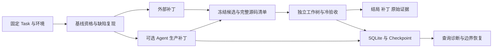
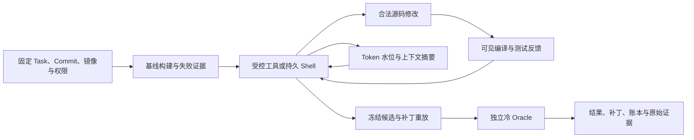

# ReproPatch｜可恢复的 C++ 修复与验证系统

ReproPatch v0.4.0 面向已准备的 CMake/CTest 工程，连接固定 Git 基线、补丁生产、隔离执行、独立验收和可恢复运行状态。核心是 C++ Repair & Verification Harness；可选内置 Agent、外部 Agent 与人工都可以提供候选补丁。交付包含补丁、验收结局和可追溯的原始证据。

核心技术栈为 Python 3.12、argparse、dataclasses、SQLite、subprocess、Git Worktree、Docker 和 CMake/CTest。公开 OpenAI Agents SDK 与 Tree-sitter C++ 作为可选依赖提供模型工具循环和语法检索。仓库：[lilong555/ReproPatch](https://github.com/lilong555/ReproPatch)。

## 工程流程

使用者提供本地仓库、完整 commit、Linux amd64 构建镜像、已有 C/C++ 文件的编辑范围，以及 F2P/P2P 测试。基线 configure/build 成功、声明的 F2P 失败签名成立、P2P 通过后，系统进入补丁生产或外部补丁验收。候选在固定基线的新工作树中应用并核对完整源码清单，再使用全新容器冷构建和逐项测试决定结局。



`verify-patch` 提供核心独立验收，`run` 接入修复 Agent，`resume` 继续同一 Run。`inspect`、`diagnose`、`replay` 和 `export-trace` 查询已提交事实，`report` 重建派生报告与索引。

当前工作流适用于单用户本地 Docker、已有 C/C++ 文本文件修改；CMake 和声明测试受保护。Task 准备负责固定构建环境、测试映射与授权范围，`ACCEPTED` 表示候选通过该声明合同。

## 工程能力

| 环节 | 实现 | 展示价值 |
| --- | --- | --- |
| 输入契约 | Task v2 固定 commit、镜像、授权文件、测试、资源和预算 | 将完成标准转成可执行合同 |
| 候选身份 | Git Worktree、SourceManifest、原始字节与 Git mode、补丁往返 | 证明验收源码对应冻结候选 |
| 独立验收 | 基线复现、CTest inventory、逐项 JUnit、全新构建目录 | 检查 F2P/P2P、测试身份与缺失、编译及回归 |
| Agent 接入 | 基于公开 SDK 集成模型循环，宿主管理整批准入、权限与计量 | 组织模型工具调用与副作用 |
| 执行生命周期 | 双流原始日志、期限、进程组、Docker 归属和清理确认 | 将命令结果与执行事实关联 |
| 修复效率 | 持久 Shell 的 `/build`、Run 内 ccache、输出预览与可选结构查询 | 按阶段定位成本并选择复用机制 |
| 状态与恢复 | SQLite 事件 reducer、附件持久化、完整输入 Checkpoint、指纹校验 | 保持 Run 身份、事件前缀、累计预算和期限 |
| 诊断与交付 | 只读查询、派生报告、内置演示资源、wheel/sdist 和分层 CI | 安装后复核完整运行链 |

模块关系见[架构](ARCHITECTURE.md)，配置与指标见[工程指南](ENGINEERING.md)，公开合同见[规格](../SPEC.md)。

## 三个深入设计

**冻结候选与独立验收。** `verify_candidate` 从已核验基线创建新工作树，`apply_candidate` 比较完整基线清单，实际应用补丁并核对源码、Git mode 和规范 diff。验收保持新的构建目录和冷构建，自检缓存服务修复反馈。入口：[verification.py](../src/repropatch/verification.py)、[workspace.py](../src/repropatch/workspace.py)。

**附件持久化与 SQLite 提交。** `save_checkpoint` 先保存下一完整 SDK 输入、补丁、源码清单和指纹，再由 `EventLog` 在一个事务中保存 Checkpoint 引用、领域事件与运行状态。恢复选择由数据库已提交引用决定，继续使用原 Run、累计计数和 deadline。入口：[recovery.py](../src/repropatch/recovery.py)、[events.py](../src/repropatch/events.py)。

**资源拥有者确认退出。** 宿主进程循环读取双流并回收进程组，`DockerSandbox.close` 依据容器 ID、名称和 Run 标签清理并复查。持久 Shell 在每条命令后冻结容器、核对空闲进程集合，再进行源码审计。入口：[process.py](../src/repropatch/process.py)、[sandbox.py](../src/repropatch/sandbox.py)、[repair_sandbox.py](../src/repropatch/repair_sandbox.py)。

每项设计的故障窗口、实现顺序、测试与追问见[面试材料](INTERVIEW.md)。

## 优化方法

事件和命令记录将成本划分为模型等待、检索、配置、编译、自检和独立验收。构建成本高时比较持久目录与 ccache；输入增长快时检查输出预览、证据索引和完整轮次压缩；检索成本高时观察结构查询命中、解析耗时和缓存失效。

比较固定任务、实现、镜像、模型配置和预算，同时记录独立验收结局、请求、已知及未知 Token、自检次数和分阶段耗时。历史实验保存各次尝试和复验的独立身份，为局部工程决策提供依据。入口：[历史评测](../benchmarks/README.md)、[发布后路线](ROADMAP.md)。

## 演示与证据

镜像和安装环境准备完成后执行：

```bash
repropatch demo --output .repropatch/demo-v0.4.0-01 \
  --image repropatch-cpp:0.1 --scenario all --json
```

三场景分别预期 `ACCEPTED`、`REJECTED / F2P_FAILED`、恢复后 `ACCEPTED`。模型身份为 `scripted`，适配器为 `agents.testing.ScriptedModel`，付费模型请求为 0，用量标记 `synthetic`；构建、测试和事务实际执行。恢复检查包含同一 Run、基线与编辑各一次、累计计数、事件前缀和原期限。

v0.4.0 的源码、分发包、同批 CI、镜像与原始运行身份见[版本证据摘要](evidence/v0.4.0/summary.json)，工程原件见 [ReproPatch-engineering-v0.4.0.zip](https://github.com/lilong555/ReproPatch/releases/download/v0.4.0/ReproPatch-engineering-v0.4.0.zip)。四分钟操作见[演示指南](DEMO.md)，行为要求见[验收矩阵](ACCEPTANCE.md)。

### 2026-11-02 工程候选快照

[CI 41395271852](https://github.com/lilong555/ReproPatch/actions/runs/41395271852)测试源码为 `465a14ca5ffaecc6799039588a4fd0b173eb8eb6`，记录 1120 项通过、4 项外部归档回放跳过，安装版工程门禁通过 16 条 CLI 命令。三场景在已准备镜像上合计 28.04 秒；依赖安装与镜像构建单独计时。该组数据保留候选身份，原始摘要见[2026-11-02 工程证据](evidence/engineering-2026-11-02/summary.json)。v0.4.0 的结果与包身份以版本证据摘要为准。

## 简历表达

**ReproPatch｜可恢复的 C++ 修复与验证系统｜个人独立开发**

面向 CMake/CTest 工程开发 Python 修复与验证系统，连接固定 Git 基线、隔离执行、可选 Agent 工具调用与外部补丁验收，交付可追溯的补丁、运行状态和原始证据。

- 基于 Git Worktree 和源码清单冻结候选，校验字节、Git mode 与补丁应用往返；在全新 Docker 环境冷构建，通过 CTest inventory 与逐项 JUnit 检查 F2P/P2P、测试身份、缺失和回归。
- 设计 SQLite 事件、运行状态和 Checkpoint 提交协议，在完整模型输入边界持久化源码及原生输入附件；恢复重建工作树、校验任务与实现身份，沿用累计预算和原始期限。
- 实现双流原始日志、超时与资源限额、容器归属和清理确认；持久修复容器支持授权文件同步及构建状态复用，独立验收使用冷环境。
- 基于公开 Agents SDK 集成可选修复循环，提供独立 `verify-patch`、诊断、只读轨迹和零密钥三场景演示，以分层 CI 与安装后 wheel 门禁检查完整运行链。

<details>
<summary>2026 年 10 月 27 日实验报告</summary>


ReproPatch 已交付 v0.3.0、受控 C++ 修复循环、独立冷验收、持久 Shell 和统一上下文压缩。在上游故障复验后的 19 道完整五组配对 fmt 缺陷上，Full 通过 17 题，Shell-only 与 mini 各通过 18 题，Codex 通过 16 题，关闭自检组通过 15 题。

21 道既有任务的 105 个注册槽位保留全部原始身份、模型失败和三次人工中断。当前评分视图为 91 项通过、11 项候选失败、3 项上游 HTTP 524。正式累计 1,997/2,520 请求，13 次用量未知；11 次校准单列。114 份收费尝试及两份补充冷评分归档完成核验。完整逐题结果见[当前报告](../benchmarks/unified-context/completion-results.md)与[首轮报告](../benchmarks/unified-context/results.md)。

## 项目与执行链

ReproPatch 将固定源码、文件权限、模型预算、编译反馈和测试验收连接成一个修复流程。技术栈为 Python 3.12、Agents SDK、Git Worktree、Docker、CMake/CTest 和 SQLite。核心安装支持零 API 密钥的 `verify-patch`；模型运行依赖单独安装。



| 机制 | 实际作用 |
| --- | --- |
| Task v2 | 固定完整 commit、镜像、授权文件、F2P/P2P 与预算 |
| Git Worktree 与源码清单 | 隔离修复和验收，检查受保护文件及补丁重放 |
| Docker | 非 root、断网、只读根文件系统、资源限制和退场清理 |
| Full 自检 | reproduce 执行配置、编译与 F2P；verify 执行完整 F2P/P2P |
| Shell-only | 持久 Bash、Run 内构建目录复用、命令后源码审计 |
| 统一上下文 | 供应商 Usage 锚点、明文增量估算、不透明状态归因和摘要替换 |
| SQLite | 保存事件、原始用量、Checkpoint、摘要状态与停止原因 |
| 冷 Oracle | 冻结候选在独立源码与构建环境中验收 |

标准运行由 Harness 完成最终独立验收；Benchmark 的 candidate-only 导出经审计候选，由统一外部 Oracle 评分。修复调试优先使用 reproduce，预算允许继续修改时执行 verify。

## 已交付状态

| 范围 | 交付证据 |
| --- | --- |
| 正式版本 | [v0.3.0](https://github.com/lilong555/ReproPatch/releases/tag/v0.3.0)，发布源码 514 项测试 |
| Shell-first | 持久 Bash、合法补丁导出及独立冷验收；基线 CI 653 项 |
| 统一上下文 | Full、关闭自检、Shell-only、mini 适配器与固定 Codex 原生摘要 |
| 冻结实现 CI | [708 项通过](https://github.com/lilong555/ReproPatch/actions/runs/40462738957)：492 Core、176 SDK、40 Docker |
| 首轮结果 | [21 题、105 槽完整记录](../benchmarks/unified-context/results.json) |
| 补充结果 | [7 次复验与两项冷评分](../benchmarks/unified-context/completion-results.json) |
| 归档核验 | [首轮归档](evidence/context-unified-2026-10-27/verification.json)与[本轮九份归档](evidence/context-unified-2026-10-27/completion-verification.json) |
| O3 Docker 资格 | [21/21 通过](ACTIONS_RESULTS.md)，资格阶段模型请求为 0 |

O3 Docker 资格确认固定镜像与优化级别下的真实 F2P、基线 P2P、参考补丁修复，以及独立冷构建中的完整原生 Oracle。129 条 C++ 候选池和原生资格记录保留各自的证据范围。

## 五组实验

模型为 gpt-6-luna、实际 max 思考强度；每次 24 请求、48 工具、8192 输出 Token，模型总期限保持 180 秒。公共上下文窗口为 128,000 Token，压缩触发为 48,000，目标为 21,600，完整 HTTP Body 保护上限为 2 MiB。

| 实验组 | 19 题完整配对通过 | 基础设施错误 | 请求 | Worker 中位秒数 |
| --- | ---: | ---: | ---: | ---: |
| Full | 17/19 | 1 | 327 | 327.24 |
| 关闭自检 | 15/19 | 0 | 359 | 248.30 |
| Shell-only | 18/19 | 1 | 315 | 394.09 |
| mini | 18/19 | 1 | 294 | 262.40 |
| Codex | 16/19 | 0 | 421 | 278.72 |

Full 独自通过 fmt-1361、fmt-2310、fmt-3732；关闭自检组独自通过 fmt-2292，Full 在该题保留上游 HTTP 524。净差为 Full 多通过 2 题，自检累计 1,605.84 秒。Shell-only 在 fmt-3819 独自通过，Full 与 Shell-only 其余逐题评分一致。Worker 按原执行器范围计时，分阶段耗时单列。

完整配对依据人工中断状态确定，排除 fmt-1171 和 fmt-3158；其余基础设施错误留在对应题目。每题每组一次，三个冻结源码快照和两个计量故障复验分别记录。21 题已有前序模型曝光，本批用于配置复核和修复机制观察。

## 上下文与运行可靠性

原 256 KiB 配置的离线审计确认 32/105 次尝试触及传输阈值，其中 16 次已有候选通过冷 Oracle。统一策略分别度量实际 Token 和正文物理字节，先留存完整请求，再执行准入。

首轮 Shell-only、mini、Codex 的选定轨迹分别有 5、3、10 次已验证压缩，均观察到历史实质缩小和后续工具执行。Full 与关闭自检组的实际压缩次数为 0，其强制压缩链路通过固定响应与 CI 验证。

Codex 的 fmt-3727 将正文从约 370 KB 压缩到 73 KB，压缩后输入 16,118 Token，最终通过 Oracle。fmt-3158 在第 11 次请求持续返回推理状态，180 秒总期限到达时尚无完成事件，最终为空候选。该次用量保留为未知。

首轮 7 项基础设施错误对应上游 6 次 HTTP 524 和 1 次 HTTP 502，独立复验后有四项通过，剩余三项再次返回 HTTP 524。Full / fmt-3158 与 Shell-only / fmt-1171 的中断候选均通过零模型冷评分。[补充核验](evidence/context-unified-2026-10-27/completion-verification.json)保留全部请求和候选身份。

## 用量与复核

正式累计为 1,976 次修复、21 次摘要、0 次实际重试，共 1,997 请求；校准 11 次单列。13 次未知用量继续保留。已知输入 43,126,953 Token、输出 954,955 Token，缓存输入与推理输出分别作为其中的细分项。金额依据供应商账单，当前记录为未知。

[summarize_context_campaign.py](../scripts/summarize_context_campaign.py)从冻结协议、原始评分与逐请求证据重算结果。脚本核验跨批次尝试身份、收费复验规则、请求唯一性、取消状态、未知用量和上下文合同，保留失败的复验结果。

[summarize_context_completion.py](../scripts/summarize_context_completion.py)核验独立复验身份、冻结候选与累计收费账本，生成当前评分视图，首轮事实保持独立可查。

[结果与复现命令](../benchmarks/unified-context/results.md)、[源码与协议身份](../benchmarks/unified-context/results.json)、[逐题 CSV](../benchmarks/unified-context/attempts.csv)和[验证摘要](evidence/context-unified-2026-10-27/summary.json)提供独立复核入口。

## 当前工程重点

现有 Full 与 Shell-only 均保留，模型总期限维持 180 秒。工程重点为对照轨迹复核、编译反馈与自检时机分析、长期证据保存，以及已有项目适配的离线任务扩容。新的模型批次独立冻结任务、源码和额度。

历史 medium 六次对照、四臂首次实验与旧 256 KiB 五组结果分别归档于[评测索引](../benchmarks/README.md)，正式发布制品身份保存在 [RELEASE.json](../RELEASE.json)。

</details>
