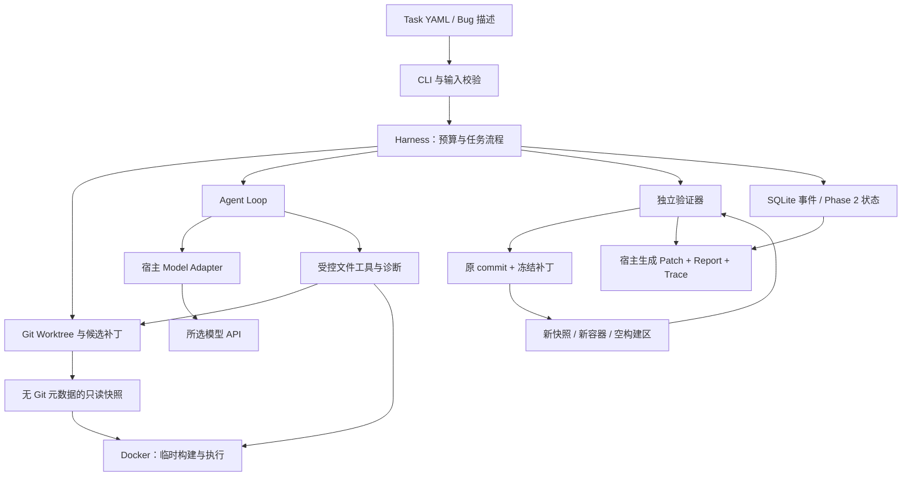
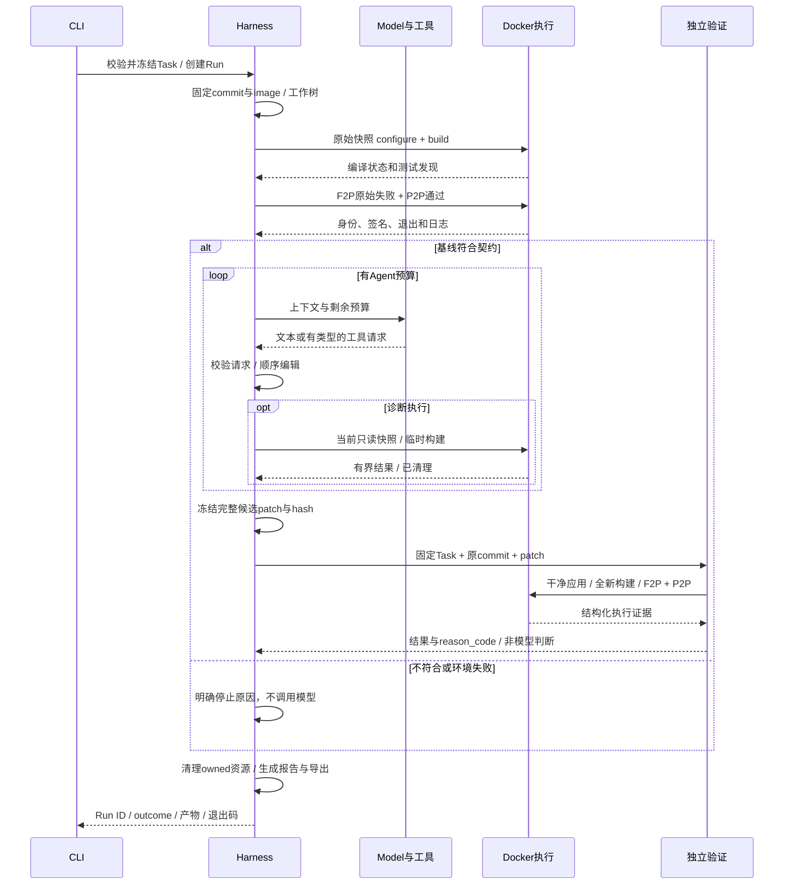

# 架构、数据流与模块边界

状态：目标 Phase 1–3 的设计；既有实现差异见[CURRENT_STATE](CURRENT_STATE.md)。本文负责模块和依赖，数据枚举不在此重复定义。

## 1. 总体架构

箭头表示调用／数据流；容器与 API 是不同的信任域。图中的 Agent Loop 是模型交互过程，不是独立服务。单 Python CLI 进程串行控制；每次真实模型请求使用一个受控宿主子进程满足总deadline，仍无并行任务。各次执行容器只运行仓库构建／测试／诊断。

## 2. 保留的目录与依赖方向

以下是**将规格合入既有仓库后的目标结构**；本轮交付的是文档目录，没有重建这些源码文件。

| 模块 | 职责／关键输入输出 | 可以依赖 | 阶段 |
|---|---|---|---|
| `cli.py` | argparse、选择模型、启动／查询 Run、退出码 | task、harness、models；后续 recovery/evaluation | P1，后续扩展 |
| `task.py` | YAML → TaskSpec → ResolvedTask；一次边界校验 | stdlib、PyYAML | P1 |
| `harness.py` | PREPARING→基线→repair loop→验收；唯一预算所有者 | task、models、tools、workspace、verification、events | P1 |
| `models.py` | Model Protocol、Mock、官方 SDK 映射及单请求worker | stdlib、openai、process；不能导入 workspace/sandbox | P1 |
| `tools.py` | 固定工具 schema、路径和参数入口、结果序列化 | task、workspace、sandbox、verification | P1 |
| `workspace.py` | detached Worktree、只读快照、byte manifest、patch／清理 | Git CLI、stdlib | P1 |
| `process.py` | 子进程启动、流式有界输出、deadline、CommandResult | stdlib | P1 |
| `sandbox.py` | 固定 Docker 参数、评估会话、整容器清理 | process、task | P1 |
| `verification.py` | baseline/agent_check/independent 公用测试执行与身份核对；独立 verdict | task、workspace、sandbox、process | P1，从 harness 提取真实逻辑 |
| `events.py` | 审计 append、读取、JSONL export | sqlite3、json | P1 |
| `errors.py` | 少量边界错误类型与可展示 code | stdlib | 已有，收敛 |
| `state.py` | Run 状态转移及同事务事件／操作记录 | events、sqlite3 | P2 才创建 |
| `recovery.py` | 所有权核对、checkpoint、恢复、trace replay | state、workspace、sandbox、harness | P2 才创建 |
| `evaluation.py` | 固定 suite、多次独立 Run、指标聚合、execution replay 协调 | harness、report 数据 | P3 才创建 |

`verification.py` 不调用模型；`models.py` 不执行工具；`workspace.py` 不判断测试成功；`sandbox.py` 不解析任务业务结局；`events.py` 不调度任务。底层模块不能反向 import cli/harness。`tools.py` 可复用验证模块的 `evaluate_checks`，但只能拿到 `agent_check` 观察，不能调用最终 `accept_candidate`。

重复的 configure/build/CTest 执行应复用一个普通函数，不为 baseline、self-check、final 各造一套执行引擎。无需为单一 Docker 实现设计多级 ExecutorFactory；开发用可信本地 fixture executor 留在 tests 中，生产 CLI 不暴露 host backend。

## 3. 核心数据与所有权

| 数据 | 唯一写入者 | 保存位置／寿命 | 权威定义 |
|---|---|---|---|
| TaskSpec、ResolvedTask | task.py | 运行前冻结；task.resolved.json | TASK_FORMAT |
| RunContext／BudgetState | harness.py | P1 内存；P2 同步事务 checkpoint | AGENT_RUNTIME／STATE |
| Message、Turn、ToolCall | models.py／harness.py | 可见对话；P2 完整组 checkpoint | AGENT_RUNTIME |
| CommandResult | process/sandbox | 每条命令事件＋日志；不可写成最终结论 | AGENT_RUNTIME |
| SourceManifest、source_tree_sha256 | workspace.py | 全树文件 bytes／mode 清单；各源码快照 | EXECUTION_AND_SECURITY §4.2 |
| CandidatePatch | workspace.py | patch.diff＋完整 byte manifest | VERIFICATION |
| TestObservation、VerificationResult | verification.py | 基线及候选 evidence refs | VERIFICATION |
| Event、Operation、Checkpoint | events/state/recovery | 每 Run SQLite／受控产物 | STATE_AND_RECOVERY |
| report.json／report.md | 宿主 Harness | 最终产物；JSON 是结构化报告 | CLI／VERIFICATION |

`RunContext` 是显式传参的数据对象，至少包含 run_id、ResolvedTask、路径、开始时间／deadline、已消费预算和事件连接。不得通过全局变量保存“当前 Run”。`CandidatePatch` 的准确字段见 VERIFICATION §6.1，包含 base commit、patch 与 manifest 的 EvidenceRef、完整候选 source_tree_sha256 和变更文件列表；逻辑源码树摘要与 manifest 文件的 bytes 哈希分开。它不包含模型口头保证。

`EvidenceRef` 是 JSON object，三个字段必需：`path: str` 为相对本 Run 产物根的规范 POSIX 路径，禁止绝对路径、`.`／`..` 段和链接越界；`sha256: str` 是文件实际原始 bytes 的 64 位小写十六进制 SHA-256；`size_bytes: int` 是非负实际文件长度（bool 不算 int）。读者先校验存在、大小与 hash；不接受指向任意宿主路径的引用。允许缺失证据的位置整体写 null，不用空 path／全零哈希伪装证据。P1 不需要内容寻址存储服务，一个独占目录就足够。

## 4. 完整执行时序

中间步骤出错不意味着都走同一个 `failed`：基线没复现、补丁错误、无法判断和基础设施错误的精确映射由验证文档规定。状态流转图位于[STATE_AND_RECOVERY](STATE_AND_RECOVERY.md)，避免在此复制一套会漂移的枚举。

## 5. 信任和副作用

宿主信任操作者提供的 Task、审核后的 Git 元数据、镜像和验收标准；不信任仓库文字、模型请求和执行输出。模型能在限定文件内提出修改，不能修改 Task／验收器／事件／最终报告。其 Shell 只能触及容器的只读源码及临时空间。

| 操作 | 副作用与是否能简单重试 |
|---|---|
| 读取／搜索只读源码 | 可重试，可能得到同一冻结版本；记录新观察 |
| 模型 API 请求 | 可能收费和外部留存数据；timeout 不证明未执行；不得自动盲重试 |
| 精确编辑 | 修改受控文件；未知结果需核对 before/after hash，不能再次盲替换 |
| 创建／删除容器、Worktree | 改外部资源；先按所有权记录核对，再决定继续／清理 |
| 容器内 shell | 可在其临时空间产生任意副作用；确认停止并丢弃空间后才可重新执行 |
| 验证 | 消耗预算并可能超时；每次新的独立尝试必须有新执行身份，不复用旧结果 |
| 发布／push／发消息 | 不属于自动工作流；需用户另行授权 |

SQLite 事务不包住 Docker、文件系统和模型 API。可核对操作记录在 P2 才升级，不能靠一个数据库 commit 承诺外部 Exactly Once。

## 6. 持久化与无状态部分

模型适配器不保存任务进度；工具路由不保存隐藏工作目录；测试结果解析是纯数据转换。预算、当前阶段、资源 ID、对话和 patch 引用由 Harness／Store 显式管理。容器不承担恢复状态，不保存长驻 Shell，不在恢复时复用旧构建目录。

Phase 1 的 report 是正常结束时的结构化总结，SQLite 审计用于诊断。Phase 2 才把状态、事件、intent/result 同事务提交，并通过 checkpoint 恢复。JSONL、Markdown report 都是可从权威记录生成的导出，不参与双写成功判断。

## 7. 性能与扩展判断

首版每次诊断可重新构建，最终验收必定重新构建；接受这项成本来换取清楚的依赖边界。Phase 3 报告中分离模型延迟、镜像／工作区准备、configure/build/test 时间，再决定缓存、并行或 C++ 执行器是否必要。不得为了预测中的大仓库性能提前设计缓存失效协议、远程执行服务和通用插件系统。
