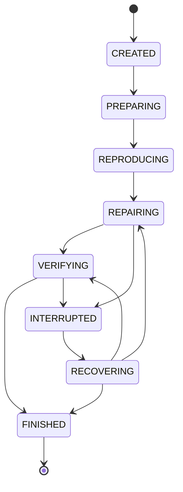

# 状态、事件与恢复

> 状态：目标规格，尚未整体实现。Phase 1 保留已有 SQLite 审计能力，消除 SQLite/JSONL 双写；Phase 2 才引入事务性运行状态、Checkpoint、Resume 与 Trace Replay；Execution Replay 属于 Phase 3。已有实现的准确边界见 [CURRENT_STATE.md](CURRENT_STATE.md)。

本文件是 `RunState`、`Outcome`、标识符、事件信封和恢复协议的权威定义。模型消息与工具结果见 [AGENT_RUNTIME.md](AGENT_RUNTIME.md)，验收判定见 [VERIFICATION.md](VERIFICATION.md)，资源所有权与清理见 [EXECUTION_AND_SECURITY.md](EXECUTION_AND_SECURITY.md)，CLI 行为见 [CLI.md](CLI.md)。

## 1. 保证范围与阶段边界

ReproPatch 是单机、单用户、单运行控制器。每个 Run 使用自己的数据库和产物目录。SQLite 事务可以原子提交该数据库内的状态、事件及预算计数；不能原子提交文件替换、Docker 执行、模型服务调用与 SQLite。恢复必须面对“操作可能已发生，但结果没有持久化”的情况，不承诺 Exactly Once。

| 能力 | Phase 1：目标 MVP | Phase 2：执行可靠性 |
|---|---|---|
| 运行状态 | 内存中按本文件状态推进，完成时原子替换 `report.json` | `runs` 表是状态与结局的权威 |
| 事件 | SQLite `events` 表是唯一权威；JSONL 是导出 | 状态变更、事件和操作记录在同一事务中提交 |
| 文件落盘 | 关键报告及补丁先临时写入，再原子替换 | 再增加不可变文件哈希引用、Checkpoint 提交协议 |
| 中断 | 尽力清理；正常 Ctrl-C 留下 `CANCELLED`；SIGKILL 可能只有部分事件 | 在下一次 `resume` 中核对资源、恢复已提交边界 |
| 重启继续 | 不支持；新建 Run 重做 | 同一 Run 可恢复，不重置预算 |
| Replay | 不提供执行重放命令 | 只实现只读 Trace Replay；有副作用的 Execution Replay 在 Phase 3 实现 |

Phase 1 的 `inspect` 遇到无最终报告、事件尾部不完整的运行，只显示“未完成的运行记录”及最后一次已知阶段，不能推断补丁已通过，也不能声称已具备恢复能力。不得因未来需要恢复而在 Phase 1 预先实现 `operations/checkpoints` 全套结构。

## 2. 运行状态与结局

### 2.1 `RunState`

| 名称 | 含义 | 引入阶段 |
|---|---|---|
| `CREATED` | Run ID 与私有产物目录已分配，尚未执行仓库代码 | Phase 1 |
| `PREPARING` | 校验外部输入、锁定 commit/image，建立工作区和冻结任务 | Phase 1 |
| `REPRODUCING` | 验证原始 F2P 故障及 P2P 基线 | Phase 1 |
| `REPAIRING` | 模型调用及有预算的工具执行 | Phase 1 |
| `VERIFYING` | 冻结候选补丁，在干净环境独立验收 | Phase 1 |
| `INTERRUPTED` | 前任控制器已不持有运行锁，运行未终结，等待恢复核对 | Phase 2 |
| `RECOVERING` | 核对持久化文件、未知操作和资源，并重建安全边界 | Phase 2 |
| `FINISHED` | 运行已终结，有且只有一个 `Outcome` | Phase 1 |

### 2.2 `Outcome`

`Outcome` 仅能存在于 `FINISHED`。其他状态的 `outcome` 必须为 `null`。阶段描述执行位置，结局描述最终结果，二者不能合并成同一个字符串字段。

| 名称 | 含义 |
|---|---|
| `ACCEPTED` | 独立验收全部通过，证据完整，必要清理已确认 |
| `REJECTED` | 有充分证据拒绝候选，例如正常构建失败、测试回归、禁止变更或无补丁 |
| `NOT_REPRODUCED` | 原始版本没有出现声明的目标故障 |
| `INCONCLUSIVE` | 证据不足以判断修复成败，例如验收超时、OOM 或证据损坏 |
| `BUDGET_EXHAUSTED` | Agent 预算耗尽且没有可交给独立验收的候选，具体规则见 Runtime |
| `ERROR` | 准备、模型协议、控制面或基础设施错误，任务无法正常继续 |
| `CANCELLED` | 操作者主动取消，清理及已获得的证据仍保留 |
| `RECOVERY_FAILED` | Phase 2 恢复不能确认安全或一致状态，停止同 Run 继续执行 |

一个 Outcome 配一个主要 `reason_code`，例如 `MODEL_RESULT_UNKNOWN`，并可带相关诊断。原因码统一大写下划线形式。补丁是否成功以 [VERIFICATION.md](VERIFICATION.md) 的判定表为准；此处不再复制验收细则。模型无工具的结束文本只构成 `AgentStopReason.MODEL_FINISHED`，本身不能设置 `ACCEPTED`。

### 2.3 合法转移

| 当前状态 | 允许的下一状态 | 约束 |
|---|---|---|
| `CREATED` | `PREPARING`、`FINISHED` | Run 建立后的资源登记等准备错误可直接结束；静态 YAML 错误不创建 Run |
| `PREPARING` | `REPRODUCING`、`FINISHED` | 冻结输入已提交且必需字段非空，才允许执行基线 |
| `REPRODUCING` | `REPAIRING`、`FINISHED` | 目标故障及 P2P 基线符合契约才进入修复 |
| `REPAIRING` | `VERIFYING`、`FINISHED` | 候选被冻结且尚有验收预算才进入验证 |
| `VERIFYING` | `FINISHED` | 首版只有一次独立验收，不返回模型继续优化 |
| 任一非终态执行阶段 | `INTERRUPTED` | 仅 Phase 2；须先取得运行锁并确认前任控制器不再持锁 |
| `INTERRUPTED` | `RECOVERING`、`FINISHED` | 先核对，再恢复或结束 |
| `RECOVERING` | `REPAIRING`、`VERIFYING`、`FINISHED` | 只恢复受支持的已提交边界 |
| `FINISHED` | 无 | 终态不可重开；重新尝试必须创建新 Run |



图中显示主要路径。准备、复现和修复阶段也可按上表直接以错误、未复现、取消或预算结局结束；Phase 2 中它们也可能被识别为中断，但在首个 Checkpoint 之前不支持继续恢复。

Phase 1 正常收到 Ctrl-C 是主动取消，以 `FINISHED/CANCELLED` 收尾。Phase 2 的 `INTERRUPTED` 用于控制器突然消失后的核对过程，不把已经取消的任务自动恢复。

## 3. 标识符与权威证据

| 字段 | 精确定义 |
|---|---|
| `task_id` | Task YAML 的 `id`，标识任务，不标识一次执行 |
| `run_id` | `uuid.uuid4().hex`，32 位小写十六进制；重新运行生成新值 |
| `step_id` | 从 1 开始的模型调用尝试序号；失败、超时和结果未知的调用也占一个 Step |
| `tool_call_id` | Harness 在模型回复内按顺序生成，如 `s000001.t01`；每次回复至多 8 个 |
| `provider_call_id` | 供应商回复的工具 ID，只用于对应消息协议，不作为持久化主键 |
| `operation_id` | 每次实际操作尝试分配的 32 位 UUID；重做操作必须使用新值 |
| `attempt` | 同一逻辑工具调用的执行尝试，从 1 开始；恢复重做递增 |
| `seq` | 每个 Run 内从 1 开始、严格递增的已提交事件序号 |
| `checkpoint_id` | 每 Run 内从 1 开始的已提交 Checkpoint 序号 |

工具参数在校验时被拒绝也算一次工具尝试。恢复复用已持久化的模型回复，不新增模型 Step；重新执行该回复中的工具则增加相应工具尝试和预算计数。`max_steps` 仅阻止新的模型请求，不阻止最后一次已返回回复中的工具；已有工具组只受工具次数与 Agent 时间限制。`provider_call_id` 不保证跨回复唯一。

权威关系如下：

1. 冻结的 Task、完整 commit、镜像 ID/digest、允许文件集合、补丁和相关文件哈希确定输入。
2. Phase 1 的事件历史以 SQLite 为准，最终报告是完成时生成的产物。
3. Phase 2 的 Run 状态、预算和 Checkpoint 指针以 SQLite 为准；`report.json` 可从数据库及引用产物重新生成。
4. JSONL、Markdown、终端输出均为展示或导出，不能反过来推进运行状态。
5. 模型回复、stdout、JUnit 等是观测值；接受决定还必须满足独立验证契约，不能由其中一份文本自称成功替代。

## 4. 事件契约与 JSONL

### 4.1 事件信封

Phase 1 即采用下列目标格式；旧 `kind` 审计字段仅属于历史格式，不和新 `type` 字段混用。

```json
{
  "schema_version": 1,
  "seq": 17,
  "run_id": "0123456789abcdef0123456789abcdef",
  "timestamp": "2026-10-19T05:00:00.123456+00:00",
  "type": "tool_finished",
  "step_id": 2,
  "tool_call_id": "s000002.t01",
  "operation_id": "fedcba9876543210fedcba9876543210",
  "payload": {
    "attempt": 1,
    "name": "edit_file",
    "result_ref": {
      "path": "operations/fedcba9876543210fedcba9876543210.result.json",
      "sha256": "<该文件实际的 SHA-256>",
      "size_bytes": 256
    }
  }
}
```

上例 ID、字节数仅演示格式，哈希占位不得作为真实运行产物。`result_ref` 及本文件其他产物引用统一使用 [ARCHITECTURE.md](ARCHITECTURE.md) 定义的 `EvidenceRef`，不把路径与哈希拆成另一套事件格式。`step_id/tool_call_id/operation_id` 不适用时为 `null`；时间戳统一 UTC RFC 3339，耗时使用单调时钟测量。UTC 时间用于关联与恢复期限，不用事件时间戳代替 `seq` 排序。

核心事件类型保持一个固定列表，不建立事件插件注册系统：

| 类型 | 关键 payload |
|---|---|
| `run_created` | task ID、版本、运行目录 |
| `state_changed` | `from`、`to`；终结时含 outcome/reason_code |
| `inputs_frozen` | Task/commit/image/允许文件集合的引用及哈希 |
| `model_started` | 模型名、Step、请求文件引用/哈希、预算计数；不含密钥 |
| `model_finished` | 完整回复引用、usage 或缺失标记、供应商请求 ID（若有）、下一动作 |
| `tool_started` | 工具名、参数、attempt、操作前置条件 |
| `tool_finished` | 结果/错误引用、attempt、耗时 |
| `command_started` | argv、阶段、父工具 operation、预记录容器身份 |
| `command_finished` | CommandResult 引用、阶段、测试名（若有） |
| `turn_completed` | 完整组记录引用、全树 post manifest、停止原因、下一动作 |
| `verification_finished` | 验收结论、证据引用、主要原因 |
| `checkpoint_committed` | Checkpoint ID、文件引用、哈希、所属边界 |
| `recovery_started` | 恢复次数、最后 Checkpoint、待核对操作 |
| `operation_reconciled` | 原操作状态、核对证据、处理结果 |
| `attempt_superseded` | 被替代的操作 ID、新尝试/恢复编号、原因 |
| `recovery_finished` | 恢复后的状态或失败原因 |
| `cleanup_finished` | 被清理的自有资源、结果及残留信息 |

Phase 1 不发事务性 `turn_completed`、Checkpoint/恢复事件；完整组持久化在 Phase 2 才实现。相同命令结果可由事件引用，避免数据库、模型上下文与报告复制数份大日志。敏感凭据永不进入事件 payload；源码及模型对话是敏感产物，按本机私有权限保管。

### 4.2 导出行为

写事件只提交 SQLite。需要 JSONL 时，读取已提交事件按 `seq` 排序，生成完整临时文件，再替换 `events.jsonl`。一次导出的截止字段统一名为 `exported_through_seq`，与导出时间一起写入 `run.json` 的 `export_metadata`，明确是哪个已提交前缀；JSONL 每行仍只是一条 Event，不增加伪事件头。`run.json` 是可重建的派生索引，不是新的状态权威；导出文件与该索引之间不承诺跨文件原子更新，元数据过时可以重新导出修复。Phase 1 在结束路径和报告生成时导出；Phase 2 增加显式 `export-trace`。

不得重新引入“每条事件同时写 SQLite 和 JSONL，再依赖两者一致”的协议。导出失败不回滚已提交运行事实；输出明确 `ARTIFACT_EXPORT_FAILED`，可重试导出。JSONL 尾部损坏时从数据库重建，不尝试让 JSONL 修补 SQLite。终结事件已提交而报告导出失败时，终态仍有效，CLI 退出 3；可写时生成 trace=null 的报告，inspect 明确报告不完整。详见 [VERIFICATION.md](VERIFICATION.md) §9.3，不因产物缺失重跑任务。

## 5. SQLite 数据模型

### 5.1 Phase 1 的最小数据库

仍使用每个 Run 的 `events.sqlite3`，但以新信封保存事件。表结构只需：

```sql
PRAGMA user_version = 1;
CREATE TABLE events (
    seq INTEGER PRIMARY KEY,
    timestamp TEXT NOT NULL,
    type TEXT NOT NULL,
    envelope_json TEXT NOT NULL
);
```

单个 `EventLog` 持有连接，提交失败立即作为持久化错误传播到 Run 边界。不要捕获错误后假装记账成功。`seq` 在事务内确定，只对已提交事件保证递增；不追求跨 Run 的全局序号。

### 5.2 Phase 2 的目标结构

Phase 2 新 Run 使用下列结构。一个库只保存一个 Run，无需 `tasks` 表或跨运行 Repository 层。数据库所在文件系统必须是受支持的本地文件系统；不将 SQLite 文件放在远程共享盘上并声称拥有相同恢复保证。

```sql
PRAGMA foreign_keys = ON;
PRAGMA journal_mode = DELETE;
PRAGMA synchronous = FULL;
PRAGMA user_version = 2;

CREATE TABLE runs (
    run_id TEXT PRIMARY KEY,
    state TEXT NOT NULL,
    outcome TEXT,
    reason_code TEXT,
    agent_stop_reason TEXT,
    next_action TEXT,
    created_at TEXT NOT NULL,
    deadline_at TEXT NOT NULL,
    task_sha256 TEXT,
    base_commit TEXT,
    image_id TEXT,
    inputs_json TEXT,
    budget_json TEXT NOT NULL,
    last_checkpoint_id INTEGER,
    recovery_attempt INTEGER NOT NULL DEFAULT 0,
    updated_at TEXT NOT NULL,
    CHECK ((state = 'FINISHED' AND outcome IS NOT NULL)
        OR (state <> 'FINISHED' AND outcome IS NULL)),
    CHECK (state NOT IN ('REPRODUCING', 'REPAIRING', 'VERIFYING')
        OR (task_sha256 IS NOT NULL AND base_commit IS NOT NULL
            AND image_id IS NOT NULL AND inputs_json IS NOT NULL))
);

CREATE TABLE events (
    seq INTEGER PRIMARY KEY,
    timestamp TEXT NOT NULL,
    type TEXT NOT NULL,
    envelope_json TEXT NOT NULL
);

CREATE TABLE operations (
    operation_id TEXT PRIMARY KEY,
    kind TEXT NOT NULL,
    step_id INTEGER,
    tool_call_id TEXT,
    attempt INTEGER NOT NULL,
    status TEXT NOT NULL,
    request_json TEXT NOT NULL,
    result_json TEXT,
    resource_json TEXT,
    started_seq INTEGER,
    finished_seq INTEGER,
    superseded_by TEXT REFERENCES operations(operation_id),
    FOREIGN KEY (started_seq) REFERENCES events(seq),
    FOREIGN KEY (finished_seq) REFERENCES events(seq)
);

CREATE TABLE checkpoints (
    checkpoint_id INTEGER PRIMARY KEY,
    event_seq INTEGER NOT NULL REFERENCES events(seq),
    boundary TEXT NOT NULL,
    resume_state TEXT NOT NULL,
    step_id INTEGER NOT NULL,
    manifest_path TEXT NOT NULL,
    manifest_sha256 TEXT NOT NULL,
    manifest_size_bytes INTEGER NOT NULL,
    created_at TEXT NOT NULL
);
```

选用默认回滚日志模式满足每 Run 单写者；没有证据表明需要 WAL。若未来因真实读取并发压力切换 WAL，需一并验证备份及 `-wal/-shm` 处理，不能只修改一个 PRAGMA。

`CREATED/PREPARING` 时尚未获得的 `task_sha256/base_commit/image_id/inputs_json` 为 `null`，不能用空字符串或原 YAML hash 假装已冻结。动态准备成功后，一个事务写入全部解析值、`inputs_frozen` 事件并进入 `REPRODUCING`；进入复现、修复、验证阶段前，状态入口同时检查字段存在及哈希引用有效。准备失败仍能保留原始输入引用和 `FINISHED/ERROR`，无需伪造冻结结果。

`inputs_json` 是冻结输入文件引用与版本；`budget_json` 的必要累计字段为 `steps_used`、`tool_calls_used`，并可附可空的 token usage 汇总。具体预算上限来自冻结 Task，不接受恢复时扩大。`deadline_at = created_at + budget.wall_seconds`。

`agent_stop_reason` 使用 Runtime 定义的枚举。`next_action` 只表示当前已提交控制决定，准备/复现期可为 `null`，不是可扩展工作流语言：

| `next_action` | 执行条件与含义 |
|---|---|
| `CALL_MODEL` | 完整组已完成且未决定停止；重新检查模型预算后才能发新请求 |
| `EXECUTE_SAVED_GROUP` | 已保存带工具请求的回复；不得再次向模型请求同一轮 |
| `FREEZE_CANDIDATE` | Agent 已停止，冻结当前有效源码差异并按 Runtime 决定验收或结束 |
| `RUN_VERIFICATION` | 候选冻结 Checkpoint 已提交，只运行独立验收 |
| `FINISH` | 已有错误/取消等停止决定，只完成清理、诊断和终态提交 |

保存一个真实模型回复的事务必须同时保存其可见内容、`model_finished`、`next_action` 及当时已确定的停止原因。无工具的最终回复写 `MODEL_FINISHED/FREEZE_CANDIDATE`；有工具的正常回复写 `EXECUTE_SAVED_GROUP`，即便此时 `steps_used == max_steps` 也先处理已有工具组。明确的模型/协议错误写 `MODEL_ERROR` 或 `PROTOCOL_ERROR` 与 `FINISH`，不把已知失败恢复成一次新请求。运行结局仍只在 `FINISHED` 时赋值。

`operations.kind` 只需 `model`、`tool`、`command`、`verification`，相关 Docker 命令信息放在 request/resource/result 内。`run_command` 的多条内部命令各自有 `command` operation，在 `request_json.parent_operation_id` 关联父工具；工具预算只在父工具尝试时扣一次，不把每条内部编译命令重复计作模型工具调用。操作状态为：

| 状态 | 含义 |
|---|---|
| `PREPARED` | 输入、操作身份、资源名、必要前后哈希已持久化，尚未授权执行 |
| `STARTED` | 开始标记和预算已提交；外部操作可能已发生 |
| `COMPLETED` | 有已持久化、可信关联到本操作的结果；工具结果本身可以是失败 |
| `LOST` | 已核对但无法获得可信原结果，不能推定成功 |

不把“工具返回错误”和“结果丢失”混为一种状态。`superseded_by` 只用于恢复后替代旧尝试，旧结果与事件永不删除。新的状态转移、预算扣减、操作开始标记及对应事件在一个本地事务内提交，然后才允许调用外部能力。

全表枚举校验由数据库入口一次完成，不需要在每个内部函数重复校验。最重要的关联用 SQLite 约束表达；Checkpoint 指针在事务中写入，加载时验证对应记录存在。`PRAGMA quick_check` 用于打开待恢复数据库时发现明确损坏，不在每次事件写入时运行。

### 5.3 并发与版本处理

Phase 2 控制器打开 Run 前，持有该 Run 的本地 `run.lock` 文件描述符及 POSIX 排他锁。`resume` 无法取得锁时返回 `RUN_BUSY`，不依赖 PID 是否存在判断所有权；PID 可以复用。读取 `inspect/report` 不取得执行锁，也不改变状态。

该锁只协调同一主机上对同一 Run 的执行，不是分布式锁，也不管理多任务调度。操作期间的 SQLite 事务保持短小，不把模型网络请求或 Docker 执行放进事务。

旧 0.1.0 数据和 Phase 1 记录允许只读查看/导出，不自动伪造恢复所需状态。Phase 2 对旧 Run 的 `resume` 明确返回 `RECOVERY_UNSUPPORTED_VERSION`；重新运行生成新版本数据库。没有必要编写把不完整旧日志升级为可恢复数据库的迁移器。

## 6. Checkpoint：提交一个可恢复边界

### 6.1 保存什么

Checkpoint 是不可变清单及被引用文件，包含：

- 冻结 Task、commit、image、Harness 版本及消息/工具协议版本的哈希。
- 相对 base commit 的完整候选补丁及 SHA-256；不保存 Docker 层、构建缓存或 tmpfs。
- 已完成对话组的完整有效 transcript，含工具结果和 `provider_call_id` 对应关系。
- 下一状态、`next_action`、`agent_stop_reason`、最后已完成 Step、预算累计值的观察快照。
- 基线验收证据、文件允许集合及补丁约束的引用。

预算快照帮助审计；恢复时以 `runs.budget_json` 和之后已经提交的操作为准，不回退到旧快照的较小计数。Checkpoint 不保存 API key、SDK 对象、进程对象、数据库连接或 pickled Python 内存。

示例文件布局与相对引用：

```text
checkpoints/000003/
  manifest.json
  patch.diff
  transcript.json
```

`manifest.json` 至少包含 `schema_version`、`checkpoint_id`、`boundary`、`resume_state`、`next_action`、`agent_stop_reason`、`step_id`、`input_fingerprints`、`files` 和 `budget_observed`。每个 `files` 项复用 [ARCHITECTURE.md](ARCHITECTURE.md) 的 `EvidenceRef`：`{path, sha256, size_bytes}`，路径相对 Run 目录，拒绝越界和 symlink。数据库中的 `manifest_path/manifest_sha256/manifest_size_bytes` 只是同一引用的扁平列表示；这里的哈希针对 Checkpoint 清单文件实际 bytes。内容文件落盘后不再改写。

### 6.2 何时保存

只定义三个边界：

1. `BASELINE_CONFIRMED`：F2P/P2P 基线符合契约，初始模型上下文完整；`step_id=0`，可恢复到 `REPAIRING`，下一动作为 `CALL_MODEL`。
2. `TURN_COMPLETED`：完整 assistant 回复及其全部工具结果已持久化。一个回复有多条工具请求时，不在中间创建 Checkpoint；下一动作已经确定为继续请求、冻结候选或结束。
3. `CANDIDATE_FROZEN`：Agent 已结束，候选补丁、停止原因和验收输入已冻结；可恢复到 `VERIFYING`，下一动作为 `RUN_VERIFICATION`。

没有 Checkpoint 的 `PREPARING/REPRODUCING` 中断运行在清理后以 `RECOVERY_FAILED/NO_CHECKPOINT` 结束；用户创建新 Run。这是明确的首版恢复范围，避免实现任意指令级恢复。

### 6.3 文件与事务顺序

```text
写临时文件 → flush/fsync → 原子 rename → fsync 父目录
→ SQLite 事务写 checkpoint + event + runs.last_checkpoint_id
```

磁盘文件与 SQLite 不能形成同一个事务，因此采用“先完整文件、后数据库引用”。

- 文件已经生成、数据库未提交：它是未引用孤儿，可忽略；不能据此提升 Checkpoint。
- 数据库引用存在、文件缺失或哈希错误：不得恢复，`CHECKPOINT_CORRUPT`。
- 最终报告尚未生成但终态事务已提交：按数据库重建报告，不再次运行模型/工具。

不为清理少量孤儿建立后台回收服务。显式 Run 清理时只删除本 Run 自有、经路径核对的未引用文件。

### 6.4 完整工具组记录先于 Checkpoint

Phase 2 区分“组的所有结果已提交”和“Checkpoint 指针已提交”两个邻接窗口，但只维护一条完整组记录，不设计任意事件回溯。

组中早先工具结果可以逐条持久化；提交**最后一个结果**前，先生成当前全树 post manifest、完整有效 transcript 和候选 patch，按第 6.3 节落盘。然后在一个事务中提交最后一个工具结果、`turn_completed`、停止原因/下一动作，并在该模型 operation 的 `result_json.completed_group` 中保存完整组记录的 `EvidenceRef`。一组有预算导致的 `NOT_EXECUTED` 尾部结果时，尾部记录与完整组标记在同一事务提交，不能保留一半“已决定不执行”的结果。

完整组记录含 `step_id`、对应 model operation、按顺序的 tool 结果引用与有效 attempt、全树 post manifest、patch、transcript、`agent_stop_reason/next_action`。全树 post manifest 使用 [EXECUTION_AND_SECURITY.md](EXECUTION_AND_SECURITY.md) §4.2 的 `SourceManifest` 契约；不仅核对最后一个被编辑文件。最后一个工具结果已 durable 必须意味着该组记录也已 durable；否则是状态不变量破坏。不保存密钥或模型隐藏推理。

`source_tree_sha256` 是 SourceManifest 规范逻辑清单的摘要；该清单作为产物落盘后，其 `EvidenceRef.sha256` 则验证清单文件的原始 bytes。前者用来比较两棵源码树，后者用来确认读取的产物未损坏，不能混用。SourceManifest 内的文件路径相对源码仓库，EvidenceRef 的路径相对 Run 产物根；恢复按各自契约校验，不把源码路径解释为宿主产物路径。

完整组提交后再建立 `TURN_COMPLETED` Checkpoint。若在两者之间崩溃，可从这份明确完整的组记录核对全树并补交 Checkpoint，不重做工具，不新增工具预算。无工具最终回复在其自身事务中已保存 `FREEZE_CANDIDATE`；恢复时复用原回复及此前源码，不进入模型循环。

## 7. 未知执行结果与安全重试

`STARTED` 在外部操作之前提交，因此恢复时无法区分“开始标记刚提交，尚未执行”和“操作已执行，结果提交前崩溃”。必须按后者处理，直到有足够证据缩小范围。

| 操作 | 核对证据 | 恢复处理 |
|---|---|---|
| 尚为 `PREPARED` 的模型请求 | 没有开始标记，执行器契约保证尚未发送 | 保留 Step 规划身份；真正发送时才扣该次模型尝试预算 |
| `STARTED` 模型请求，无已提交回复 | 本地不知道供应商是否完成/计费 | `RECOVERY_FAILED/MODEL_RESULT_UNKNOWN`；不自动重新请求 |
| 已保存无工具最终回复，候选尚未冻结 | 回复与 `MODEL_FINISHED/FREEZE_CANDIDATE`、之前有效源码 | 直接冻结候选；无新模型请求、无工具重做 |
| 所有工具结果与完整组已提交，Checkpoint 未提交 | 完整组记录及全树 post manifest | 核对后补交 Checkpoint，继续已保存下一动作，不重做/不再次计费 |
| 已提交模型回复，工具组未完整完成 | 原始请求/回复、provider IDs、最后 Checkpoint | 按第 8 节重建工作区并重做最多一个工具组，不再次调用模型 |
| 文件读取、目录、搜索 | 输入快照/文件哈希 | 在已恢复源码上使用新 operation 重做；记录重复尝试 |
| `edit_file` | 完整文件前哈希、预期后哈希、实际哈希 | 前态表示未生效，后态表示已生效；第三态停止恢复 |
| Docker 中的 shell、编译、测试 | 预记录唯一 name/labels、实际 container ID、退出结果（若可得） | 先核对并销毁自有容器，失去可靠结果记 `LOST`；不得仅因容器不在运行就记成功 |
| 独立验收 | 冻结候选、输入哈希、已记录容器身份 | 清理后在全新工作区/容器重新验收，使用新 operation、继续扣时间预算 |
| 导出 JSONL/Markdown | 权威 SQLite | 可安全重建，不执行仓库代码 |

Phase 2 的源码替换使用临时文件加原子替换，写操作前保存 `pre_sha256/post_sha256`。恢复在实际内容既不匹配前态也不匹配后态时返回 `WORKSPACE_DIVERGED`，不猜测、覆盖或自动修复未知第三方改动。

容器创建也可能在结果落盘前中断。因此在调用 Docker 前，持久化随机唯一 name、Run/operation labels 和预期镜像；收到响应后再保存实际 ID。清理须符合安全文档的多项所有权核对。容器同名却标签不匹配时拒绝清理，不能根据名称前缀批量删除。

若清理响应不确定，重新查询已记录对象；确认不存在可视为清理完成，无法查询或仍有自有进程时停止恢复。单纯杀死 `docker exec` CLI 不能作为容器内进程已结束的证明。

## 8. `resume` 算法与组合情况

### 8.1 最小恢复算法

1. 取得本机 Run 排他锁，读取已知版本的数据库；检查输入文件及数据库可读性。终态 Run 不恢复执行。
2. 对未终结 Run，以事务记录 `INTERRUPTED → RECOVERING` 和新的恢复编号；保留原 `next_action/agent_stop_reason`。对历史 `RECOVERING` 中断也先重新核对，不能假设上次已清理。
3. 核对所有 `STARTED` 且无结果的操作及已记录资源，先消除可能仍在运行的自有容器。即使预算已耗尽，也要进行有限的必要清理和诊断，不能因预算检查提前返回而留下自有进程。发现未知模型结果或无法确认清理时结束恢复。
4. 检查冻结 Task、commit、image、Harness/工具/消息协议兼容条件及最后 Checkpoint 的文件哈希。没有冻结输入/Checkpoint 的运行按 `NO_CHECKPOINT` 结束；Phase 2 首版要求相同 Harness 版本，不构建跨版本恢复兼容框架。
5. 读取绝对期限和累计预算，但按操作类别决定能否继续：step 只限制新模型请求，tool/time 才限制工具，独立验收使用其剩余预留时间。恢复不扩大限额、不退款，停机时间计入 wall budget。
6. 检查最后 Checkpoint 之后至多一个逻辑模型回复：无工具最终回复按 §8.2；已有完整组记录按 §8.3；真正未完成的工具组按 §8.4。回退任何源码前先保留原观察候选。
7. 根据已提交 `next_action/agent_stop_reason` 决定继续 Loop、冻结候选、独立验收或收尾。不得仅因恢复到 `REPAIRING` 就无条件新调模型。
8. 原子提交恢复后的状态和事件，再继续相应动作。已完整提交组/冻结候选后的正常结束仍用 Runtime/Verification 的结局规则；未完成组因无法安全重做而停止使用明确的恢复失败结局。

没有待补齐工具组、且当前候选来自已确认完整边界时，预算终止可沿正常规则处理：有候选则在尚有预留时间时独立验证，无候选则 `BUDGET_EXHAUSTED`；冻结候选没有验收时间则 `INCONCLUSIVE/VERIFICATION_BUDGET_EXHAUSTED`。真正未完成组的余额不足按 §8.4 处理，不能把回退后缺少改动的源码冒充“最终候选”。

### 8.2 已保存最终回复：直接执行停止决定

若模型 operation 已保存有效的无工具最终回复，则它与 `MODEL_FINISHED/FREEZE_CANDIDATE` 必须在同一事务提交。恢复核对最后完整源码边界，将已存回复接回有效 transcript，直接冻结候选；该分支不需要重做工具或请求模型。若已保存的决定是 `FINISH`，只执行对应错误/取消的收尾。

预算停止后的完整组也保留其 `agent_stop_reason/FREEZE_CANDIDATE`；恢复不得重新执行其 `NOT_EXECUTED` 调用或把已知停止改为 `CALL_MODEL`。只有明确记录 `CALL_MODEL`、最新预算也允许时，才可生成新模型操作。

### 8.3 完整组已提交、Checkpoint 未提交：补交恢复边界

如果模型回复、该组全部结果和 §6.4 的完整组记录已持久化：

1. 验证全部引用的大小与哈希，确认工具结果按原回复顺序恰好覆盖该组；包含 `NOT_EXECUTED` 时遵守其已保存停止原因。
2. 确认相关容器均已清理。先以 EvidenceRef 校验该组 SourceManifest 产物，再按执行安全文档 §4.2 对当前整棵源码树重新计算 `source_tree_sha256` 并比较，同时核对候选 patch 的允许范围与文件哈希。同一文件可以在组内多次修改，以最终全树 manifest 为准，不拿早先 edit 的后哈希直接和最终文件比较。
3. 由已存完整组生成新的 `TURN_COMPLETED` Checkpoint，提交指针及事件；不再执行该组的任何工具，不新增模型/工具预算。
4. 按已保存下一动作继续。若原为 `CALL_MODEL` 但停机后预算不允许，转为相应停止原因并冻结当前已确认候选；不重新消费模型请求。

全树不符时以 `WORKSPACE_DIVERGED` 失败，不回退后偷偷重做已经完整确认的组。若全部工具结果看似存在却缺少按 §6.4 必须同事务提交的完整组引用，则是 `STATE_INVARIANT_BROKEN`，不从零散 stdout 拼接一份可信状态。

### 8.4 真正未完成的组：有恢复预算才重做一次

只有回复已保存、但至少一个工具结果尚未可靠提交且没有完整组记录时，使用整组重做。范围仍局限于最后一个逻辑回复、最多 8 个工具：

1. 保留原始模型回复、旧工具结果及安全可读取的观察候选，写入本 Run 的 `recovery/<恢复编号>/observed.patch.diff` 与对应 manifest，标记 `verification_eligible:false`。保存失败要明确记录，不能声称已经保留。
2. 核对该组未完成的文件修改/容器操作，确认没有未知外部进程或无法解释的源码第三态；把已核对原操作更新为 `COMPLETED` 或 `LOST` 并保留证据。不得让旧 `STARTED` 在回退后继续误代表新源码状态。
3. 开始回退前检查工具余额至少容纳该组全部工具尝试，且 Agent 时间有正余额。`steps_used == max_steps` 不阻止此分支，因为模型回复已经取得。若 tool/time 不足，直接 `FINISHED/RECOVERY_FAILED`，原因为 `RECOVERY_BUDGET_INSUFFICIENT`；不回退后验收、不追加收费请求。
4. 从前一 Checkpoint 在新的自有 Worktree 重建源码及完整 transcript，原中断 Worktree 按保留策略处理，不就地强制 reset。
5. 将已存 assistant 回复接回，按原顺序重做整个组。每次使用新 `operation_id`、递增 `attempt`；旧尝试通过 `attempt_superseded` 和关联字段保留，全部尝试都计预算。
6. 重做完成后按 §6.4 提交完整组，并建立 `TURN_COMPLETED` Checkpoint。下一模型请求只看到有效新尝试的结果，完整 trace 仍含旧尝试。

工具次数可在开始前判断，实际耗时不能预知。若重做途中 Agent 时间耗尽，停止并清理，以 `RECOVERY_FAILED/RECOVERY_BUDGET_INSUFFICIENT` 结束，同时保留原观察候选及重做中的候选；不能把只完成前半段工具后形成的差异当作原组成功恢复的结果交给验收。不退还已经发生的尝试，也不为完成组临时扩展限额。

该策略仅因现有能力边界而成立：源码只能通过可还原的 `edit_file` 修改；shell 无网络、无外部可写 bind mount，容器内其他文件是可丢弃状态；工具按顺序执行；模型在完整组完成前不获得下一轮决策机会。未来增加远程写入、发送消息或不可逆外部副作用前，必须改变恢复协议。首版不增加跨组回溯、跨版本恢复或通用 rewind 引擎。

### 8.5 组合故障的优先级

| 观察到的组合 | 行为 |
|---|---|
| 源码后哈希匹配，但工具结果未提交 | 记录修改已观察到并保留候选；仅在工具/时间余额足够时回到旧 Checkpoint 以新尝试重做 |
| Docker 已停止，但退出结果没有可靠记录 | 记录 `LOST`，清理并重做；不从“已停止”推断测试成功 |
| 模型回复已提交，同时其工具容器仍运行 | 先清理容器，再复用回复重做工具组；不新调用模型 |
| 无工具最终回复已提交、候选 Checkpoint 未提交 | 保留 `MODEL_FINISHED/FREEZE_CANDIDATE`，直接冻结候选，不请求模型 |
| 完整组/post manifest 已提交，工具余额为 0，Checkpoint 未提交 | 核对全树并补交 Checkpoint，不重做；仍可使用预留时间验收已有候选 |
| 真正未完成组没有足够重做工具/时间余额 | 保留不确定候选，`RECOVERY_FAILED/RECOVERY_BUDGET_INSUFFICIENT`，禁止验收回退后的不完整结果 |
| 已有完整 Checkpoint，同时下一模型请求处于未知状态 | 优先 `MODEL_RESULT_UNKNOWN`，不回滚后隐式重新收费 |
| 已冻结候选、验收中崩溃 | 丢弃该次验收的可执行环境；全新环境重验，保留原失败/未知记录 |
| 多个不完整逻辑模型组、出现两条无法排序的写操作 | 违反串行不变量，`RECOVERY_FAILED/STATE_INVARIANT_BROKEN` |
| 主操作失败且清理也失败 | 保留主原因，并附 `cleanup_error`；清理无法确认时禁止继续或接受 |

恢复期间再次崩溃，下一次仍遵守相同的 operation 身份、所有权核对和预算账目。不承诺任意次数重试最终成功；绝对期限提供终止边界。

## 9. Trace Replay 与 Execution Replay

本节统一定义两种语义；只读 Trace Replay 在 Phase 2 实现，Execution Replay 在 Phase 3 才实现及验收。定义存在不表示两者已经可用。

| 项目 | Trace Replay | Execution Replay |
|---|---|---|
| 实现阶段 | Phase 2 | Phase 3 |
| 目的 | 看清原来发生了什么 | 检查同输入下工具、补丁与验证能否重现 |
| 是否创建新 Run | 否 | 是，并记录 `replay_of_run_id` |
| 是否调用模型 | 否 | 否；使用保存的回复/工具请求 |
| 是否执行仓库代码 | 否 | 是，只能走同样的 Docker 边界 |
| 是否影响原 Run | 否 | 否 |
| 输入要求 | 可读 SQLite/导出与引用证据 | 完整冻结输入、相同 commit/image、完整有效操作序列 |
| 比较内容 | 事件、结果、状态变化 | 工具状态、补丁哈希、测试身份与独立验收结局 |

Trace Replay 按 `seq` 展示，旧尝试及 superseded 标记均可查看，不执行被记录的工具。读取旧 JSONL 只能展示其已有内容，不能恢复权威状态。

Execution Replay 新建工作区并独立复现原始故障，再顺序执行已记录的有效工具调用，不访问模型 API。输出不是逐字 stdout 比对：绝对路径、编译时间、调度、工具输出可能变化。报告分别列补丁哈希是否一致、命令状态/选定测试是否一致及最终验收是否一致。比较失败不修改历史 Run。

只有已经完成、记录完整且输入可用的 Run 才支持执行重放；未完成 trace、协议版本不同、镜像缺失或不可获取、patch hash 不符时在执行前拒绝，说明缺少哪些前置条件。它不替代 Resume，也不证明模型能再次产生相同修复。

## 10. 恢复失败与诊断产物

可正常写入的 Phase 2 数据库在不可恢复时，原子记录 `FINISHED/RECOVERY_FAILED`、原因和证据引用。主要原因包括：

```text
NO_CHECKPOINT
CHECKPOINT_CORRUPT
INPUT_CHANGED
MODEL_RESULT_UNKNOWN
WORKSPACE_DIVERGED
OWNED_RESOURCE_UNCONFIRMED
STATE_INVARIANT_BROKEN
RECOVERY_BUDGET_INSUFFICIENT
```

操作者若愿意重新付费、改变输入或放宽预算，必须显式启动新的 Run；不能修改旧数据库字段来假装原运行延续。旧 Run 的 patch、trace、资源信息保留，便于确认发生了什么。

数据库本身无法读取或无法提交时，系统不能同时保证“数据库权威”及“成功写入终态”。此时不伪造一次终态提交：停止执行，CLI 返回错误，将 `STATE_CORRUPT` 或 `STATE_WRITE_FAILED` 写入尽力生成的 `recovery-error.json`，标明 `database_updated:false`。该文件是本次恢复操作失败的诊断回执，不替代原 Run 的权威状态，也不能让 `inspect` 显示虚假的已完成结局。不得自动删除、重建或用 JSONL 覆盖损坏数据库。

## 11. 最小必要验证

测试 ID 与完整运行方式以 [TESTING_AND_EVALUATION.md](TESTING_AND_EVALUATION.md) 为准。实现 Phase 2 时新增的恢复测试集中于以下故障窗口，不穷举每条 SQL/每个内部方法：

| 场景 | 防止的重要回归 |
|---|---|
| 模型 STARTED 后、回复提交前终止 | 未知计费结果被自动重试 |
| 已存回复、第一条 edit 生效后终止 | 重复替换、丢失回复或再次收费 |
| 已存无工具最终回复、候选 Checkpoint 前终止 | 恢复后再次付费调用已经结束的模型 |
| 完整组提交后、Checkpoint 前终止且工具余额为 0 | 无故重做已完成组，丢失有效候选 |
| 真正未完成组的重做预算不足 | 把回退后缺少修改的源码当作完整恢复候选验收 |
| 容器执行中终止控制器 | 恢复时旧进程与新进程同时运行 |
| 文件写完但 Checkpoint 事务前终止 | 把孤儿文件误认为已提交恢复点 |
| Checkpoint 内容被改坏 | 从错误源码继续并给出成功结局 |
| 终态事务提交、report 写入前终止 | 重新执行已完成任务 |
| 停机时间耗尽 wall budget | 重启使预算被重置或退还 |

采用受控故障注入点、临时目录、Fake Model 和显式 Docker 集成完成验证。无需通用故障注入框架或随机混沌测试平台。通过条件是状态/预算/资源/结果满足上述不变量，不是新增了多少测试用例。
