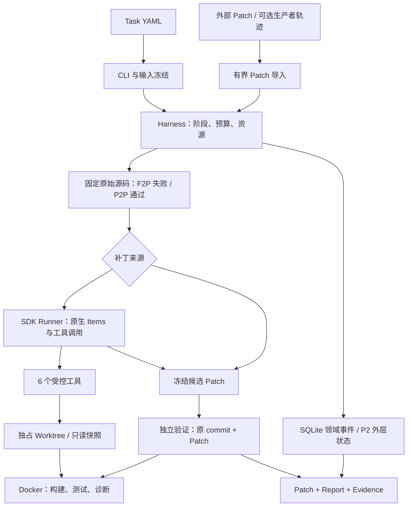
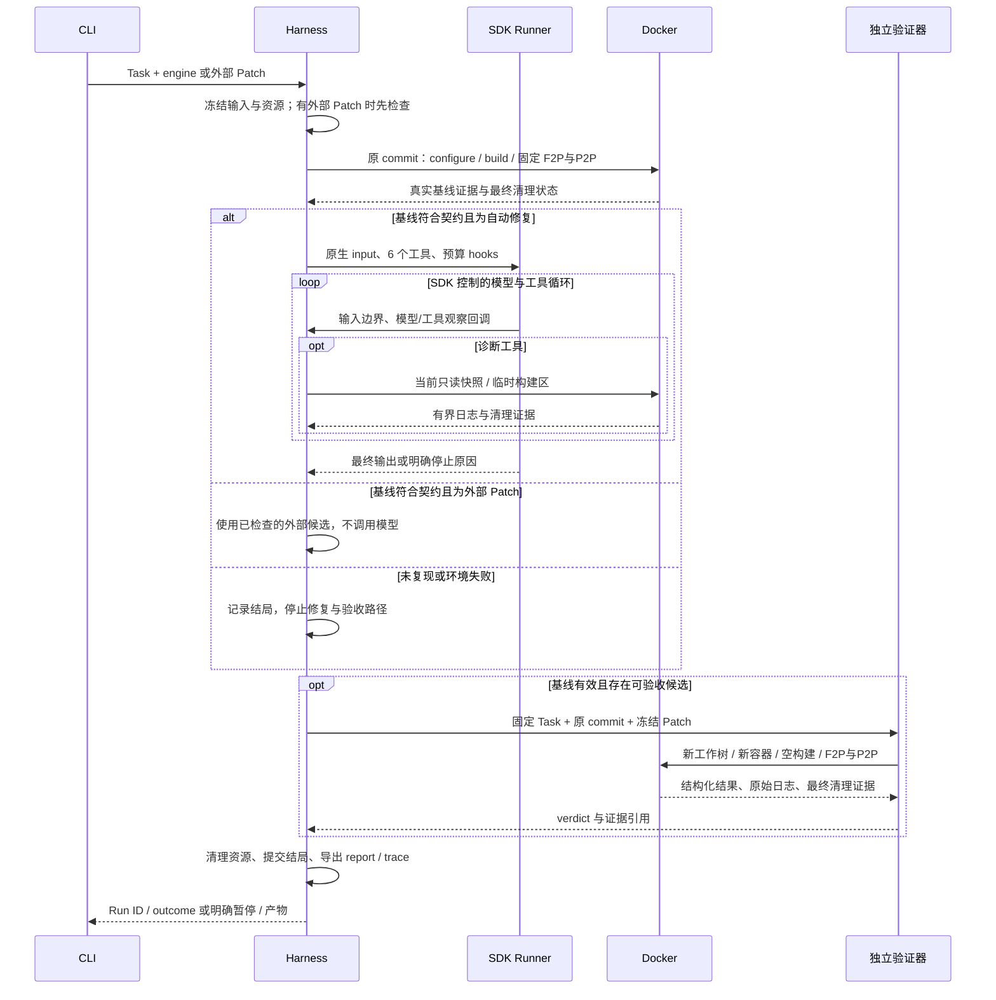

# 架构、数据流与模块边界

规格修订：`2026-10-19.2`。本文负责模块、依赖和 EvidenceRef；任务、SDK 调用与恢复的详细契约分别见 [TASK_FORMAT](TASK_FORMAT.md)、[AGENT_RUNTIME](AGENT_RUNTIME.md)、[STATE_AND_RECOVERY](STATE_AND_RECOVERY.md)。以下是目标设计，不是现有 0.1.0 的能力清单。

## 1. 架构核心与两条入口

ReproPatch 维护固定 C++ 任务与独立验证器。补丁既可以由集成的 OpenAI Agents SDK 产生，也可以从现成 Coding Agent 或人工修复中导入。两条入口使用相同的源码约束、基线复现和验收逻辑，不能因补丁来源不同而降低验收条件。



图中执行链共享底层 Docker 管理代码，各次 evaluation 仍拥有独立容器和空构建空间；最终验证不复用 Agent 的容器或构建产物。

Phase 1 的目标入口为：

- `run TASK --engine agents-sdk`：先复现基线，再运行 SDK Agent，最后独立验证。
- `run TASK --engine fake --mock-script FILE`：以 SDK 的 `agents.testing.ScriptedModel` 驱动同一集成路径，用于确定性 fixture；它不是另一个自制 Runtime。
- `verify-patch TASK --patch FILE`：先把外部 Patch 有界复制到本 Run、核对可应用性和改动范围，再复现原始基线、独立验证候选；不调用模型，不需要模型密钥或可选 Agent 依赖。

外部 Patch 生产过程不在这次验证 Run 内。ReproPatch 不证明外部 Agent 使用了 Docker、遵守了模型预算或提供了完整轨迹；可选 producer 信息仅是来源声明。新命令参数的完整定义见 [CLI](CLI.md)。

## 2. SDK 与 Harness 的职责分工

SDK 原生提供模型循环、函数工具调用、Responses Items 的组装和模型错误类型；本项目直接调用 Runner，不把 SDK 包在另一套逐轮调度器内。[官方运行文档](https://openai.github.io/openai-agents-python/running_agents/)定义这些行为，选定 SDK 版本、公开 API 与集成门槛以 Runtime 文档为准。

| 职责 | 权威实现 | ReproPatch 的必要工作 |
|---|---|---|
| 模型请求、Responses 协议、对话连续性 | OpenAI Agents SDK 与其模型客户端 | 显式配置模型、关闭不需要的远端 trace/存储/重试；记录版本与已观察用量 |
| 函数工具 schema 与调用派发 | SDK FunctionTool | 静态注册 6 个函数，限制串行派发，实施路径、预算、输出及异常边界 |
| 请求上下文 | SDK 原生输入项 | 在公开输入 hook 上检查体积；超限停止，不手工删 reasoning/function items |
| Task、仓库、镜像和预算 | ReproPatch | 冻结输入、执行预算 gate、登记和清理自己创建的资源 |
| 源码修改与 Patch | ReproPatch + Git CLI | 限定可编辑文件，生成完整候选、核对源码摘要和干净应用结果 |
| 独立验收 | ReproPatch + CMake/CTest | 固定 F2P/P2P、区分未运行/失败/无法确定、生成宿主可信报告 |
| 会话恢复数据 | SDK 原生下一次输入 | 只在已闭合安全边界保存；不自制消息协议或恢复 pending tools |
| Run 阶段、资源及证据索引 | SQLite + ReproPatch | P1 审计单写；P2 同事务提交外层状态、计数与 Checkpoint 引用 |
| 多任务评测调度 | 优先外部 Harbor 等现成工具 | P3 只实现必要的任务映射、产物交接和结果聚合 |

不实例化 hosted tools、MCP、handoff、skills、memory、默认 ShellTool 或 SandboxAgent。工具名单、执行权限和支持范围由本项目的固定注册决定。SDK 的函数派发不提供 Docker 隔离；仓库代码仍必须经本项目 sandbox 边界。

## 3. 目标模块与依赖方向

这些名称用于在既有代码上实施改造，不要求先创建空文件。详细字段留在对应权威文档中。

| 模块 | 职责及输入输出 | 依赖方向 | 阶段 |
|---|---|---|---|
| `cli.py` | 解析参数；运行、导入 Patch、查询、导出 | task、harness；按命令延迟加载 Agent/recovery/evaluation/integrations | P1 起 |
| `task.py` | YAML → TaskSpec → ResolvedTask；输入集合与配置边界 | stdlib、PyYAML | P1 |
| `harness.py` | 准备、基线、补丁来源选择、最终验收、预算和资源协调 | task、workspace、verification、events；Agent 路径才加载 models | P1 |
| `models.py` | 建立 SDK Agent/Runner、公开 hooks 和 ScriptedModel fixture；返回修复停止信息及原生输出引用 | 可选 openai-agents/openai；tools、事件/预算回调 | P1 改造 |
| `tools.py` | 6 个受控数据/执行函数；不自写工具派发循环 | workspace、sandbox、verification、task；无需 import SDK 才能使用核心验证 | P1 |
| `workspace.py` | Worktree、只读快照、SourceManifest、Patch 导入/生成/清理 | Git CLI、stdlib | P1 |
| `process.py` | 启动 Git/Docker 等宿主控制命令；有界流式输出、命令 deadline 与回收 | stdlib | P1 |
| `sandbox.py` | 固定 Docker profile、evaluation 生命周期、容器清理 | process、task | P1 |
| `verification.py` | 共享 configure/build/CTest 观察函数；基线和独立 verdict | task、workspace、sandbox | P1，从现有 harness 提取 |
| `events.py` | append/read/export 领域事件；审计单写、文件引用 | sqlite3、json | P1 |
| `errors.py` | 少量领域/边界异常及稳定 code | stdlib | 已有，收敛 |
| `recovery.py` | P2 外层状态事务、Checkpoint 引用、资源核对与安全恢复 | events、workspace、sandbox；通过普通函数返回恢复输入 | P2 才增加 |
| `evaluation.py` | 读取固定实验记录、汇总结果 | Run 报告与领域证据；不用自建 scheduler | P3 按需 |
| `integrations/harbor.py` | 静态任务导出；已结束 trial 的本地产物映射／导入 | 已有 verify-patch 和有界文件读取；不管理 Harbor producer 生命周期 | P3 才增加 |

不另建 `state.py` 的单层转发，不创建 operations 调度层。P2 的状态事务可以在 events/recovery 中直接实现，只有实际代码规模需要时才拆分。

`verification.py` 不导入模型依赖；`sandbox.py` 不判断补丁业务结局；`workspace.py` 不解释测试结果；`events.py` 不运行工具。下层模块不得反向 import CLI。SDK hooks 通过显式传入的普通回调更新 Harness 预算和事件；不引入依赖注入容器。

保留一个宿主 RunContext，保存当前 Run 的 ResolvedTask、目录、预算、数据库连接与资源记录。它是控制面内部数据，不是模型输入；传给 SDK 的本地 context 也不能整体序列化为 Checkpoint。工具通过绑定的受控对象访问工作区，恢复只保存公开 ModelInputData 的原生输入和 instructions。密钥、数据库连接和宿主环境不进入原生输入或 Checkpoint。

## 4. 数据契约与唯一写入者

| 数据 | 唯一写入者 | 保存位置/用途 | 权威定义 |
|---|---|---|---|
| TaskSpec、ResolvedTask | task.py | task.resolved.json；一次读取与冻结 | TASK_FORMAT |
| RunContext、预算 gate | harness.py | P1 内存；P2 外层事务计数 | AGENT_RUNTIME |
| 原生 SDK input/output Items | SDK；models.py 原样有界导出 | private Agent 产物；不用四 role 归一化 | AGENT_RUNTIME |
| CommandResult | process/sandbox | 每命令事件、stdout.bin/stderr.bin | AGENT_RUNTIME |
| SourceManifest、source_tree_sha256 | workspace.py | 完整候选与源码快照身份 | EXECUTION_AND_SECURITY §4.2 |
| CandidatePatch | workspace.py | patch.diff 与 manifest 引用 | VERIFICATION |
| TestObservation、EvaluationEvidence | verification.py | 原始基线及独立验收证据 | VERIFICATION |
| Event、外层 Run 状态、Checkpoint | events/recovery | 每 Run SQLite；不成为第二份 SDK 会话数据库 | STATE_AND_RECOVERY |
| report.json / report.md | 宿主 Harness | 展示已记录的结局和证据 | VERIFICATION、CLI |
| 外部 producer trace | CLI 有界复制；生产者内容不解释为可信事实 | 可选 EvidenceRef；不作为恢复输入 | CLI、EXECUTION_AND_SECURITY |

`EvidenceRef` 是 JSON object，三个字段必需：

```json
{"path":"logs/c0001/stdout.bin","sha256":"0123456789abcdef0123456789abcdef0123456789abcdef0123456789abcdef","size_bytes":1234}
```

示例 hash 仅说明格式。path 是相对本 Run 产物根的规范 POSIX 路径，禁止绝对路径、空段、`.`/`..` 段及链接越界；sha256 对应文件实际原始 bytes；size_bytes 为非负整数，bool 不算 int。必要证据先核对存在、大小、hash 及所属 Run，再解析或用于结论。允许缺失的字段整体写 null，不用空 path 或全零 hash。

SourceManifest 的逻辑树摘要 `source_tree_sha256` 与保存该 manifest 文件的 EvidenceRef.sha256 含义不同，分别用于源码身份与产物完整性。校验 hash 不认证外部生产者，也不能防止已控制宿主账户的攻击者同时改写数据库和文件。

每条 CommandResult 使用独立 `stdout_log`、`stderr_log` 引用，保存原始 bytes。日志不是自定义 Base64 JSONL 协议；两个流之间不承诺逐条写入顺序。事件 JSONL 仍是 SQLite 领域事件的导出格式，两者不可混淆。

## 5. 完整任务时序



“SDK 最终输出”只表示修复生产者停止；ACCEPTED 只能由验证契约决定。显式取消不进入图中的候选验收分支。输入错误、模型错误、未复现和验证无法确定的区别由相应权威文档定义。

## 6. 持久化、恢复与外部副作用

P1 保留已有 SQLite 审计基础，消除 JSONL 双写；原生 SDK 输入/输出是有界附件。P1 不承诺崩溃续跑。P2 仅增加 runs/events/checkpoints 三表，保存外层阶段、预算与安全 Checkpoint；不增加 SDK Session 数据库、不复制 SDK 内部消息状态、不把每条工具调用建成可调度 operation。

P2 在公开模型输入 hook 的完整边界保存 SDK 原生下一次输入、base 上的 Patch 和源码 manifest。下一次模型请求前将 `segment_open` 持久置为 true，并保持到下一个完整边界。进程若在 open segment 中断，恢复先清理自己的容器，再明确 RECOVERY_FAILED；不回滚、重放半组工具或重发未知模型请求。具体事务顺序与显式 `--pause-after-step` 入口见状态文档。

| 操作 | 真实副作用及边界 |
|---|---|
| 模型请求 | 可能收费和外部留存；本地超时不能证明服务端未处理，不自动重新发起未知请求 |
| 精确文件编辑 | 改变本 Run 工作树；完整安全 Checkpoint 可从 base+Patch 重建，未知编辑不自动重做 |
| Git/Docker 资源操作 | 必须登记所有权；超时后停止并核对属于本 Run 的容器，不能只杀 CLI |
| 容器内命令 | 消耗资源、改变临时空间；不承诺任务输出或程序时间完全确定 |
| 外部 Patch 导入 | 读取不可信数据；允许的内容变化仍须经过全树检查和独立测试 |
| 独立验收重跑 | 创建新 Run、新资源并消耗新预算；原 Run 与证据保留 |
| 发布、push、消息 | 不属于自动工作流，须另有用户授权 |

SQLite 事务不包含 Docker、文件系统和模型 API。原子提交 Checkpoint 引用并不构成跨系统 Exactly Once。

## 7. 阶段规模与复用边界

核心安装只需要 PyYAML 与 Python 标准库。Agent extra 引入 openai-agents 及实际使用的 openai 依赖；其传递依赖和升级成本必须如实记录，不能称为“只多一个轻量包”。模型集成可以整体替换，不要求验证器迁移到该 SDK 的工具或沙箱体系。

Phase 3 使用两段式产物交接：export-harbor 生成静态任务映射和配置了 `verifier.disable=true`／显式 artifacts 的 Harbor job；Harbor 完成 producer 与原生产物收集。随后 `verify-harbor --job DIR --task-map FILE` 读取已经结束的本地 trial 中 `<trial>/artifacts/candidate.patch`，有界导入并复用 verify-patch；`eval` 只聚合已保存结果。缺 Patch、producer 失败和验证异常仍保留分类，不从统计中消失。

Harbor 只拥有 producer 环境，ReproPatch 只拥有新建的原始基线和独立验收容器；没有容器获得 Docker socket。本项目不实现 inline BaseVerifier、远程下载协议、嵌套 Docker 或第二个作业调度器。ReproPatch 的输入和执行保证从已落盘 Patch 进入本项目时开始，不替 Harbor 的生成／收集阶段认证安全性。固定版本试点及映射细节以 [TESTING_AND_EVALUATION](TESTING_AND_EVALUATION.md) 为准。

Execution Replay 的 `replay RUN_ID --mode execution` 使用保存的 Task+Patch 创建新的独立验证，不重放历史 Shell 脚本。

当前代码与阻塞状态见 [CURRENT_STATE](CURRENT_STATE.md)。第一项实施继续完成 P1-01 的 Docker 基线并对齐本次修订；后续先让 verifier 路径可运行，再接入 SDK。不给重建模型循环、C++ 执行器、工作流引擎或复杂缓存安排隐含的 MVP 前置条件。
