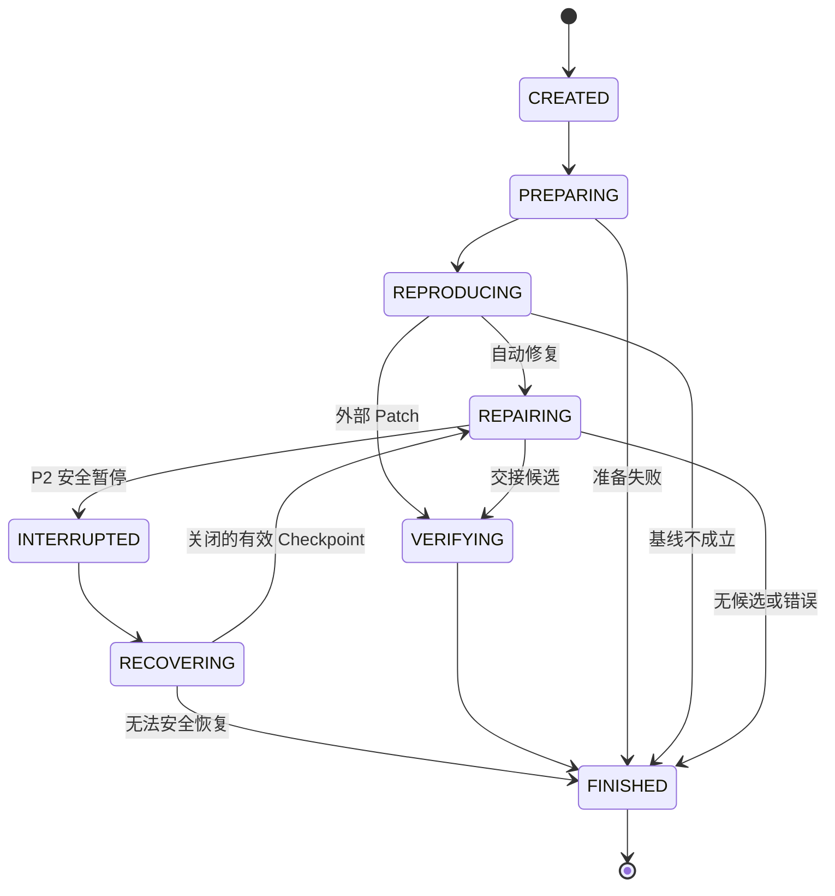

# 状态、事件与安全恢复

规格修订：`2026-10-19.2`。本文件是 RunState、Outcome、标识符、事件信封和恢复协议的权威。SDK 接入、工具及预算见 [AGENT_RUNTIME](AGENT_RUNTIME.md)，验收判定见 [VERIFICATION](VERIFICATION.md)，资源所有权见 [EXECUTION_AND_SECURITY](EXECUTION_AND_SECURITY.md)，命令与退出码见 [CLI](CLI.md)。以下是目标设计，不是已实现能力声明。

## 1. 保证范围与阶段

每个 Run 使用独立产物目录、一个 SQLite 文件和一个本地控制器。SDK 管理对话，SQLite 管理 ReproPatch 的外层事实。文件、Docker 和模型 API 不参与 SQLite 事务，不能因此许诺跨系统 Exactly Once。

| 能力 | Phase 1 | Phase 2 |
|---|---|---|
| Run 状态 | 内存阶段；领域事件和最终报告记录观察 | `runs` 表是外层状态、结局及预算权威 |
| 事件 | 复用已有 SQLite 审计，取消 JSONL 双写 | 与外层状态、预算、Checkpoint 指针同事务更新 |
| 对话 | 保存 SDK 原生输入／输出附件 | 仅保存安全边界的原生下一次输入；不建立第二个会话数据库 |
| 中断 | 尽力清理；正常取消留 CANCELLED；SIGKILL 可只剩部分审计 | 可从已提交且关闭的安全 Checkpoint 继续；未知副作用明确失败 |
| 主动暂停 | 不支持 | `--pause-after-step N` 在下一输入边界暂停 |
| 重放 | 不提供恢复承诺 | Trace Replay 只读；Execution Replay 在 P3 复用新一次独立验收 |

P1 的 `inspect` 遇到没有最终事实的记录，显示未完成和最后已知阶段，不能推断成功或自动续跑。P1 不预建恢复表。P2 只有 `runs/events/checkpoints` 三表，不新增 per-tool operation 调度表、SDK Session 数据库、半组工具重放、历史回滚或另一个 Agent Loop。

## 2. 状态与结局

### 2.1 RunState

这里的 `RunState` 是 ReproPatch 的外层枚举，与 SDK 同名的运行快照类型不同；不得把 SDK 的 pending 工具状态直接视为可恢复 Checkpoint。

| 状态 | 含义 |
|---|---|
| `CREATED` | Run ID 和私有目录已创建，尚未执行仓库代码 |
| `PREPARING` | 冻结任务、commit、image，准备工作区；外部 Patch 在此阶段检查 |
| `REPRODUCING` | 在原始源码上检查 F2P 失败及 P2P 通过 |
| `REPAIRING` | SDK Runner 自动修复；只用于 run 入口 |
| `VERIFYING` | 对固定候选在干净环境独立验收 |
| `INTERRUPTED` | P2 已提交安全暂停，或新控制器已确认旧控制器不持锁而运行未终结 |
| `RECOVERING` | P2 正在核对资源、输入与安全 Checkpoint |
| `FINISHED` | 已终结，有且只有一个 Outcome |

`INTERRUPTED/RECOVERING` 仅属于 P2；不新增 PAUSED 状态。恢复不是把旧进程内存原样还原。

### 2.2 Outcome

Outcome 只能在 FINISHED 时非 null。状态表示执行位置，Outcome 表示最终结果，两者不能合并。

| Outcome | 含义 |
|---|---|
| `ACCEPTED` | 独立验收通过，证据完整，必要清理已确认 |
| `REJECTED` | 有充分证据拒绝候选，包括禁止改动、正常构建／测试失败或无补丁 |
| `NOT_REPRODUCED` | 原始源码没有出现声明的目标故障 |
| `INCONCLUSIVE` | 验收证据或资源不足，不能判断修复成败 |
| `BUDGET_EXHAUSTED` | 修复预算停止且没有可验收候选 |
| `ERROR` | 输入准备、模型／协议、控制面或基础设施错误 |
| `CANCELLED` | 操作者主动取消；保留已有证据并清理，不继续验收 |
| `RECOVERY_FAILED` | P2 无法安全继续同一个 Run；保留失败原因和证据 |

一个 Outcome 配一个主要 `reason_code`，相关诊断可以补充，不能互相覆盖。原因码使用大写下划线名称。具体验收规则只由 VERIFICATION 定义；模型最终文本只表示 `MODEL_FINISHED`，不是 ACCEPTED。SDK 预算停止后候选仍可验收，`agent_stop_reason` 与 Outcome 分开保存。verify-patch 没有 AgentStopReason。

### 2.3 转移约束

| 当前状态 | 允许下一状态 | 必要条件 |
|---|---|---|
| CREATED | PREPARING、FINISHED | 静态 YAML 错误在创建 Run 前拒绝；已创建后的错误留记录 |
| PREPARING | REPRODUCING、FINISHED | 输入已冻结并有效，才可执行基线 |
| REPRODUCING | REPAIRING、VERIFYING、FINISHED | 基线符合契约；自动路径进入 REPAIRING，外部 Patch 路径直接 VERIFYING |
| REPAIRING | VERIFYING、FINISHED、INTERRUPTED | 正常停止／预算停止按验收规则；INTERRUPTED 仅 P2 安全暂停 |
| VERIFYING | FINISHED | 单次独立验收，不回到模型继续优化 |
| 旧控制器留下的任一非终态 | INTERRUPTED | 新控制器先取得同 Run 排他锁；不能抢占活跃控制器 |
| INTERRUPTED | RECOVERING、FINISHED | 安全恢复核对或明确取消 |
| RECOVERING | REPAIRING、FINISHED | 只有合格的修复输入边界可继续；其余明确 RECOVERY_FAILED |
| FINISHED | 无 | 查询／重新导出不修改结局；重新执行生成新 Run |



图省略通用取消和崩溃接管边，表格是完整约束。SIGINT／Ctrl-C 是 CANCELLED；不能把取消改成等待恢复的暂停。SIGKILL 没有保证能提交任何新状态。

## 3. 身份与权威来源

| 字段 | 定义 |
|---|---|
| `task_id` | YAML 的 id，标识任务 |
| `run_id` | `uuid.uuid4().hex`，32 位小写十六进制；新执行用新值 |
| `step_id` | 本 Run 从 1 开始的 SDK 模型 turn 序号；失败／超时也消费该 turn |
| `tool_call_id` | 按响应顺序生成，如 `s000001.t01`；每响应至多 8 个 |
| `provider_call_id` | 原生响应的调用 ID；与 tool_call_id 对应，不作跨响应主键 |
| `operation_id` | 需要关联命令／资源时分配的 32 位 UUID；仅审计关联，不代表可重放任务 |
| `command_id` | CommandResult 使用的 operation_id；工具内部多条命令分别分配 |
| `seq` | 每 Run 从 1 开始、严格递增的已提交事件序号 |
| `checkpoint_id` | 每 Run 从 1 开始的已提交安全 Checkpoint 序号 |

step_id 不等于实际 HTTP 尝试次数。工具预算计入整批准入调用；无效参数也消费已经准入的额度，中途失败不退还。没有工具级 attempt／superseded 计数或重复执行协议。provider_call_id 保持 SDK 原值，仅在本地索引关联，不能由它决定宿主路径。

冻结任务、源码、镜像和工具／SDK 配置决定输入；SQLite 决定已提交事件和 P2 外层状态。report、JSONL、终端输出是派生产物，不能反向修改权威状态。测试日志和模型文本都是观察值，最终结论仍须满足独立验收条件。

## 4. 事件与导出

### 4.1 统一信封

P1 即使用下列格式。旧产品的 `kind` 审计格式属于历史数据，不在本次规格里静默兼容成新格式。

```json
{
  "schema_version": 1,
  "seq": 17,
  "run_id": "0123456789abcdef0123456789abcdef",
  "timestamp": "2026-10-19T05:00:00.123456+00:00",
  "type": "command_finished",
  "step_id": 2,
  "tool_call_id": "s000002.t01",
  "operation_id": "fedcba9876543210fedcba9876543210",
  "payload": {
    "evaluation_role": "agent_check",
    "result_ref": {
      "path": "evidence/fedcba9876543210fedcba9876543210.result.json",
      "sha256": "0123456789abcdef0123456789abcdef0123456789abcdef0123456789abcdef",
      "size_bytes": 2048
    }
  }
}
```

示例字节数和 hash 只演示格式，不是实际证据。`result_ref` 指向宿主保存的 CommandResult JSON，其原始输出分别由 `stdout_log/stderr_log` 引用，不使用旧 log_path、合并日志或 Base64 分块格式。所有引用复用 [EvidenceRef](ARCHITECTURE.md) 的 path／sha256／size_bytes；大输出保留附件，不反复塞进事件。

`step_id/tool_call_id/operation_id` 不适用时为 null。时间为 UTC RFC3339，耗时用 monotonic；展示顺序按 seq，不能按可能回拨的时钟排序。

| 事件类型 | 必要 payload 含义 |
|---|---|
| `run_created` | task ID、input_mode、engine_kind、版本和目录身份 |
| `state_changed` | from／to；终结时含 outcome、reason_code |
| `inputs_frozen` | Task、commit、image、文件集合及配置引用 |
| `resource_registered` | 执行前保存唯一资源名、Run 归属、预期 profile／image；创建后补实际 ID |
| `baseline_finished` | 基线结论及 EvaluationEvidence 引用 |
| `model_started` | step_id、原生 input 引用、累计 steps_used、模型配置标识 |
| `model_finished` | 原生 output 引用、实际 usage 字段存在性、可观察请求标识 |
| `tool_batch_admitted` | 本响应所有调用的索引／名称、批量准入数、累计 tool_calls_admitted |
| `tool_started/tool_finished` | 工具名、provider_call_id、受控参数／结果或引用 |
| `command_started/command_finished` | 实际 argv、cwd、阶段／父工具、资源关联或 CommandResult |
| `agent_stopped` | AgentStopReason、可选 final_text 引用；不是恢复动作指令 |
| `verification_finished` | 验收观察、verdict、证据和主要原因 |
| `cleanup_finished` | 已核对的自有资源、最终清理是否确认及残留错误 |
| `checkpoint_committed` | P2 Checkpoint ID、manifest 的 EvidenceRef、已完成 step |
| `recovery_started/recovery_finished` | P2 恢复次数、来源阶段、Checkpoint、核对结论／原因 |

这是一张固定领域事件表，不是通用事件 DSL。工具结果的原生 function_call_output 由 SDK 生成；事件不复制一份可重放的四角色会话。P1 不发 checkpoint／recovery 事件。pause 使用 checkpoint_committed 和 state_changed，state_changed 注明触发参数；不用单独的暂停状态机。

资源创建也存在“已创建但返回值丢失”的窗口，所以唯一 name 和归属信息必须先持久化，再调用 Docker。恢复可以从已提交资源登记及清理事件核对已知对象，不把事件当成重执行命令列表。最终清理由 evaluation.cleanup 和 cleanup_finished 证明；中间 CommandResult.cleanup_confirmed=false 只是当时观察，不能据此把整个 evaluation 判为未清理。

### 4.2 JSONL、报告及失败一致性

写事件只提交 SQLite。导出读取已提交事件前缀，按 seq 生成临时 JSONL，再原子替换 events.jsonl。`exported_through_seq` 及导出时间写入 run.json 的 export_metadata；每行仍是一条 Event，不增加伪事件头。run.json 的导出索引不是状态权威，跨文件不承诺原子更新；索引滞后时重新导出即可。

P1 在结束路径和报告生成时导出，P2 增加显式 export-trace。不得每条事件双写 SQLite 和 JSONL。JSONL 损坏可从数据库重建，不能用它修补 SQLite。

正常收尾顺序为：完成必要清理与证据检查、确定 verdict、提交终态事实、导出 JSONL／report。清理不确认必须在提交最终结局前体现。终态已提交后的导出失败不能改写结局或触发重新执行；此次 CLI 退出 3，错误 ARTIFACT_EXPORT_FAILED，inspect 显示权威结局及 artifacts_complete=false。可写报告中的 trace 置 null，不伪造空成功文件。完整顺序见 [VERIFICATION §9.3](VERIFICATION.md)。

## 5. SQLite：只存必要外层状态

### 5.1 P1 最小审计表

每 Run 保留 events.sqlite3，一个 EventLog 持有连接。事件提交失败传播到 Run 边界，不静默回退到“只写 JSONL”。

```sql
PRAGMA user_version = 1;
CREATE TABLE events (
    seq INTEGER PRIMARY KEY,
    timestamp TEXT NOT NULL,
    type TEXT NOT NULL,
    envelope_json TEXT NOT NULL
);
```

seq 在事务内分配，只保证已提交事件递增，不追求跨 Run 全局序号。

### 5.2 P2 三表

P2 新 Run 使用以下结构；一个数据库只允许本 Run 的一条 runs 记录。不建 tasks 表、外部数据库、分布式锁或 Repository 套壳。

```sql
PRAGMA foreign_keys = ON;
PRAGMA journal_mode = DELETE;
PRAGMA synchronous = FULL;
PRAGMA user_version = 2;

CREATE TABLE runs (
    run_id TEXT PRIMARY KEY,
    input_mode TEXT NOT NULL CHECK (input_mode IN ('run', 'verify-patch')),
    engine_kind TEXT NOT NULL CHECK (engine_kind IN ('agents-sdk', 'fake', 'none')),
    state TEXT NOT NULL CHECK (state IN (
        'CREATED', 'PREPARING', 'REPRODUCING', 'REPAIRING',
        'VERIFYING', 'INTERRUPTED', 'RECOVERING', 'FINISHED')),
    outcome TEXT CHECK (outcome IN (
        'ACCEPTED', 'REJECTED', 'NOT_REPRODUCED', 'INCONCLUSIVE',
        'BUDGET_EXHAUSTED', 'ERROR', 'CANCELLED', 'RECOVERY_FAILED')),
    reason_code TEXT,
    agent_stop_reason TEXT,
    created_at TEXT NOT NULL,
    deadline_at TEXT NOT NULL,
    task_sha256 TEXT,
    base_commit TEXT,
    image_id TEXT,
    inputs_json TEXT,
    steps_used INTEGER NOT NULL DEFAULT 0 CHECK (steps_used >= 0),
    tool_calls_admitted INTEGER NOT NULL DEFAULT 0
        CHECK (tool_calls_admitted >= 0),
    usage_json TEXT,
    segment_open INTEGER NOT NULL DEFAULT 0 CHECK (segment_open IN (0, 1)),
    last_checkpoint_id INTEGER REFERENCES checkpoints(checkpoint_id),
    recovery_attempt INTEGER NOT NULL DEFAULT 0 CHECK (recovery_attempt >= 0),
    updated_at TEXT NOT NULL,
    CHECK ((state = 'FINISHED' AND outcome IS NOT NULL AND reason_code IS NOT NULL)
        OR (state <> 'FINISHED' AND outcome IS NULL)),
    CHECK ((input_mode = 'run' AND engine_kind IN ('agents-sdk', 'fake'))
        OR (input_mode = 'verify-patch' AND engine_kind = 'none')),
    CHECK (state <> 'REPAIRING' OR input_mode = 'run'),
    CHECK (state NOT IN ('REPRODUCING', 'REPAIRING', 'VERIFYING')
        OR (task_sha256 IS NOT NULL AND base_commit IS NOT NULL
            AND image_id IS NOT NULL AND inputs_json IS NOT NULL))
);

CREATE TABLE events (
    seq INTEGER PRIMARY KEY,
    timestamp TEXT NOT NULL,
    type TEXT NOT NULL,
    envelope_json TEXT NOT NULL
);

CREATE TABLE checkpoints (
    checkpoint_id INTEGER PRIMARY KEY,
    event_seq INTEGER NOT NULL UNIQUE REFERENCES events(seq),
    step_id INTEGER NOT NULL CHECK (step_id >= 0),
    manifest_ref_json TEXT NOT NULL,
    created_at TEXT NOT NULL
);
```

JSON 列在入库边界校验，不要求额外 SQLite JSON 扩展。manifest_ref_json 是完整 EvidenceRef JSON。input_mode 与 CLI／报告使用相同枚举；engine_kind 对应报告 engine.kind，不另引入 repair／verify_patch 别名。单写者使用默认回滚日志即可；没有实际并发读取压力不提前切 WAL。数据库限本地受支持文件系统，不对 NFS／共享盘承诺相同语义。

CREATED／PREPARING 尚未获得的冻结字段为 null，不能填空字符串或把原 YAML hash 当作 task_sha256。准备成功后，在一个事务内写入实际冻结值、inputs_frozen 和 REPRODUCING 状态。阶段入口核对字段及其引用；准备失败可以直接记录 FINISHED/ERROR。

inputs_json 引用冻结 Task、完整源码输入、工具／instructions／SDK 配置及版本；定义和采集来自 TASK_FORMAT、Runtime、执行文档，不在状态库重建一套配置。基线结果另存事件及证据，Checkpoint 必须引用已确认基线。`deadline_at = created_at + wall_seconds`，恢复不能更改。预算上限读取冻结 Task；steps_used、tool_calls_admitted 为累积扣减，报告 tool_calls_used 是后一字段的展示映射。

usage_json 仅聚合实际已观察的原始用量字段；缺失 token／HTTP 次数为 null，不能把 SDK 缺省补出的零当作真实计量。verify-patch 的这两个调用计数和 http_attempts 均为 0；外部生成的费用／时间不在本 Run 内。

本地排他锁覆盖 run／resume 的整个控制进程，使用操作系统文件锁，不用残留 PID 文件模拟锁。resume 以“只打开现有库”的方式访问；库不存在时不能由 sqlite3.connect 自动创建空库并冒充恢复。查询可只读打开。旧 P1 审计和 0.1.0 记录仍可按其版本查询，不能凭新增三张表把旧记录提升成可恢复 Run；不自动改写历史数据库。

## 6. 安全 Checkpoint 与 segment 门闩

### 6.1 唯一边界及内容

只有 SDK 公开 `call_model_input_filter` 的完整输入边界能创建可恢复 Checkpoint：上一 turn 的工具已经结束，全部必要容器清理已确认，下一次模型请求尚未开始。第一次输入边界在基线确认后，已完成 step 为 0；其余边界的 step 为最近已完成的模型 turn。公开输入容器是 ModelInputData，包含 input 原生项列表及 instructions，见 [SDK Run Config](https://openai.github.io/openai-agents-python/ref/run_config/)。

Checkpoint manifest 字段固定如下：

| 字段 | 类型和含义 |
|---|---|
| schema_version | 整数 1，指 Checkpoint manifest 版本 |
| checkpoint_id | 正整数，与数据库一致 |
| boundary | 固定 `model_input_ready` |
| step_id | 非负整数，已经完成的全 Run turn 数 |
| input_fingerprints | Task hash、完整 base commit、image ID、Harness／Python／SDK／openai 版本及模型／工具／instructions 配置身份 |
| baseline | 已确认原始基线的 EvidenceRef |
| native_next_input | SDK ModelInputData 的有界 JSON 文件 EvidenceRef |
| patch | 从固定 base 到此源码的普通 Patch，EvidenceRef；允许无修改时的零字节文件 |
| source_manifest | 完整 SourceManifest 文件的 EvidenceRef |
| source_tree_sha256 | SourceManifest 规范逻辑摘要，不是该产物文件的 hash |
| counters | steps_used、tool_calls_admitted 的非负整数快照 |
| deadline_at | 本 Run 原始绝对期限，不在恢复时重设 |

`native_next_input` 文件只保存公开 ModelInputData 的 input 和 instructions；原生 items 用上游公开类型／序列化方式保存，保持工具调用关联和必要 opaque continuation，不设计四角色消息或 finish_reason 协议。恢复把 input 传给 Runner，并使用保存的 instructions 构造同配置 Agent。保存的是完整下一次输入，不是任意 SDK RunState、pending action、客户端、context、密钥或可执行回调。加密的 continuation 只在本地私有附件保留，不当作隐藏推理文本展示。具体 SDK 配置由 Runtime 统一定义。

目录为 checkpoints/<checkpoint_id>/ 下的 manifest.json、next-input.json、patch.diff、source-manifest.json。所有 EvidenceRef 路径相对 Run 产物根。源码清单及其规范 hash 以 [EXECUTION_AND_SECURITY §4.2](EXECUTION_AND_SECURITY.md#42-sourcemanifest) 为准：source_tree_sha256 比较完整源码身份，EvidenceRef.sha256 校验保存文件的实际 bytes，不能互换。

### 6.2 文件和数据库提交顺序

先把输入、Patch、SourceManifest 和 manifest 写入临时文件，flush／fsync 后原子 rename，并 fsync 所属目录；文件此后不可变。然后一个 SQLite 事务插入 checkpoint_committed、checkpoints 行、更新 runs.last_checkpoint_id、计数快照和 `segment_open=0`。失败传播；不释放一个“看似已暂停”的成功响应。

文件已生成而事务未提交时，它只是孤儿，不是恢复点。数据库引用缺失或 hash 不符时，CHECKPOINT_CORRUPT；不能从文件名最大的一份自动猜恢复点。终态已提交而报告未导出时，仅重建报告，不重跑模型或工具。少量孤儿在显式 Run 清理时处理，不建立后台回收服务。

### 6.3 开启与关闭执行段

segment_open 表示“自最新安全 Checkpoint 后，是否可能发生了新的模型／工具副作用”，不是当前一定有活跃进程的证明。协议如下：

1. 输入 filter 完成上下文／预算检查，确认无活跃工具和未确认清理，按 §6.2 保存完整边界。
2. 若命中明确暂停参数，在同一个 Checkpoint 事务中设置 INTERRUPTED/outcome=null，并由 HarnessPause 离开 Runner；不发送下一请求。
3. 否则公开 on_llm_start 在模型调用前以一个事务写 model_started、`steps_used += 1` 和 `segment_open=1`。事务失败就不调用模型。
4. on_llm_end 保存原生回复和实际可观察 usage；整批准入工具并扣减 tool_calls_admitted 后，SDK 才能派发。单个工具开始／完成事件和命令证据继续记录，**不能因为模型回复已保存就关闭 segment**。
5. 只有到下一完整输入 filter 并成功提交 Checkpoint，才在 REPAIRING 阶段把 segment 关闭。最后一个允许 turn 的工具仍可执行，max_steps 只阻止新模型 turn。

即使全部工具看似返回、或完整无工具最终回复已经落盘，只要安全输入 Checkpoint 没有提交，崩溃后也不从零散事件补建可恢复边界。正常活跃进程可按 SDK 最终结果／预算停止交接候选进入 VERIFYING；这不是恢复。终态和 VERIFYING 的 segment 值不提供续跑资格，恢复必须先检查阶段。

没有半组重放、回滚后重做、有效尝试选择或 next_action 小型调度器。牺牲这个窄窗口的同 Run 续跑，是保持单人项目实现规模及避免重复付费的明确取舍。

## 7. 暂停与恢复

### 7.1 明确暂停

P2 的 run／resume 接受 `--pause-after-step N`，这是此次控制进程的选项，不是 Task 验收条件。N 是全 Run 累计 turn 的绝对目标，run 时要求 `1 <= N < max_steps`；resume 时还要求 `steps_used < N`。参数不延长 wall deadline，也不持久化成后续 resume 的自动暂停偏好。

到达 N 后，只有 SDK 准备下一次输入时才能提交安全暂停。若模型已经正常结束，立即进入候选验收，不制造额外请求来凑暂停。N 必须小于 max_steps，避免依赖 SDK 超出 turn 限制后是否还调用 filter。

成功暂停保持 INTERRUPTED/outcome=null，释放运行锁，保留 Checkpoint 所依赖的产物与源码。CLI 此次退出 0，并给 `paused=true` 和 Checkpoint 引用；这不表示 ACCEPTED。普通 run 的成功仍要求验收通过，具体区别见 CLI。SIGINT 是取消，不能用它模拟可恢复暂停。

### 7.2 resume 顺序

1. 校验 Run ID／目录，取得本机排他锁，只打开现有已知版本数据库。终态拒绝继续，旧格式返回 RESUME_UNSUPPORTED；不得重建损坏库。
2. 保存接管前阶段，以事务记录 INTERRUPTED→RECOVERING 和恢复编号。先按已持久化归属核对／终止自有容器；即使时间已耗尽也必须执行有界必要清理。名称、标签或归属不匹配时不能删除陌生资源。
3. 只有接管前为 REPAIRING，或安全暂停的 INTERRUPTED，且 segment_open=0、最后 Checkpoint 已提交，才有继续资格。PREPARING／REPRODUCING／VERIFYING 中断、或上次 RECOVERING 再次中断，清理后结束 RECOVERY_FAILED，不自动重跑该阶段。
4. 核对冻结 Task／base／image、Harness／SDK／工具／模型／instructions 身份及所有必需 EvidenceRef。P2 首版要求原版本和配置；没有跨版本恢复兼容层。关闭段的 runs 计数必须等于 Checkpoint 快照，不能取两者较小值。准备期没有冻结字段是合法旧事实，但不满足恢复资格。
5. 从固定 base 和保存 Patch 在新的自有 worktree 重建源码，核对完整 SourceManifest；不复用旧 build／容器。若原 repair 树仍存在且被第三方改为不同内容，返回 WORKSPACE_DIVERGED，不就地 reset 覆盖改动。缺失的可丢弃工作区可由完整 Checkpoint 重建，不能因此跳过产物核验。
6. 保留累计预算及原绝对 deadline，停机时间计入 wall。安全源码已恢复后，若 Agent 时间／turn 已耗尽，就不能再调用模型。先完成下一步的恢复成功事务，再由 Harness 按 Runtime 正常预算规则处理已有候选：有验证预留才验收，无候选则 BUDGET_EXHAUSTED；验证自身没有足够时间时按 Verification 给 INCONCLUSIVE。此分支只适用于已确认的安全候选，不从 RECOVERING 直接跳到 VERIFYING。
7. 事务记录恢复成功并回到 REPAIRING。预算允许时才构造相同 SDK Agent，用保存的原生 input、instructions 和剩余 max_turns 调用 Runner；否则进入上一步的普通预算停止路径。新的 step_id 从累计 steps_used 继续，不重新编号。fake 模式从被冻结脚本的 steps_used 位置构造剩余 ModelStep 列表，交给新的 ScriptedModel，不读写上游私有游标。
8. 之后仍按 §6 的同一 hooks 工作；恢复不扩大预算、请求次数和文件权限。

resume 的参数不能替换任务、模型或预算。需要新设置时启动新 Run。模型 key 从原 key_env 名称重新读取，不放入 Checkpoint。保留暂停期间的必要文件，不因普通失败保留策略提前清除它们。

### 7.3 不能继续的窗口

| 观察 | 同 Run 处理 |
|---|---|
| 最新关闭的 Checkpoint 之后，没有新 model_started | 校验并恢复；这是明确支持的窗口 |
| model_started 已提交，没有完整模型结果 | 清理后 RECOVERY_FAILED／MODEL_RESULT_UNKNOWN，不重发未知收费请求 |
| 回复已存，任一工具已开始或结果尚未闭合 | RECOVERY_FAILED／OPEN_AGENT_SEGMENT；不调用模型或重做工具 |
| 所有工具结果已存，Checkpoint 尚未提交 | 同样 OPEN_AGENT_SEGMENT；不推导或补提交边界 |
| SDK 最终回复已存，但控制器在交接前崩溃 | 不自动重复模型请求；保留未验候选并 RECOVERY_FAILED |
| 原始复现或独立验收中崩溃 | 清理后 UNSUPPORTED_RECOVERY_PHASE；需新 verify-patch Run |
| Checkpoint 文件已写但未入库 | 忽略孤儿；若旧 segment 开放，不能用孤儿恢复 |
| Checkpoint 引用损坏、计数不一致、配置变化 | 分别 CHECKPOINT_CORRUPT、STATE_INVARIANT_BROKEN、INPUT_CHANGED |
| 容器已不运行，但退出结果未记录 | 可证明清理，不能推断测试成功或恢复资格 |
| 关闭 Checkpoint 的停机耗尽预算 | 不退款；按安全候选预算停止规则收尾 |
| 同时主错误与清理失败 | 保留主因并附 cleanup_error；不能继续或 ACCEPTED |

无法继续时，可以尽力保存当前可安全读取的 Patch／manifest 到 recovery/<恢复编号>/，标 `verification_eligible:false`；保存失败必须明确报告。它不是已完成修复，也不允许拿回退后的另一份源码偷偷替换原候选。操作者可显式用保存 Patch 新建 verify-patch Run：重新检查输入、复现基线、使用新预算独立验证。这是保留工作成果的入口，不是重放未知副作用。

恢复只重建受控源码；不会重发旧 shell、模型、工具调用。Docker 删除／查询和报告导出等可重试操作仍先核对归属或权威数据。API 超时不证明服务端未计费，容器缺失也不证明旧测试通过。

## 8. Trace Replay 与 Execution Replay

| 项目 | Trace Replay | Execution Replay |
|---|---|---|
| 阶段 | P2 | P3 |
| 目的 | 检查原运行证据及阶段 | 对保存的候选重新独立验收 |
| 新 Run | 不创建 | 创建，记录 replay_of_run_id |
| 模型调用 | 无 | 无 |
| 仓库代码执行 | 无 | 原始基线与新一次验证，走相同 Docker 边界 |
| 输入 | SQLite／已导出事件和可读附件 | 保存 Task、固定 commit／image、有效候选 Patch |
| 历史命令 | 只展示，不执行 | 不逐条重放；执行冻结 Task 的基线／验收命令 |
| 原运行 | 只读 | 不修改旧事实或产物 |

Trace Replay 按 seq 展示领域事件，可关联本地原生 SDK 输入／输出附件；默认不展示 opaque continuation。缺失引用显示证据不可核查，不以展示失败改写历史 Outcome。读取 JSONL 不导入成权威恢复状态，外部 producer trace 仍是不可信 opaque 附件。

Execution Replay 的 `replay RUN_ID --mode execution` 是新 verify-patch Run 的入口复用；没有历史工具序列执行器。所需输入不可获得、hash 不符或映射不支持时，在仓库执行前明确拒绝。新报告比较源码／Patch 身份、测试身份、基线及 verdict，可列出环境差异；不要求 stdout 逐字一致，也不证明模型会再次生成同一补丁。

独立验收重跑消耗新 Run 的时间和资源；原生成过程的时间／费用不计入这次验证。不要把 Trace Replay、safe resume 和重新验收合成一个含糊的“可完全复现”承诺。

## 9. 失败、诊断与最小验证

可以写入的 P2 数据库在恢复失败时，事务记录 FINISHED／RECOVERY_FAILED、主要 reason_code、相关证据。主要代码为 NO_CHECKPOINT、CHECKPOINT_CORRUPT、INPUT_CHANGED、MODEL_RESULT_UNKNOWN、OPEN_AGENT_SEGMENT、WORKSPACE_DIVERGED、OWNED_RESOURCE_UNCONFIRMED、STATE_INVARIANT_BROKEN、UNSUPPORTED_RECOVERY_PHASE。它们说明为什么不再自动继续，不提供强制绕过开关。

数据库不可读或不能提交时，不能同时声称已写入终态。停止执行，返回 STATE_CORRUPT／STATE_WRITE_FAILED，尽力生成 recovery-error.json，明确 `database_updated:false`。这是此次命令的诊断回执，不替代原 Run 状态；inspect 不得显示虚假的 FINISHED。禁止自动删除、重建或用 JSONL 覆盖损坏数据库。

恢复测试在 P2 真正实现时添加，归入 [TESTING_AND_EVALUATION](TESTING_AND_EVALUATION.md) 的风险测试组，不为三张表每一列单独造测试：

| 必要场景 | 防止的重要回归 |
|---|---|
| ScriptedModel 完整工具批次后显式暂停，再以剩余 turn 恢复 | 消息／源码不一致，重复已消费回复，预算重新开始 |
| model_started 后和编辑后分别中断 | 未知请求自动重收费、重复副作用 |
| 已写输入文件但 Checkpoint 事务前中断 | 孤儿文件被误认安全边界 |
| Checkpoint 损坏／版本不符／预算停机耗尽 | 从错误输入继续、绕过限额或伪造兼容 |
| 容器存活时控制器中断 | 恢复创建新执行而旧进程仍在运行 |
| 终态已提交但导出失败 | 重执行任务、篡改已确定结局 |

故障点以少量明确 hooks 和临时目录实现，复用 SDK ScriptedModel；真实清理另用显式 Docker gate。P1 不为尚未实现的恢复添加复杂 Mock／故障框架。验证目标是这些外部可观察不变量成立，不是测试数量或覆盖率。
